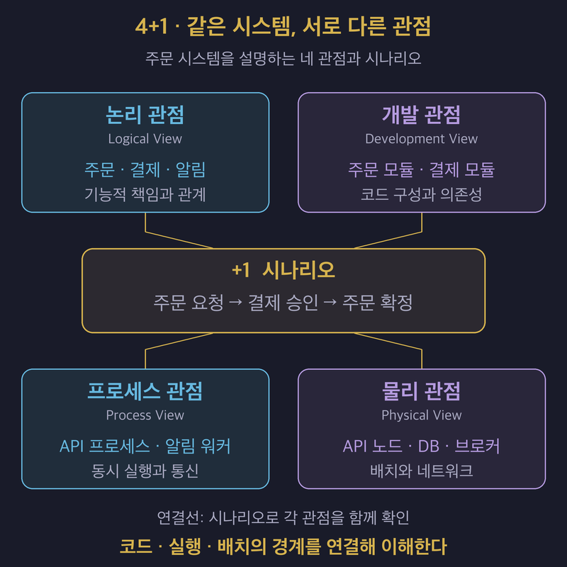

# 4+1 View Model: 하나의 아키텍처를 여러 관점으로 설명하기

## 1. 관심사가 다르면 필요한 구조도 다르다

- **4+1 View Model은 논리·프로세스·개발·물리 관점으로 아키텍처를 설명하고, 시나리오로 이들을 연결하는 모델이다.**
- Philippe Kruchten이 1995년에 발표했다. 네 관점은 같은 시스템의 서로 다른 관심사를 다룬다.
- 논리 관점에서의 책임 분리가 실행 시의 프로세스 분리나 서버 분리를 뜻하지는 않는다.
- `+1`인 시나리오는 설계를 구체화하고 여러 관점이 함께 동작하는지 확인하는 데 쓰인다.

## 2. 네 관점이 답하는 질문을 구분한다

| 관점 | 설명하는 내용 | 핵심 질문 |
| :--- | :--- | :--- |
| 논리 관점 — Logical View | 주요 추상화와 책임, 이들의 관계를 설명한다. | 시스템은 어떤 기능적 책임으로 구성되는가? |
| 프로세스 관점 — Process View | 실행 단위의 협력, 동시성과 동기화를 설명한다. | 동시에 실행되는 작업은 어떻게 통신하고 조율되는가? |
| 개발 관점 — Development View | 모듈·패키지·라이브러리 등 소프트웨어의 정적 구성을 설명한다. | 코드를 어떤 단위로 구성하고 의존성을 관리하는가? |
| 물리 관점 — Physical View | 소프트웨어를 하드웨어와 실행 노드에 배치하는 구조를 설명한다. | 무엇이 어디에서 실행되고 어떤 통신 경로를 갖는가? |

- 프로세스 관점을 작성할 때는 업무 순서와 함께 실행 주체, 병렬 처리와 대기 지점을 드러낸다.
- 관점 사이의 관계를 설명해야 하나의 아키텍처로 읽을 수 있다. 논리 요소 하나가 여러 모듈에 구현되거나 여러 실행 인스턴스에 걸쳐 동작할 수 있다.

## 3. 주문 처리 예시로 관점 사이의 관계를 확인한다

- 아래는 관점의 차이를 설명하기 위한 가상의 주문 시스템 예시이다.
- 주문 확정에는 결제가 필요하고, 알림은 주문 확정 뒤 별도로 처리한다고 가정한다.

| 관점 | 주문 시스템에서 설명할 내용 |
| :--- | :--- |
| 논리 관점 | 주문은 상태 전이를 관리하고, 결제는 승인 결과를 제공하며, 알림은 확정된 주문을 고객에게 전달한다. |
| 프로세스 관점 | API 프로세스가 결제 응답을 기다리고, 별도 워커가 알림 작업을 처리한다. 결제 시간 초과와 작업 재전달 시의 동작을 정한다. |
| 개발 관점 | 주문·결제·알림 모듈의 공개 인터페이스와 의존 방향을 정하고, 외부 결제 연동 코드를 분리한다. |
| 물리 관점 | API와 워커의 실행 노드, DB와 메시지 브로커의 위치, 외부 결제 시스템으로 나가는 경로를 표시한다. |

- 알림 모듈이 분리되어 있어도 주문 API 안에서 동기적으로 호출하면 알림 지연이 주문 응답에 영향을 줄 수 있다.
- 워커를 별도 서버에 배치해도 주문과 같은 DB 연결 한도를 소모한다면 자원 경합이 남을 수 있다.
- **코드 경계, 실행 경계와 배치 경계를 함께 확인해야 분리가 실제로 어떤 효과를 내는지 판단할 수 있다.**

## 4. 시나리오로 설명의 빈틈을 찾는다

- 위 예시에서 “결제 승인은 끝났지만 응답이 유실되어 고객이 주문을 다시 요청한다”는 상황을 따라가 볼 수 있다.

| 확인 순서 | 관점 사이에서 확인할 내용 |
| :--- | :--- |
| 업무 책임을 확인한다. | 중복 결제 방지와 주문 상태 복구를 누가 책임지는지 찾는다. |
| 실행 흐름을 확인한다. | 재요청을 받은 API와 결제 결과 조회가 어떻게 협력하는지 확인한다. |
| 구현 위치를 확인한다. | 해당 정책을 구현할 모듈과 사용할 인터페이스가 있는지 찾는다. |
| 배치와 실패 범위를 확인한다. | 다른 API 인스턴스로 재요청되어도 이전 처리 상태를 확인할 수 있는지 점검한다. |

- 시나리오에 등장하는 책임이나 통신이 다른 관점에 없으면 설계 누락인지 문서 누락인지 확인한다.
- 기능 흐름에 부하·장애 조건과 측정 기준을 더하려면 [품질 목표와 시나리오](../architecture-quality/03_defining_measurable_quality_goals_and_scenarios.md)를 함께 사용한다.

## 5. 문서에 적용할 때는 질문부터 정한다

- 먼저 독자가 확인하려는 질문을 정하고, 해당 관점에서 필요한 요소와 관계를 고른다.
- 같은 요소의 이름을 일관되게 사용하고, 관점 사이에서 대응되는 모듈·프로세스·노드를 추적할 수 있게 한다.
- 예를 들어 장애 격리가 검토 주제라면 코드 구성만으로 결론을 내리지 않고 실행 단위와 배치까지 살핀다.
- [C4 Model](02_visualizing_architecture_with_the_c4_model.md)의 주요 구조도는 상세 수준을 나눈다. 4+1의 관점과 C4의 네 단계를 일대일로 대응시키지 않는다.

## 6. 레퍼런스

- [Philippe Kruchten — The 4+1 View Model of Architecture](https://arxiv.org/abs/2006.04975): 1995년 IEEE Software 논문의 저자 공개본이다. 각 관점과 시나리오의 역할을 설명한다.
