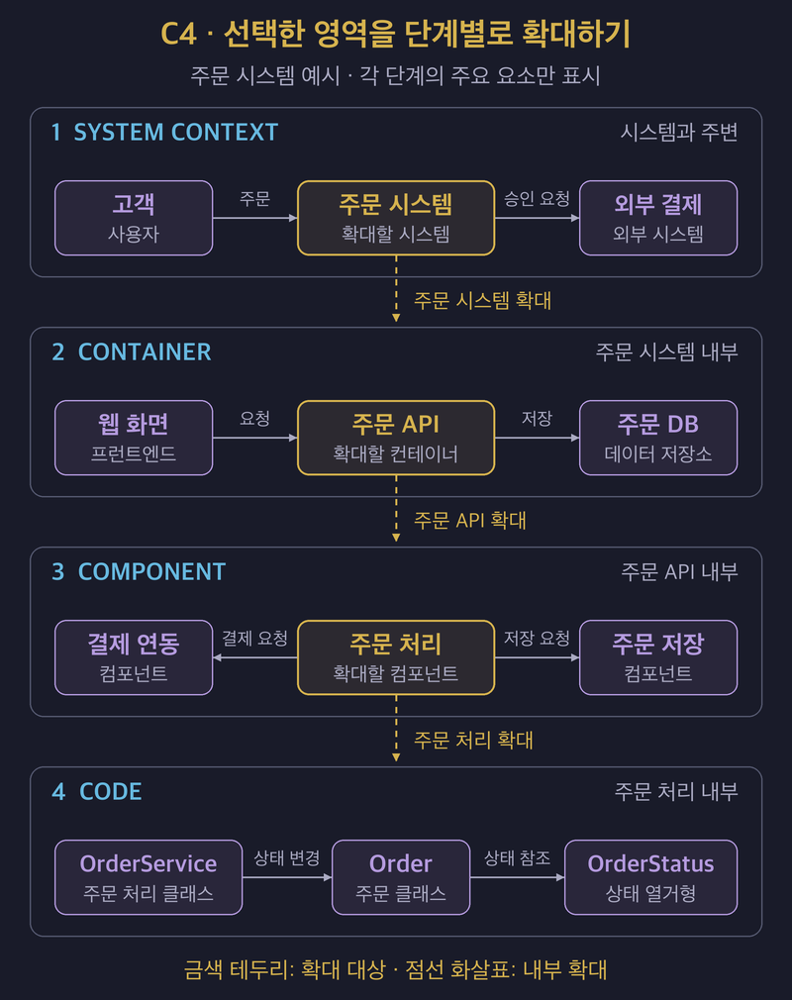

# C4 Model: 아키텍처를 상세 수준별로 시각화하기

## 1. 독자가 필요한 수준까지 구조를 확대한다

- **C4 Model은 시스템 맥락, 컨테이너, 컴포넌트, 코드의 네 수준으로 소프트웨어 구조를 설명한다.**
- Simon Brown이 만든 모델이며 특정 도구나 표기법에 종속되지 않는다.
- 먼저 시스템의 경계를 설명하고, 필요한 부분을 확대하면서 내부 책임과 관계를 드러낸다.
- 네 수준을 모두 작성할 필요는 없다. 공식 가이드는 대부분의 개발 팀에 시스템 맥락도와 컨테이너도가 충분하다고 설명한다.

## 2. 네 수준의 범위와 독자를 구분한다

| 수준 | 설명할 범위 | 주로 확인하는 내용 |
| :--- | :--- | :--- |
| System Context | 시스템 하나와 그 사용자·외부 시스템을 보여 준다. | 시스템의 역할과 외부 의존성을 파악한다. |
| Container | 시스템 내부의 애플리케이션과 데이터 저장소를 보여 준다. | 주요 책임, 기술 선택과 통신 관계를 파악한다. |
| Component | 컨테이너 하나의 내부 구성과 관계를 보여 준다. | 기능이 어떤 인터페이스와 구현 단위로 나뉘는지 파악한다. |
| Code | 컴포넌트 내부의 클래스·인터페이스·함수 등을 보여 준다. | 중요한 구현 구조를 자세히 확인한다. |

- 시스템 맥락도는 비개발자와도 시스템 범위를 합의할 때 유용하다.
- 내부로 확대할수록 개발자와 운영자가 확인할 기술적 세부사항이 늘어난다.
- 모든 코드를 수작업으로 옮기기보다 설명이 필요한 부분만 선택한다.

## 3. 컨테이너와 컴포넌트의 경계를 정확히 잡는다

- C4에서 **컨테이너는 애플리케이션이나 데이터 저장소를 나타내는 실행 관점의 경계**이다. 웹 애플리케이션, 모바일 앱, 워커와 DB 등이 해당한다.
- Docker 컨테이너나 서버 대수와의 일대일 대응을 전제로 하지 않는다.
- 컴포넌트는 명확한 인터페이스 뒤에 관련 기능을 묶은 단위이며, 같은 컨테이너 안에서 실행된다. C4의 컴포넌트 자체는 독립 배포 단위가 아니다.
- JAR나 패키지라는 파일·코드 조직 방식만으로 컨테이너와 컴포넌트를 구분하지 않는다.

### 주문 시스템을 확대하는 예시

| 수준 | 가상의 주문 시스템에서 표시할 요소 |
| :--- | :--- |
| System Context | 고객이 주문 시스템을 사용하고, 주문 시스템이 외부 결제 시스템과 연동한다. |
| Container | 웹 프런트엔드, 주문 API, 알림 워커와 주문 DB를 표시한다. |
| Component | 주문 API 내부의 주문 처리, 결제 연동과 주문 저장 컴포넌트를 표시한다. |
| Code | 주문 처리 컴포넌트의 상태 전이와 관련 인터페이스를 표시한다. |

- 운영 환경에서 주문 API를 세 개 실행해도 구조도에서는 주문 API라는 컨테이너 하나를 설명할 수 있다.
- 세 인스턴스를 어느 노드에 배치하고 어떻게 트래픽을 나누는지는 배포도에서 설명한다.

## 4. 실행 흐름과 배치는 별도 다이어그램으로 보완한다

| 보조 다이어그램 | 답하려는 질문 |
| :--- | :--- |
| System Landscape | 여러 시스템이 조직이나 업무 영역 안에서 어떻게 연결되는가? |
| Dynamic | 특정 시나리오에서 구성요소들이 어떤 순서로 상호작용하는가? |
| Deployment | 특정 환경에서 시스템·컨테이너 인스턴스가 어떤 인프라에 배치되는가? |

- 컨테이너도에는 주요 통신 관계를, 동적 다이어그램에는 시나리오별 호출 순서를 담는다.
- 복제, 장애 전환과 로드밸런싱처럼 환경마다 달라지는 배치 정보는 해당 환경의 배포도에 담는다.
- 구조가 선택된 이유와 감수한 비용은 [ADR](03_recording_architectural_decisions_with_adrs.md)에 연결한다.

## 5. 설명 없이 읽을 수 있는지 점검한다

- 제목에 대상과 다이어그램 종류를 밝히고, 시스템 또는 컨테이너 경계를 표시한다.
- 요소에는 이름과 책임을 적고, 컨테이너처럼 기술 선택이 중요한 수준에는 사용 기술을 표시한다.
- 화살표에는 관계의 의미를 적는다. “사용한다”보다 “주문을 저장한다”, “결제를 요청한다”처럼 구체적으로 표현한다.
- 통신 방식이 중요하면 프로토콜을 표시하고 화살표 방향이 설명과 맞는지 확인한다.
- 색상·도형·선 종류에 의미를 부여했다면 범례로 설명한다.
- **읽기 쉬운 다이어그램인지와 그 구조가 품질 요구사항을 충족하는지는 각각 검토한다.**

## 6. 레퍼런스

- [C4 Model — Diagrams](https://c4model.com/diagrams): 네 수준의 구조도와 보조 다이어그램, 필요한 수준만 선택하는 기준을 설명한다.
- [C4 Model — Container](https://c4model.com/abstractions/container), [Component](https://c4model.com/abstractions/component): 각 추상화의 의미와 경계를 설명한다.
- [C4 Model — Container Diagram](https://c4model.com/diagrams/container), [Deployment Diagram](https://c4model.com/diagrams/deployment): 구조와 환경별 배치의 구분을 설명한다.
- [C4 Model — Review Checklist](https://c4model.com/diagrams/checklist): 다이어그램의 범위·요소·관계를 읽을 수 있는지 확인하는 기준이다.
