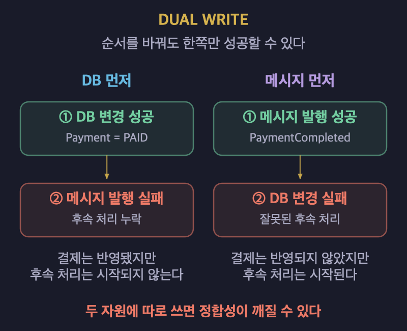
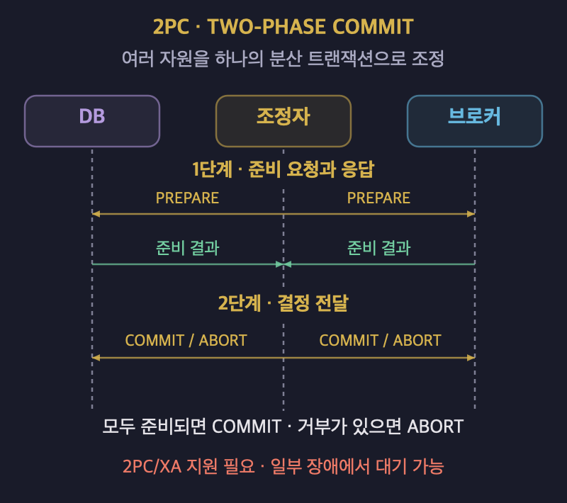
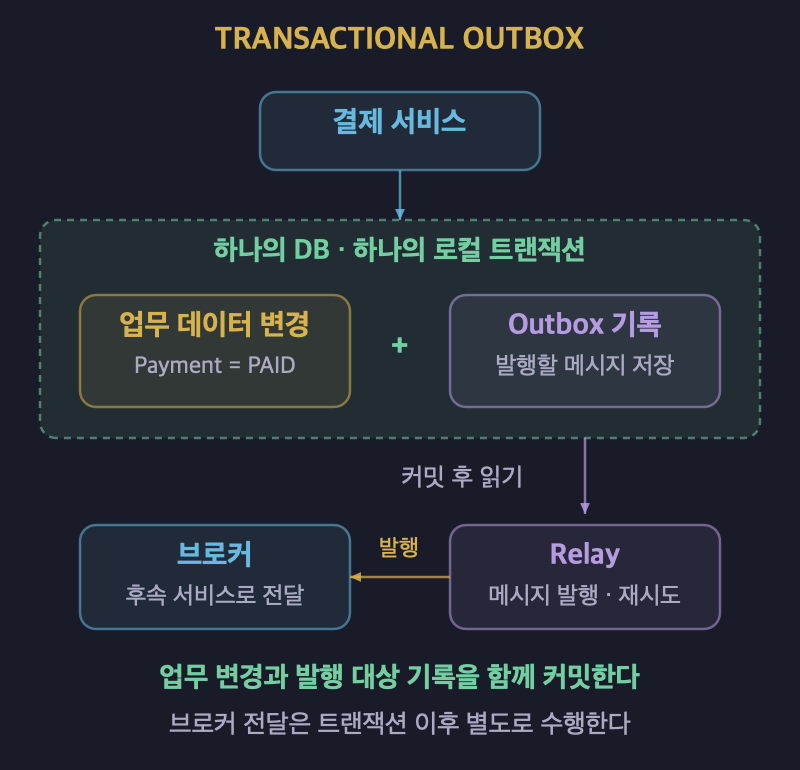
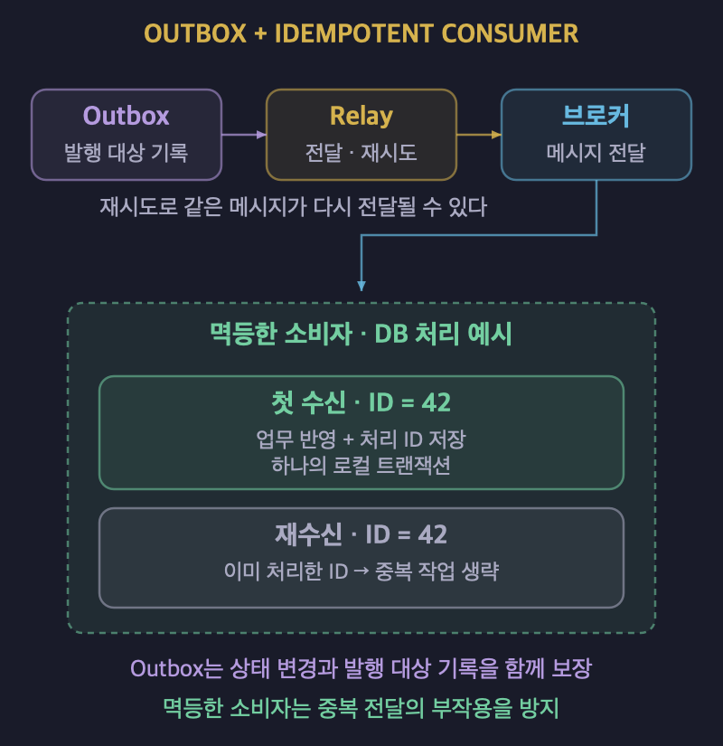

# 문제와 트레이드오프로 이해하는 설계 해법

## 1. 패턴의 개념과 필요성

### 반복되는 설계 문제를 해결한다

- **패턴은 반복되는 문제에 대해 축적된 해결 지식이다.**
- 비슷한 설계 문제를 매번 처음부터 해결할 필요는 없다.
- 검증된 해결 아이디어를 현재의 상황에 맞게 활용할 수 있다.
- 해결 구조뿐 아니라 적용 조건과 감수할 비용도 함께 이해해야 한다.

### 패턴을 이해하는 다섯 가지 요소

| 요소 | 설명 |
| :---: | :--- |
| Context | 문제가 반복해서 발생하는 상황을 설명한다. |
| Problem | 해결해야 할 문제를 정의한다. |
| Forces | 문제를 어렵게 만드는 제약과 상충하는 요구를 설명한다. |
| Solution | 문제를 해결하는 구조를 제시한다. |
| Consequences | 적용으로 얻는 이점과 감수할 비용을 설명한다. |

- Forces에는 제약사항, 품질 요구사항, 상충하는 관심사가 포함된다.
- Consequences에는 패턴을 적용한 뒤 새로 생기는 문제도 포함된다.
- **해결 방법과 함께 문제가 어려운 이유와 적용의 대가를 살펴야 한다.**

## 2. 스타일과 패턴의 차이

### 구조를 보는 관점과 문제를 푸는 관점

| 구분 | 중심 질문 | 예시 |
| :---: | :--- | :--- |
| 아키텍처 스타일 | 시스템이 어떤 구조로 구성되는가? | 계층형, 이벤트 주도, 마이크로서비스가 있다. |
| 아키텍처 패턴 | 반복되는 설계 문제를 어떻게 해결하는가? | CQRS, Transactional Outbox, Circuit Breaker가 있다. |

- 스타일은 시스템의 전체적인 구조를 설명하는 관점이다.
- 패턴은 반복되는 문제와 해결 방법을 설명하는 관점이다.
- 두 용어의 구분은 절대적이지 않다.
- 계층형이나 마이크로서비스도 분류 기준에 따라 패턴으로 부를 수 있다.
- 명칭보다 어떤 문제를 해결하는 구조인지 이해하는 것이 중요하다.

### 적용 범위와 문제 영역

- **아키텍처 패턴은 시스템 구조와 주요 구성 요소에 영향을 준다.**
- 디자인 패턴은 주로 클래스, 객체, 모듈 수준의 설계 문제를 다룬다.
- 패턴은 메시징, 데이터, 분산 트랜잭션, 복원력 등의 문제 영역으로도 나눌 수 있다.
- 문제 영역은 서로 겹칠 수 있다.
- Transactional Outbox는 메시징과 데이터 정합성 문제를 함께 다룬다.

## 3. 문제에 따라 찾아보는 대표 패턴

| 문제 영역 | 해결할 문제 | 대표 패턴 |
| :---: | :--- | :--- |
| 인터페이스 | 서로 다른 인터페이스를 연결해야 한다. | Adapter |
| 확장 | 알고리즘을 교체할 수 있어야 한다. | Strategy |
| 구조 | 시스템을 계층으로 나눠야 한다. | Layers |
| 데이터 | 읽기 모델과 쓰기 모델을 분리해야 한다. | CQRS |
| 메시징 | 하나의 이벤트를 여러 수신자에게 전달해야 한다. | Publish-Subscribe Channel |
| 메시징·데이터 | DB 변경과 이벤트 발행 사이의 정합성을 지켜야 한다. | Transactional Outbox |
| 메시징 | 중복 메시지를 안전하게 처리해야 한다. | Idempotent Consumer |
| 분산 트랜잭션 | 여러 서비스에 걸친 트랜잭션을 처리해야 한다. | Saga |
| 복원력 | 장애가 연쇄적으로 확산되는 것을 제한해야 한다. | Circuit Breaker |

- 위 패턴들은 적용 범위와 해결하는 문제 영역이 서로 다르다.
- 패턴 이름을 먼저 정하기보다 현재의 문제를 구체적으로 정의한다.

## 4. 드라이버에서 설계 결정까지

- **아키텍처 드라이버는 설계 결정에 큰 영향을 주는 요구와 제약이다.**
- 드라이버를 바탕으로 해결해야 할 설계 문제를 구체화한다.
- 문제에 맞는 해결 후보를 찾고 이점과 비용을 비교한다.
- 현재의 요구와 제약을 만족하는 해결안을 선택한다.
- 선택한 이유와 감수할 대가를 ADR에 기록한다.
- 이 과정은 고정된 절차가 아니라 설계를 검토하는 사고 흐름이다.
- **ADR(Architecture Decision Record)은 설계 결정을 기록하는 문서이다.**

## 5. DB 변경과 이벤트 발행의 정합성 문제

### 결제 완료 후 후속 처리가 유실되는 상황

- 결제가 완료되면 배송, 알림, 포인트 등의 후속 처리가 이어져야 한다.
- 결제 서비스는 DB의 결제 상태를 `PAID`로 변경한다.
- 이후 `PaymentCompleted` 이벤트를 메시지 브로커에 발행한다.
- 이벤트 발행이 실패하면 후속 서비스는 결제 완료 사실을 전달받지 못한다.
- **DB와 브로커는 서로 다른 자원이므로 하나의 로컬 트랜잭션으로 묶을 수 없다.**

| 요소 | 결제 사례에 적용한 내용 |
| :---: | :--- |
| 드라이버 | 결제 완료 후 후속 처리가 유실되지 않아야 한다. |
| 설계 문제 | 결제 상태 변경은 성공했지만 이벤트 발행이 실패할 수 있다. |
| Forces | DB와 브로커를 하나의 로컬 트랜잭션으로 처리할 수 없다. |

### Dual Write의 한계

- Dual Write는 서로 다른 두 자원에 각각 데이터를 기록하는 방식이다.
- DB 변경과 메시지 발행을 따로 수행하면 한쪽만 성공할 수 있다.
- **실행 순서를 바꾸는 것만으로 정합성 문제를 해결할 수 없다.**

| 실행 순서 | 실패 상황 | 결과 |
| :---: | :--- | :--- |
| DB 변경 후 메시지를 발행한다. | DB 변경은 성공하고 메시지 발행은 실패한다. | 결제 상태는 반영되지만 후속 처리가 시작되지 않는다. |
| 메시지 발행 후 DB를 변경한다. | 메시지 발행은 성공하고 DB 변경은 실패한다. | 결제 상태가 반영되지 않았는데 후속 처리가 시작된다. |

### 2PC와 Transactional Outbox 비교

| 비교 항목 | 2PC | Transactional Outbox |
| :---: | :--- | :--- |
| 해결 방식 | 여러 자원을 하나의 분산 트랜잭션으로 조정한다. | 업무 데이터와 발행할 메시지를 같은 DB 트랜잭션으로 저장한다. |
| 필요 조건 | 참여 자원이 2PC/XA를 지원해야 한다. | 업무 데이터와 Outbox 기록을 같은 로컬 트랜잭션으로 묶어야 한다. |
| 메시지 전달 | 브로커를 포함한 자원의 트랜잭션을 조정한다. | Relay가 저장된 메시지를 브로커로 전달한다. |
| 감수할 비용 | 지연과 운영 복잡성이 늘고 일부 장애에서 블로킹이 발생할 수 있다. | Relay 운영과 중복 메시지 처리가 필요하다. |

## 6. Transactional Outbox와 멱등한 소비자

### 기본 구조와 처리 흐름

- **Transactional Outbox는 업무 데이터 변경과 발행 대상 기록을 함께 저장한다.**
- 결제 상태 변경과 Outbox 메시지 삽입을 하나의 로컬 트랜잭션으로 처리한다.
- 트랜잭션이 성공하면 두 기록이 함께 반영된다.
- 트랜잭션이 실패하면 두 기록이 함께 취소된다.
- 별도의 Relay가 Outbox에 저장된 메시지를 읽어 브로커로 전달한다.

| 구성 요소 | 역할 |
| :---: | :--- |
| 업무 데이터 | 결제 상태 등 비즈니스 처리 결과를 저장한다. |
| Outbox | 브로커로 발행할 메시지를 업무 데이터와 함께 저장한다. |
| Relay | 커밋된 Outbox 메시지를 읽어 브로커로 전달한다. |
| 소비자 | 메시지를 받아 배송, 알림 등의 후속 작업을 처리한다. |

### 선택 이유와 보장 범위

- 2PC 없이 로컬 트랜잭션으로 상태 변경과 발행 대상 기록을 함께 보장할 수 있다.
- 발행할 메시지가 DB에 남으므로 Relay가 전달을 재시도할 수 있다.
- **브로커 전달 자체는 DB 트랜잭션 이후에 별도로 수행된다.**
- 메시지 저장만으로 후속 작업까지 즉시 완료되는 것은 아니다.

### 중복 발행이 발생하는 상황

- Relay가 브로커에 메시지를 전달한 직후 중단될 수 있다.
- 발행 완료를 기록하지 못했다면 재시작 후 같은 메시지를 다시 전달할 수 있다.
- 따라서 소비자는 같은 메시지를 여러 번 받을 수 있다.

### Idempotent Consumer로 중복을 처리한다

- **멱등한 소비자는 같은 메시지를 반복해서 받아도 처리 결과가 달라지지 않게 한다.**
- 이미 처리한 메시지가 다시 전달되어도 후속 작업을 중복 수행하지 않도록 설계한다.
- Outbox는 업무 상태와 발행 대상 기록 사이의 정합성을 해결한다.
- Idempotent Consumer는 중복 전달로 인한 부작용을 해결한다.
- 두 패턴을 함께 사용해 서로 다른 실패 가능성에 대응한다.

## 7. 패턴을 선택할 때 확인할 사항

- 패턴이 필요한 상황과 해결하려는 문제를 먼저 정의한다.
- 문제를 어렵게 만드는 제약과 품질 요구를 확인한다.
- 여러 해결 후보의 보장 범위와 비용을 비교한다.
- 패턴 적용으로 새롭게 발생하는 문제도 검토한다.
- **패턴은 모든 문제를 없애는 정답이 아니라 트레이드오프를 선택하는 수단이다.**
- 선택한 이유와 감수할 비용을 설명할 수 있어야 한다.
