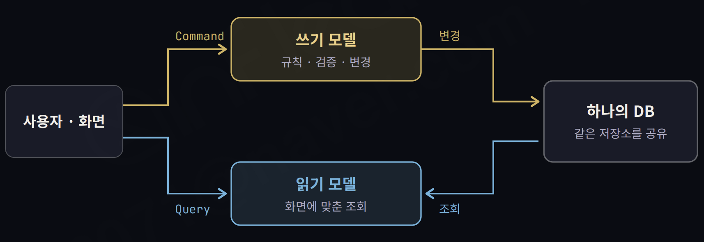
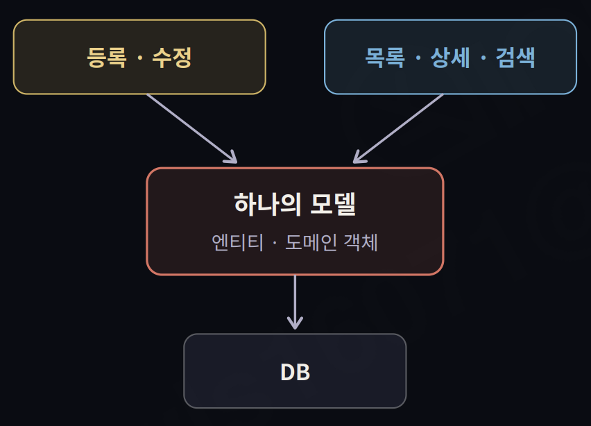
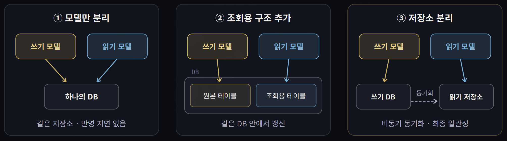
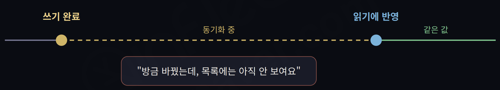

# CQRS: 읽기와 쓰기를 나누는 이유

## 1. CQRS의 개념

- **CQRS는 정보를 변경하는 모델과 조회하는 모델을 분리하는 패턴이다.**
- Command Query Responsibility Segregation의 약자이다.
- Command는 등록, 수정, 취소처럼 상태 변경을 요청한다.
- Query는 목록, 상세, 검색처럼 정보를 요청한다.
- 쓰기 모델은 업무 규칙을 검사하고 상태를 변경한다.
- 읽기 모델은 화면이나 조회 목적에 맞는 데이터를 반환한다.
- **핵심은 모델의 분리이며 저장소 분리는 선택 사항이다.**

| 구분 | Command | Query |
| :---: | :--- | :--- |
| 목적 | 규칙을 지키며 정보를 변경한다. | 필요한 정보를 조회한다. |
| 처리 예시 | 주문을 생성하거나 취소한다. | 주문 목록이나 상세 정보를 조회한다. |
| 모델의 책임 | 검증, 정합성, 상태 변경을 담당한다. | 조회와 응답 데이터 구성을 담당한다. |

## 2. CQS에서 CQRS로

### CQS는 메서드의 역할을 분리한다

- CQS는 Command Query Separation의 약자이다.
- Bertrand Meyer가 제시한 객체 설계 원칙이다.
- 명령 메서드는 상태를 변경하고, 조회 메서드는 값을 반환한다.
- 엄격한 CQS에서는 명령 메서드가 값을 반환하지 않는다.
- 조회 메서드는 관찰 가능한 상태를 변경하지 않는다.
- 상태 변경 여부가 명확해져 코드의 예측과 검증이 쉬워진다.

### CQRS는 모델의 책임을 분리한다

- CQRS는 Greg Young을 통해 널리 알려졌다.
- 메서드의 역할 구분을 읽기·쓰기 모델의 분리로 확장한다.
- 하나의 서비스에 있던 주문 변경과 조회 책임을 각각 나눌 수 있다.
- 분리 범위는 객체 수준부터 별도 프로세스나 시스템까지 달라질 수 있다.

| 비교 항목 | CQS | CQRS |
| :---: | :--- | :--- |
| 중심 단위 | 메서드의 역할을 나눈다. | 읽기와 쓰기 모델의 책임을 나눈다. |
| 주요 목적 | 상태가 변경되는 지점을 명확하게 한다. | 읽기와 쓰기의 서로 다른 요구에 대응한다. |
| 조회의 역할 | 상태를 바꾸지 않고 값을 반환한다. | 업무 상태 변경을 요청하지 않고 정보를 조회한다. |

## 3. 읽기와 쓰기를 나누는 이유

### 하나의 모델에 서로 다른 요구가 쌓인다

- 화면이 늘어나면 조회용 필드와 메서드가 모델에 계속 추가된다.
- 하나의 화면을 위해 여러 엔티티를 조합하는 조회가 복잡해진다.
- 조회 성능을 위한 변경이 쓰기 모델의 업무 규칙에 영향을 줄 수 있다.
- **읽기와 쓰기의 요구 차이가 커질수록 하나의 모델을 유지하기 어려워진다.**

### 각각에 맞는 구조로 최적화한다

| 비교 항목 | 쓰기 모델 | 읽기 모델 |
| :---: | :--- | :--- |
| 관심사 | 업무 규칙을 지키며 정확하게 변경한다. | 필요한 데이터를 빠르게 제공한다. |
| 데이터 구조 | 규칙과 정합성을 유지하기 쉽게 구성한다. | 조회 조건과 화면에 맞게 구성한다. |
| 최적화 수단 | 트랜잭션, 동시성 제어, 검증을 활용한다. | 인덱스, 캐시, 검색 엔진, 사전 조합을 활용한다. |

- 읽기와 쓰기의 요청량이 다르면 필요한 자원 규모도 달라질 수 있다.
- 단순한 업무에서는 하나의 모델로도 충분할 수 있다.

## 4. 분리 수준에 따른 구조

### 모델만 분리한다

- 쓰기 모델과 읽기 모델이 같은 DB의 데이터를 사용한다.
- 업무 변경과 조회의 코드 및 책임을 구분한다.
- 별도 읽기 저장소를 동기화하는 과정은 필요하지 않다.
- 하나의 DB를 사용하면서도 CQRS를 적용할 수 있다.

### 조회용 구조를 추가한다

- 같은 DB 안에 원본 테이블과 조회용 테이블을 따로 둘 수 있다.
- 읽기 모델은 조회에 맞게 가공한 데이터를 사용한다.
- 원본 변경을 조회용 데이터에 반영하는 갱신 로직이 필요하다.
- 갱신 시점과 트랜잭션 범위를 설계해야 한다.

### 저장소까지 분리한다

- 쓰기 DB와 읽기 저장소를 별도로 구성한다.
- 읽기와 쓰기에 서로 다른 저장 기술을 선택할 수 있다.
- 저장소의 부하와 용량을 각각 확장할 수 있다.
- 비동기로 동기화하면 변경 내용이 조회에 반영되기까지 지연이 생긴다.

| 분리 수준 | 읽기 데이터의 위치 | 추가로 관리할 사항 |
| :---: | :--- | :--- |
| 모델을 분리한다. | 쓰기와 같은 DB의 데이터를 사용한다. | 두 모델의 책임과 코드를 관리한다. |
| 조회용 구조를 추가한다. | 같은 DB에 조회용 데이터를 따로 둔다. | 조회용 데이터의 갱신 로직을 관리한다. |
| 저장소를 분리한다. | 별도의 읽기 저장소를 사용한다. | 동기화, 일관성, 장애 복구를 관리한다. |

- 세 형태는 분리 정도를 이해하기 위한 예시이다.
- 반드시 순서대로 도입해야 하는 단계는 아니다.
- **분리 범위가 커질수록 최적화의 자유도와 운영 부담이 함께 늘어난다.**

## 5. 이벤트 소싱과의 차이

| 비교 항목 | CQRS | Event Sourcing |
| :---: | :--- | :--- |
| 핵심 질문 | 읽기와 쓰기의 책임을 어떻게 나누는가? | 상태 변경의 원본을 무엇으로 저장하는가? |
| 핵심 구조 | 쓰기 모델과 읽기 모델을 분리한다. | 상태를 변경한 이벤트 이력을 원본으로 저장한다. |
| 현재 상태 | 선택한 저장 방식에 따라 관리한다. | 이벤트를 순서대로 적용해 재구성한다. |

- **CQRS와 이벤트 소싱은 서로 다른 패턴이다.**
- CQRS는 이벤트 소싱 없이도 적용할 수 있다.
- 이벤트로 읽기 모델을 동기화한다고 해서 반드시 이벤트 소싱인 것은 아니다.
- 이벤트 이력이 상태의 원본인지 구분해야 한다.

## 6. 장점과 한계

### 장점

- 읽기와 쓰기를 각각의 요구에 맞게 최적화할 수 있다.
- 쓰기 모델에서 조회용 코드를 줄이고 업무 규칙에 집중할 수 있다.
- 저장소를 나누면 각각의 부하에 맞게 확장할 수 있다.
- 설계에 따라 읽기와 쓰기 사이의 장애 전파를 줄일 수 있다.

### 한계

- **두 모델을 이해하고 관리해야 하므로 코드와 설계 복잡도가 늘어난다.**
- 조회용 데이터를 따로 저장하면 데이터 중복과 동기화 로직이 생긴다.
- 비동기 동기화에서는 최종 일관성과 운영 복잡성을 감수해야 한다.
- 모델을 나누는 것만으로 성능 향상이나 장애 격리가 보장되지는 않는다.

## 7. 비동기 동기화와 최종 일관성

### 변경 직후에는 조회 결과가 다를 수 있다

- 최종 일관성에서는 쓰기 결과와 읽기 데이터가 일시적으로 다를 수 있다.
- 변경 전달과 처리가 정상적으로 완료되면 읽기 데이터에도 결과가 반영된다.
- 쓰기가 성공했어도 목록 화면에는 변경 내용이 아직 보이지 않을 수 있다.
- 이 지연을 업무와 사용자 경험에서 허용할 수 있는지 판단해야 한다.

### 이벤트 전달 과정의 실패를 다룬다

| 발생 가능한 문제 | 대응 방향 |
| :--- | :--- |
| DB 변경은 성공했지만 이벤트 발행이 실패한다. | Transactional Outbox로 상태 변경과 발행 대상 기록을 함께 저장한다. |
| 같은 이벤트가 여러 번 전달된다. | Idempotent Consumer로 중복 처리의 부작용을 방지한다. |
| 이벤트가 순서와 다르게 전달된다. | 순서 보장, 최신 데이터 재조회, 데이터 보정 등 업무에 맞는 방식을 검토한다. |

- Outbox와 멱등한 소비자만으로 이벤트 순서 문제까지 해결되는 것은 아니다.
- 동기화 실패를 감지하고 재처리하거나 보정할 수 있어야 한다.

## 8. 배민스토어 전시 영역 사례

- 2023년 공개된 전시 영역 사례에서는 읽기와 쓰기 모델을 분리했다.
- 상품, 리뷰, 가게, 쿠폰 정보를 화면에 빠르게 제공하는 것이 중요했다.
- 다른 도메인의 Kafka 이벤트를 받아 전시에 필요한 읽기 모델로 변환했다.
- 읽기 데이터를 DynamoDB와 Redis에 저장해 제공했다.
- 이벤트 순서가 뒤바뀌면 데이터 정합성이 깨질 수 있었다.
- 가격과 재고 등 중요한 정보에는 식별자를 전달하는 Zero Payload 방식을 사용했다.
- 이벤트 수신 후 HTTP API로 최신 데이터를 조회해 읽기 저장소에 반영했다.
- 모니터링과 보정 로직을 함께 운영했다. [배민스토어 전시 영역 사례](https://techblog.woowahan.com/13101/)

## 9. 적용할 때와 다른 방법을 먼저 볼 때

### 적용을 검토할 상황

- 읽기와 쓰기의 요청량이나 성능 요구가 크게 다르다.
- 조회 화면에 필요한 데이터 모양이 쓰기 모델과 많이 다르다.
- 도메인이 복잡해 쓰기 모델을 업무 규칙에 집중시키고 싶다.
- 분리로 얻는 이점이 모델과 동기화 관리 비용보다 크다.

### 다른 방법을 먼저 검토할 상황

- 읽기와 쓰기의 요구가 크게 다르지 않다.
- 하나의 모델로도 업무를 단순하게 표현할 수 있다.
- 일부 조회만 느리고 모델 전체의 책임 분리는 필요하지 않다.
- 성능 문제라면 쿼리 개선, 인덱스, 캐시, 읽기 복제본 등을 먼저 검토한다.

### 필요한 영역에만 적용한다

- **CQRS는 시스템 전체에 일괄 적용할 필요가 없다.**
- 상품 전시처럼 읽기와 쓰기의 요구 차이가 큰 영역에 적용할 수 있다.
- 계층형, 모듈형 모놀리스, 마이크로서비스 안에서도 사용할 수 있다.
- 도메인 경계 안에서 필요한 수준만 분리한다.

## 10. 레퍼런스

- [Martin Fowler — CQRS](https://martinfowler.com/bliki/CQRS.html): 모델 분리의 정의와 적용 범위, 복잡성에 대한 판단을 설명한다.
- [Martin Fowler — Command Query Separation](https://martinfowler.com/bliki/CommandQuerySeparation.html): CQS의 기원과 메서드 수준의 명령·조회 구분을 설명한다.
- [Microsoft — CQRS pattern](https://learn.microsoft.com/en-us/azure/architecture/patterns/cqrs): 단일 저장소와 분리 저장소 방식, 장점과 고려사항을 설명한다.
- [우아한형제들 — 배민스토어에 이벤트 기반 아키텍처를 곁들인…](https://techblog.woowahan.com/13101/): 읽기 모델 구성과 이벤트 순서 문제에 대응한 사례를 설명한다.
