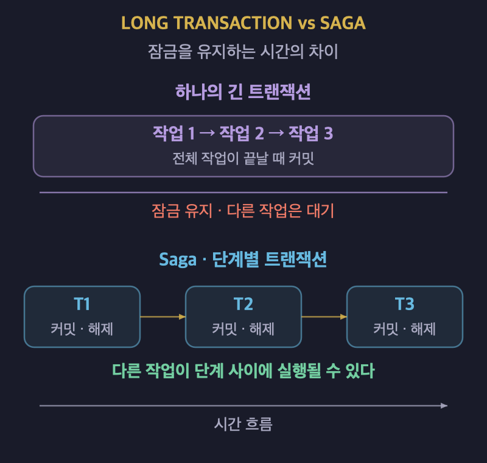
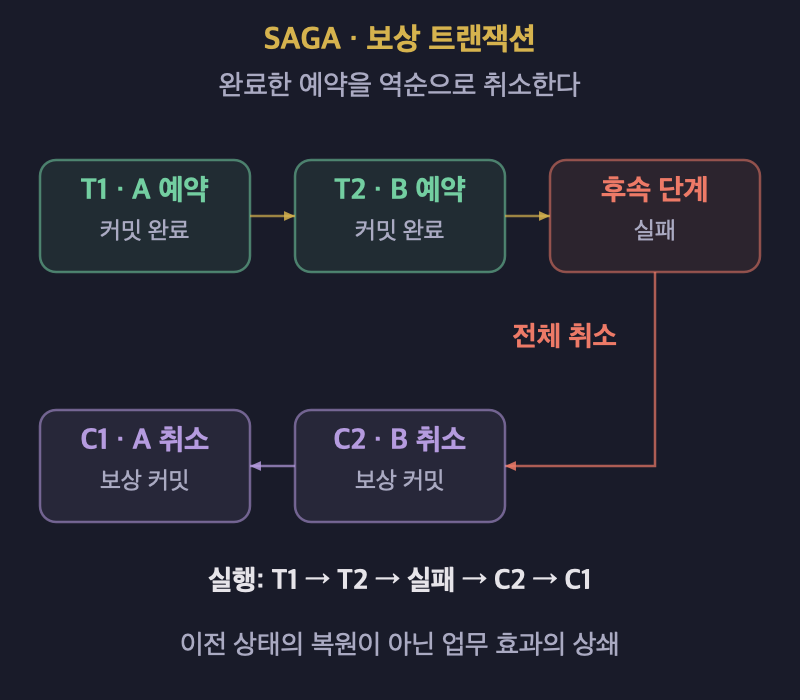
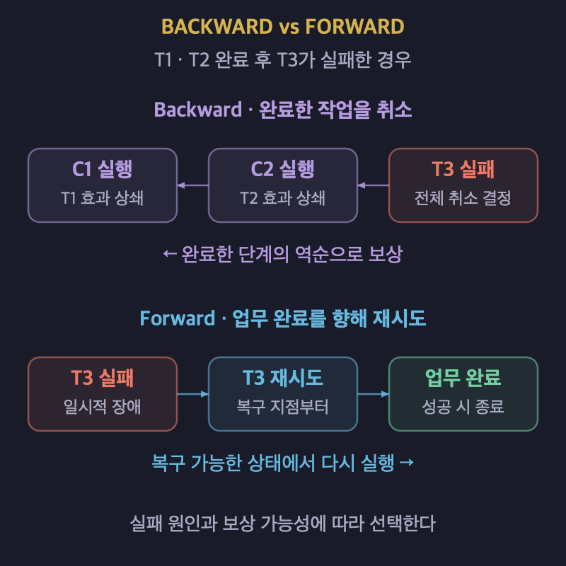
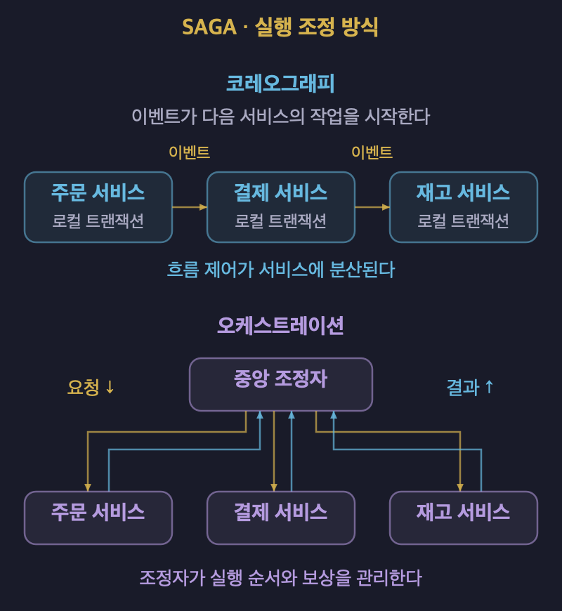

# Saga: 긴 트랜잭션을 나누고 보상하는 방법

## 1. Saga의 개념

- **Saga는 긴 업무를 여러 개의 짧은 트랜잭션으로 나누고 실행을 조정하는 방식이다.**
- Hector Garcia-Molina와 Kenneth Salem이 1987년에 제안했다.
- 각 하위 트랜잭션은 자체적으로 일관성을 유지하고 커밋한다.
- 완료된 단계는 잠금을 해제해 다른 트랜잭션의 실행을 허용한다.
- 전체 업무를 취소해야 하면 완료된 단계의 보상 트랜잭션을 실행한다.
- **각 단계의 원자성은 유지하지만 전체 업무의 원자성과 격리성은 단일 트랜잭션과 다르다.**

## 2. 장기 트랜잭션이 만드는 문제

- 장기 트랜잭션은 실행에 수 시간에서 수 일이 걸릴 수 있다.
- 많은 데이터를 처리하거나 복잡한 계산과 사용자 응답을 기다릴 수 있다.
- 잠금을 완료 시점까지 유지하면 다른 작업의 접근이 지연된다.
- 접근하는 데이터와 잠금 유지 시간이 늘면 충돌과 교착 상태의 부담이 커진다.
- 실행 중 장애가 발생하면 많은 작업을 취소하거나 다시 수행해야 한다.
- Saga는 잠금을 오래 유지하는 대신 단계별 커밋과 보상을 사용한다.

| 비교 항목 | 하나의 긴 트랜잭션 | Saga |
| :---: | :--- | :--- |
| 커밋 단위 | 전체 작업을 한 번에 커밋한다. | 각 하위 트랜잭션을 커밋한다. |
| 잠금 유지 | 잠금 기반 제어에서는 완료까지 오래 유지할 수 있다. | 각 단계가 끝나면 해당 잠금을 해제한다. |
| 중간 결과 | 격리 수준에 따라 다른 작업의 관찰을 제한한다. | 커밋된 중간 결과가 다른 작업에 보일 수 있다. |
| 실패 처리 | 커밋되지 않은 변경을 롤백한다. | 완료한 단계의 효과를 보상하거나 실행을 재시도한다. |

## 3. 하위 트랜잭션과 보상 트랜잭션

### 업무를 짧은 단계로 나눈다

- 전체 업무를 `T1 → T2 → T3`와 같은 순서로 구성한다.
- 각 단계는 독립적으로 커밋할 수 있는 업무 단위여야 한다.
- 단계 사이에는 다른 트랜잭션이 끼어들 수 있다.
- 단계를 나누는 기준은 코드 길이보다 업무의 의미와 일관성 조건이다.

### 완료한 작업의 효과를 상쇄한다

- 보상 트랜잭션 `Ci`는 완료한 트랜잭션 `Ti`의 효과를 상쇄한다.
- 예약에는 예약 취소처럼 업무 의미에 맞는 보상을 정의한다.
- 보상도 데이터를 변경하고 커밋하는 별도의 트랜잭션이다.
- **보상은 과거의 DB 상태를 그대로 복원하는 물리적 Undo가 아니다.**
- 다른 작업이 만든 변경을 덮어쓰지 않으면서 취소 효과를 반영해야 한다.
- 실행 이력이나 취소 기록은 보상 후에도 남을 수 있다.

### 항공편 예약을 취소한다

| 순서 | 작업 | 결과 |
| :---: | :--- | :--- |
| 1 | `T1`에서 항공편 A를 예약한다. | A 예약을 커밋한다. |
| 2 | `T2`에서 항공편 B를 예약한다. | B 예약을 커밋한다. |
| 3 | 후속 단계가 실패해 전체 예약을 취소하기로 한다. | 보상 절차를 시작한다. |
| 4 | `C2`에서 항공편 B의 예약을 취소한다. | B 예약의 효과를 상쇄한다. |
| 5 | `C1`에서 항공편 A의 예약을 취소한다. | A 예약의 효과를 상쇄한다. |

- 순차 Saga의 기본 보상 흐름은 완료한 단계의 역순이다.
- 진행 중인 DB 트랜잭션의 롤백과 이미 커밋된 단계의 보상은 구분한다.

## 4. 실패 이후의 복구 전략

| 방식 | 복구 방향 | 처리 방법 |
| :---: | :--- | :--- |
| Backward Recovery | 완료한 작업을 취소한다. | 보상 트랜잭션을 역순으로 실행한다. |
| Forward Recovery | 업무 완료를 향해 진행한다. | 복구 가능한 지점부터 실행을 재시도한다. |
| Partial Recovery | 일부 결과를 유지하고 다시 진행한다. | 필요한 구간만 보상하고 재실행한다. |

- 저장 지점은 복구를 시작할 위치를 식별하는 데 사용한다.
- 일시적인 장애와 업무 규칙 위반을 구분해 복구 방향을 정한다.
- 보상하기 어려운 업무는 완료를 향한 재시도 전략을 검토한다.
- 재시도를 선택한다고 해서 모든 실패가 자동으로 해결되는 것은 아니다.
- 보상 자체도 실패할 수 있으므로 진행 상태를 기록해야 한다.
- 반복 실패를 감지하고 재처리하거나 운영자가 개입할 수 있어야 한다.

## 5. 실행 상태와 복구 정보를 관리하는 방법

- SEC는 Saga Execution Component의 약자이다.
- Saga의 실행 순서와 로그를 관리하는 구성 요소이다.
- 하위 트랜잭션의 처리와 Saga 전체의 실행 관리를 구분한다.
- 장애 이후에도 완료한 단계와 남은 단계를 판별할 수 있어야 한다.
- 보상에 필요한 식별자와 입력값을 영속적으로 저장한다.
- 복구에 필요한 중간 상태를 프로세스의 로컬 변수에만 두지 않는다.
- 별도 실행 프로세스와 보상 정보 테이블을 이용하는 구현도 가능하다.

| 관리할 정보 | 목적 |
| :--- | :--- |
| Saga 식별자와 현재 상태를 저장한다. | 전체 업무의 진행 상황을 추적한다. |
| 완료한 단계와 처리 결과를 저장한다. | 재시작 시 실행 위치를 판단한다. |
| 보상 작업과 입력값을 저장한다. | 완료한 작업을 정확히 취소한다. |
| 저장 지점과 복구 진행 상태를 저장한다. | 복구 중 장애가 발생해도 이어서 처리한다. |

## 6. 병렬 Saga와 단계 설계

- 독립적인 단계는 Fork와 Join 구조로 병렬 실행할 수 있다.
- 병렬 실행은 전체 처리 시간을 줄이는 데 도움이 된다.
- 단계 사이의 의존성이 있으면 실행 순서와 보상 순서를 함께 분석한다.
- 한 단계의 취소가 다른 단계의 결과에 미치는 영향을 확인한다.
- 병렬화 자체가 연쇄 취소나 일관성 문제를 해결하지는 않는다.
- **단계의 독립성과 보상 가능성을 먼저 확인하고 병렬화를 결정한다.**

## 7. 마이크로서비스에서의 구현 방식

- 마이크로서비스에서는 서비스별 로컬 트랜잭션을 연결해 하나의 업무를 처리한다.
- 각 서비스는 자신의 데이터를 변경하고 후속 실행에 필요한 결과를 전달한다.
- 전체 흐름을 조정하는 방식으로 코레오그래피와 오케스트레이션을 사용한다.

| 비교 항목 | 코레오그래피 | 오케스트레이션 |
| :---: | :--- | :--- |
| 실행 방식 | 서비스가 이벤트를 받아 다음 작업을 수행한다. | 조정자가 참여 서비스에 작업을 요청한다. |
| 흐름의 위치 | 이벤트 처리 로직에 분산된다. | 조정자의 실행 로직에 모인다. |
| 장점 | 별도 중앙 조정자 없이 단계를 연결한다. | 실행 순서와 보상 흐름을 파악하기 쉽다. |
| 부담 | 단계가 늘면 전체 흐름과 의존성을 추적하기 어렵다. | 조정자의 상태 저장과 장애 복구가 필요하다. |

- 두 방식 모두 실패한 업무와 보상 진행 상황을 추적해야 한다.
- 중앙 조정자를 사용한다면 재시작 후 실행을 이어갈 수 있어야 한다.
- 논리적으로 중앙에서 조정한다고 반드시 하나의 프로세스로만 실행해야 하는 것은 아니다.

## 8. 장점과 한계

### 장점

- 긴 업무 전체에 걸쳐 잠금을 유지하는 부담을 줄인다.
- 단계 사이에 다른 작업이 진행될 수 있어 동시성을 높인다.
- 서비스별 데이터와 로컬 트랜잭션의 경계를 유지할 수 있다.
- 업무 특성에 맞게 보상과 재시도 전략을 선택할 수 있다.

### 한계

- 보상 로직을 업무 규칙에 맞게 직접 설계해야 한다.
- 전체 업무가 완료되기 전에 중간 결과가 외부에 보일 수 있다.
- 다른 작업이 중간 결과에 의존하면 취소와 복구가 복잡해진다.
- 여러 서비스의 실행 상태와 장애 원인을 함께 추적해야 한다.
- 보상하기 어렵거나 되돌릴 수 없는 작업은 별도 전략이 필요하다.

### 중간 상태 노출과 Dirty Read를 구분한다

- Saga의 각 단계는 커밋되었어도 전체 업무는 아직 진행 중일 수 있다.
- 다른 작업은 이 상태를 최종 결과로 오해할 수 있다.
- Saga 수준에서 이러한 노출을 Dirty Read라고 표현하기도 한다.
- DB 격리 수준의 Dirty Read는 커밋되지 않은 데이터를 읽는 현상이다.
- **커밋된 중간 결과의 노출과 DB의 미커밋 데이터 읽기는 구분해야 한다.**
- 처리 중 상태와 확정 상태를 명시하고, 상태별로 허용할 작업을 정한다.

## 9. 적용할 때 확인할 사항

- 업무를 독립적으로 커밋 가능한 단계로 나눌 수 있는지 확인한다.
- 단계별 보상 작업을 정의하고 실제로 수행할 수 있는지 확인한다.
- 중간 결과의 노출을 업무에서 허용할 수 있는지 확인한다.
- 재시도와 중복 요청이 같은 효과를 반복해서 만들지 않도록 설계한다.
- 실행 상태를 영속화하고 복구 실패를 관찰할 수 있게 한다.
- 메시지를 사용한다면 DB 변경과 메시지 발행 사이의 실패도 처리한다.
- Transactional Outbox는 변경과 발행 대상 기록을 함께 저장하는 데 활용할 수 있다.
- 멱등한 소비자는 메시지의 중복 처리로 인한 부작용을 줄인다.
- **Saga를 도입하는 것만으로 메시지 전달과 동시성 문제가 모두 해결되지는 않는다.**
- 하나의 짧은 로컬 트랜잭션으로 처리할 수 있다면 그 구성을 먼저 검토한다.

## 10. 레퍼런스

- [Hector Garcia-Molina·Kenneth Salem — Sagas](https://www.cs.princeton.edu/techreports/1987/070.pdf): 1987년 공개된 Saga의 기술 보고서이다.
- [Microsoft — Saga distributed transactions pattern](https://learn.microsoft.com/en-us/azure/architecture/patterns/saga): 분산 환경의 실행 방식, 보상, 동시성 문제와 운영 고려사항을 설명한다.
- [Chris Richardson — Saga](https://microservices.io/patterns/data/saga.html): 서비스별 로컬 트랜잭션을 연결하는 방식과 관련 패턴을 설명한다.
