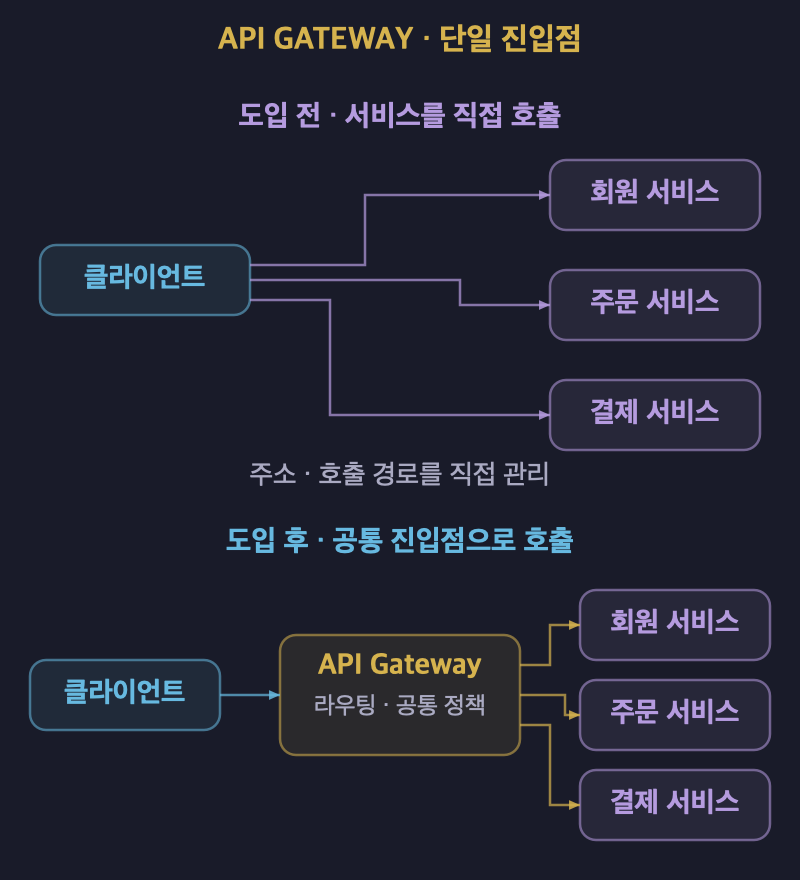
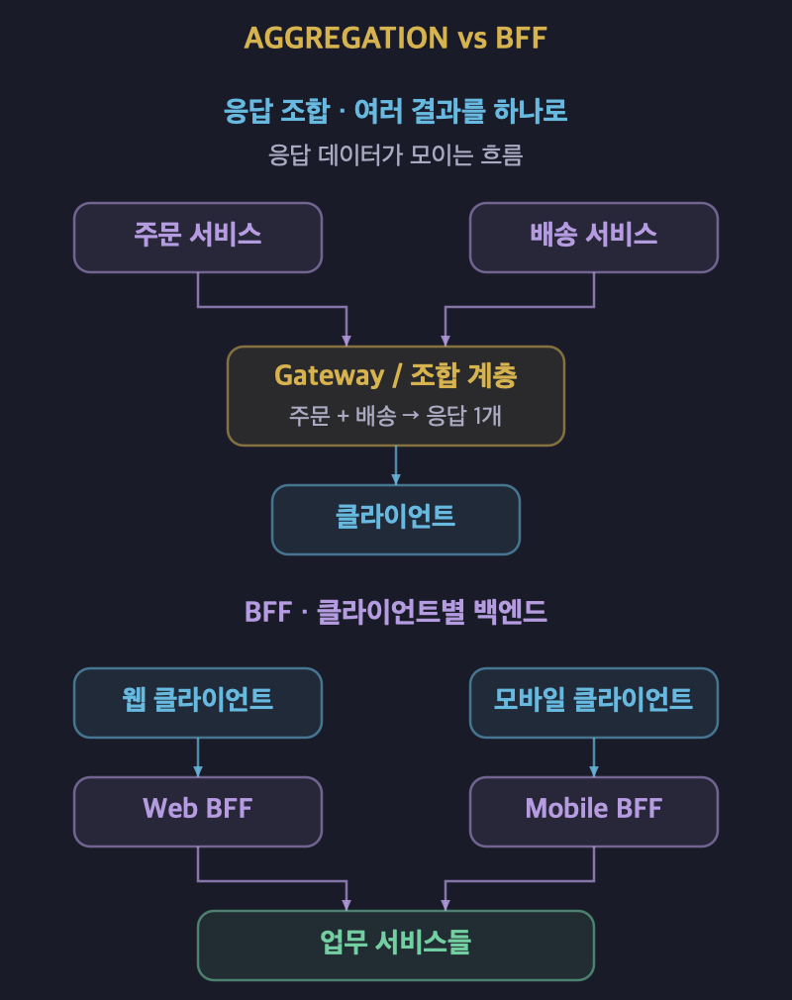
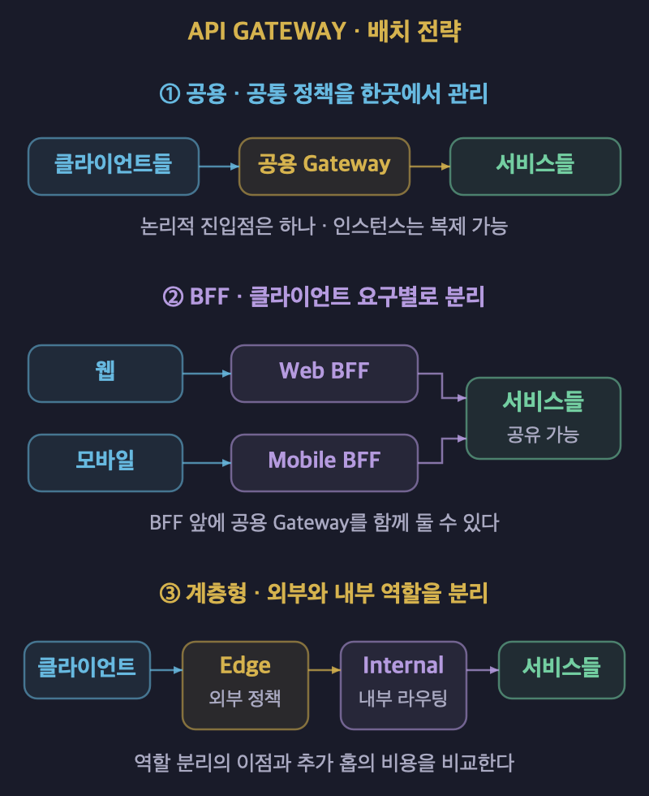
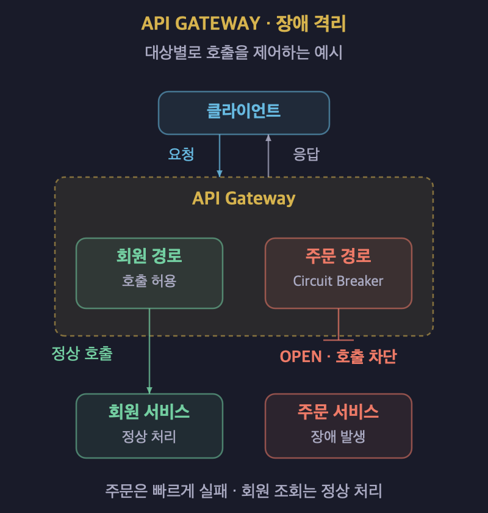

# API Gateway: MSA의 단일 진입점

## 1. API Gateway의 개념

- **API Gateway는 클라이언트와 여러 서비스 사이에서 요청을 받는 공통 진입점이다.**
- 요청을 적절한 서비스로 전달하는 리버스 프록시 역할을 한다.
- 클라이언트가 내부 서비스의 주소와 배치 구조를 직접 알지 않게 한다.
- 인증, 요청 제한, 로깅처럼 여러 서비스에 필요한 공통 기능을 처리할 수 있다.
- 서비스는 자신의 업무 규칙과 데이터 처리에 집중한다.
- **단일 진입점은 논리적인 접근 경계이며 서버 한 대를 의미하지 않는다.**
- 클라이언트나 업무 영역에 따라 여러 게이트웨이를 둘 수 있다.

## 2. 서비스에 직접 접근할 때 생기는 문제

- 서비스가 늘어나면 클라이언트가 관리할 호출 주소도 많아진다.
- 서비스의 분리와 배치 변경이 클라이언트에 영향을 줄 수 있다.
- 하나의 화면을 위해 여러 서비스를 호출하고 결과를 조합해야 한다.
- 외부에 노출된 각 서비스에 접근 제어와 보안 정책을 적용해야 한다.
- 인증과 로깅 같은 공통 기능이 서비스마다 중복될 수 있다.

| 비교 항목 | 서비스에 직접 접근한다. | API Gateway를 거친다. |
| :---: | :--- | :--- |
| 호출 대상 | 클라이언트가 여러 서비스의 주소를 관리한다. | 게이트웨이가 제공하는 API를 호출한다. |
| 내부 구조 변경 | 변경이 클라이언트에 직접 영향을 줄 수 있다. | 라우팅으로 일부 변경을 감출 수 있다. |
| 공통 정책 | 외부에 노출된 서비스마다 적용한다. | 진입점에서 공통 정책을 적용한다. |
| 운영 부담 | 각 서비스의 외부 접근 경계를 관리한다. | 게이트웨이의 용량과 가용성을 추가로 관리한다. |

## 3. 핵심 역할

### 요청을 적절한 서비스로 전달한다

- URL 경로와 호스트 등의 조건으로 목적지를 선택한다.
- `/api/orders` 요청을 주문 서비스로 전달할 수 있다.
- 외부 API 주소와 내부 서비스 주소를 분리한다.
- 내부 주소를 숨기는 것과 직접 접근을 차단하는 것은 별도 문제이다.
- 내부 서비스의 노출 범위는 네트워크와 접근 정책으로 함께 관리한다.

### 인증과 공통 접근 정책을 처리한다

- 액세스 토큰 검증과 API 접근 정책을 진입점에 모을 수 있다.
- JWT 형식의 토큰이라면 서명, 만료, 발급자와 수신 대상 등을 확인한다.
- **인증을 중앙화해도 서비스의 업무별 인가 책임이 사라지지는 않는다.**
- 주문 취소 권한처럼 업무 데이터가 필요한 판단은 해당 서비스가 수행한다.
- 각 서비스는 전달받은 사용자 정보가 신뢰할 수 있는 경로에서 왔는지 확인한다.
- 서비스가 인증 정보를 검증한다는 이유만으로 MSA가 아닌 것은 아니다.

### 요청과 응답의 형태를 조정한다

- 헤더, 경로, 요청과 응답의 형식을 변환할 수 있다.
- 구현체와 구성에 따라 HTTP와 gRPC 사이의 변환을 지원할 수 있다.
- 여러 서비스의 응답을 조합해 클라이언트에 한 번에 반환할 수 있다.
- 변환 기능과 지원 범위는 제품 및 설정에 따라 달라진다.

### 공통 정책과 관측성을 제공한다

| 기능 | 역할 |
| :--- | :--- |
| Rate Limiting을 적용한다. | 일정 시간 동안 허용할 요청량을 제한한다. |
| IP 접근 정책을 적용한다. | 허용하거나 차단할 요청 출발지를 관리한다. |
| CORS 정책을 적용한다. | 브라우저의 다른 출처 요청에 대한 허용 범위를 정한다. |
| 접근 로그를 남긴다. | 요청 경로, 상태 코드, 처리 시간 등을 확인한다. |
| 추적 정보를 전달한다. | 게이트웨이와 하위 서비스의 요청 흐름을 연결한다. |

- CORS는 브라우저 정책이며 인증이나 서비스 접근 제어를 대체하지 않는다.
- 게이트웨이의 로그만으로 서비스 내부의 처리 과정까지 알 수는 없다.
- 하위 서비스의 로그와 추적 정보를 함께 연결해야 한다.

## 4. 응답 조합과 BFF의 차이

| 비교 항목 | 응답 조합 | BFF |
| :---: | :--- | :--- |
| 핵심 목적 | 여러 호출의 결과를 하나의 응답으로 묶는다. | 특정 클라이언트에 맞는 백엔드를 제공한다. |
| 적용 단위 | 개별 API의 요청과 응답 흐름에 적용한다. | 웹과 모바일 등 클라이언트별 경계를 만든다. |
| 예시 | 주문 정보와 배송 정보를 함께 반환한다. | 모바일에 필요한 필드와 호출 흐름을 제공한다. |

- BFF는 Backend for Frontend의 약자이다.
- 하나의 공용 API가 서로 다른 화면 요구를 모두 수용하기 어려울 때 검토한다.
- BFF 안에서 여러 서비스의 응답을 조합할 수 있다.
- **응답을 조합한다고 반드시 BFF인 것은 아니다.**
- BFF를 API Gateway 뒤의 별도 서비스로 배치할 수도 있다.
- 클라이언트의 요구가 비슷하면 BFF를 나누는 이점이 작을 수 있다.

## 5. 게이트웨이 배치 전략

| 방식 | 구성 | 장점 | 고려할 사항 |
| :---: | :--- | :--- | :--- |
| 공용 게이트웨이를 둔다. | 여러 클라이언트와 팀이 하나의 진입점을 공유한다. | 공통 정책을 한곳에서 관리하기 쉽다. | 설정 충돌과 장애 영향 범위가 커질 수 있다. |
| 클라이언트별 BFF를 둔다. | 웹과 모바일의 백엔드를 구분한다. | 화면과 통신 요구에 맞게 독립적으로 변경한다. | 배포 대상과 중복 코드가 늘어날 수 있다. |
| 게이트웨이를 계층화한다. | 외부 Edge와 내부 게이트웨이의 역할을 나눈다. | 외부 접근 정책과 내부 라우팅을 분리한다. | 네트워크 홉과 운영 복잡도가 늘어난다. |

- 공용 게이트웨이도 여러 인스턴스로 복제해 운영할 수 있다.
- BFF와 공용 게이트웨이는 함께 사용할 수 있다.
- 계층을 늘릴 때는 각 계층의 책임과 소유 팀을 명확히 한다.
- 모든 서비스 간 통신을 외부 게이트웨이로 우회시킬 필요는 없다.
- 서비스 수보다 클라이언트 요구, 팀 경계, 운영 부담을 함께 판단한다.

## 6. 장애 전파를 줄이는 방법

- 특정 서비스의 장애가 게이트웨이의 자원을 계속 점유하지 않게 해야 한다.
- 주문 서비스가 실패해도 무관한 회원 조회까지 영향을 받지 않도록 설계한다.
- 게이트웨이와 서비스 내부의 장애 대응은 각 호출 경계에 맞게 구성한다.

| 수단 | 처리 방식 |
| :--- | :--- |
| Timeout을 설정한다. | 하위 서비스의 응답을 기다리는 시간을 제한한다. |
| Circuit Breaker를 적용한다. | 실패가 누적된 대상의 호출을 잠시 차단하고 빠르게 실패시킨다. |
| 자원을 격리한다. | 특정 대상의 지연이 전체 연결과 처리 자원을 소진하지 않게 한다. |
| 재시도를 제한한다. | 반복 호출로 장애 중인 서비스의 부하가 늘어나는 것을 줄인다. |

- 응답을 조합한다면 일부 서비스의 실패를 어떻게 표현할지 정한다.
- 업무에서 허용할 때만 부분 응답이나 대체 데이터를 반환한다.
- 여러 계층에서 동시에 재시도하면 호출 횟수가 크게 늘어날 수 있다.
- Circuit Breaker만으로 모든 장애 전파가 차단되는 것은 아니다.

## 7. 게이트웨이에 넣지 않을 책임

- **게이트웨이에는 공통 통신 정책을 두고 핵심 업무 규칙은 서비스에 둔다.**
- VIP 할인이나 주문 취소 조건을 게이트웨이에서 판단하지 않는다.
- 업무 데이터를 조회하려고 서비스의 DB에 직접 접근하지 않는다.
- 여러 서비스의 업무 트랜잭션을 게이트웨이가 직접 관리하지 않는다.
- 복잡한 응답 조합과 장시간 실행되는 흐름은 별도 서비스로 분리한다.
- 게이트웨이의 상태 저장이나 캐시와 업무 DB의 직접 접근은 구분한다.

| 게이트웨이가 맡을 수 있는 책임 | 업무 서비스가 맡을 책임 |
| :--- | :--- |
| 토큰을 검증하고 공통 접근 정책을 적용한다. | 사용자가 특정 주문을 취소할 수 있는지 판단한다. |
| 경로에 따라 주문 서비스로 전달한다. | 주문 상태를 변경하고 데이터를 저장한다. |
| 가벼운 응답 형식 변환을 수행한다. | 할인과 재고 차감 등의 업무 규칙을 실행한다. |

## 8. 구현 방식과 선택 기준

| 구현 방식 | 예시 | 선택할 때 확인할 사항 |
| :--- | :--- | :--- |
| 애플리케이션 기반 게이트웨이를 사용한다. | Spring Cloud Gateway를 사용한다. | 기존 개발 환경과 필터 확장 요구를 확인한다. |
| 클라이언트 전용 백엔드를 개발한다. | NestJS나 FastAPI로 BFF를 구현한다. | 화면별 조합 요구와 직접 구현할 운영 기능을 확인한다. |
| 프록시나 전용 게이트웨이를 사용한다. | Nginx나 Kong을 사용한다. | 라우팅, 정책 확장, 설정 관리 방식을 확인한다. |
| 관리형 게이트웨이를 사용한다. | AWS API Gateway를 사용한다. | 서비스 제한, 연동 방식과 사용량에 따른 비용을 확인한다. |

- Spring Cloud Gateway에는 WebFlux와 Web MVC 기반 방식이 있다.
- 모든 Spring Cloud Gateway 구성이 Netty 기반인 것은 아니다.
- NestJS와 FastAPI는 애플리케이션 프레임워크이므로 필요한 게이트웨이 기능을 별도로 구성해야 한다.
- 제품 이름만으로 모든 인증, 변환, 장애 대응 기능이 제공된다고 가정하지 않는다.
- 처리 성능뿐 아니라 운영 역량, 확장 요구와 비용을 함께 비교한다.

## 9. 장점과 운영상 트레이드오프

### 장점

- 클라이언트가 알아야 할 내부 서비스 구조를 줄인다.
- 외부 요청에 대한 공통 정책을 일관되게 적용하기 쉽다.
- 접근 로그와 요청 흐름을 진입점에서 관찰할 수 있다.
- 응답 조합을 통해 클라이언트의 네트워크 왕복을 줄일 수 있다.

### 운영 부담

- 게이트웨이가 중단되면 이를 통과하는 요청이 영향을 받는다.
- 가용성 요구에 맞게 복제, 부하 분산과 장애 전환을 구성한다.
- 모든 요청이 모이는 경로에서는 용량 부족이 전체 병목이 될 수 있다.
- 네트워크 홉과 필터 처리가 추가되어 지연이 늘어날 수 있다.
- 라우팅과 정책 설정의 잘못된 배포가 여러 서비스에 영향을 줄 수 있다.
- 처리량, 오류율, 지연 시간과 하위 서비스별 상태를 관찰한다.
- **API Gateway는 MSA의 정의상 필수 조건이 아니라 요구에 따라 선택하는 패턴이다.**

## 10. 레퍼런스

- [Microsoft — Use API gateways in microservices](https://learn.microsoft.com/en-us/azure/architecture/microservices/design/gateway): 게이트웨이의 역할, 도입 이유와 기술 선택 기준을 설명한다.
- [Microsoft — Gateway Aggregation pattern](https://learn.microsoft.com/en-us/azure/architecture/patterns/gateway-aggregation): 응답 조합, 부분 실패 처리와 별도 조합 서비스의 활용을 설명한다.
- [Microsoft — Backends for Frontends pattern](https://learn.microsoft.com/en-us/azure/architecture/patterns/backends-for-frontends): 클라이언트별 백엔드의 목적과 운영상 트레이드오프를 설명한다.
- [Spring — Spring Cloud Gateway](https://docs.spring.io/spring-cloud-gateway/reference/index.html): 게이트웨이 기능과 WebFlux 및 Web MVC 기반 구성을 설명한다.
