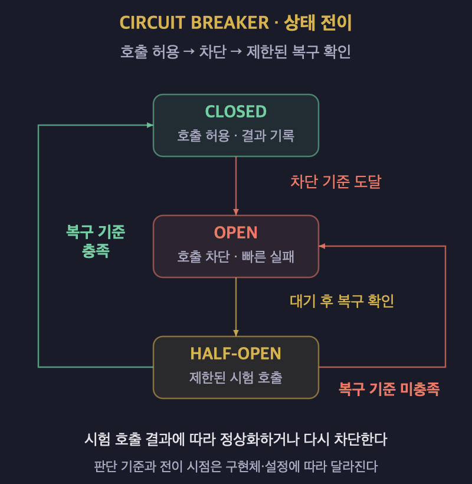
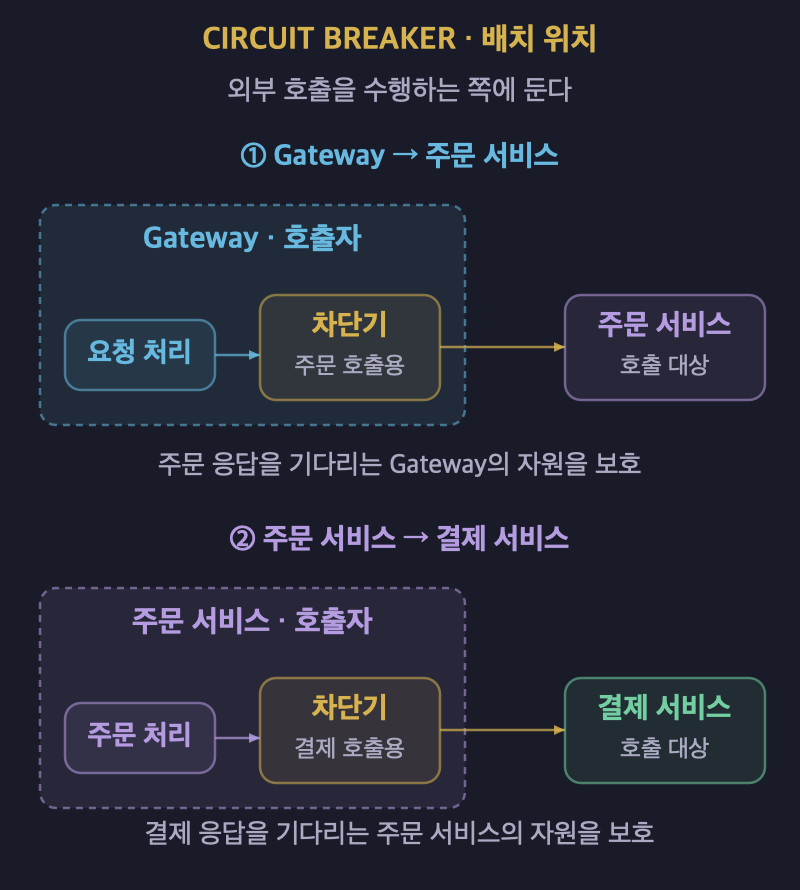

# Circuit Breaker: MSA 장애 전파를 막는 법

## 1. 연쇄 장애가 발생하는 이유

- 마이크로서비스는 다른 서비스의 응답을 기다리며 작업을 처리할 수 있다.
- 호출 대상이 느려지면 요청을 보낸 쪽에도 대기 작업이 쌓인다.
- 대기가 길어지면 스레드, 연결, 메모리 같은 자원이 소진될 수 있다.
- 같은 자원을 사용하는 정상 기능도 영향을 받을 수 있다.
- **하나의 서비스 장애가 의존 관계를 따라 퍼지는 현상을 연쇄 장애라고 한다.**

| 단계 | 발생하는 문제 |
| :---: | :--- |
| 추천 서비스가 응답하지 않는다. | 추천 결과를 기다리는 요청이 쌓인다. |
| 게이트웨이의 처리 자원이 부족해진다. | 무관한 요청까지 지연될 수 있다. |
| 메인 페이지의 응답이 늦어진다. | 일부 기능의 장애가 전체 서비스 장애처럼 보인다. |

## 2. Circuit Breaker의 개념

- **Circuit Breaker는 실패가 반복되는 대상의 호출을 일시적으로 차단하는 패턴이다.**
- 최근 호출 결과를 관찰해 계속 호출해도 되는지 판단한다.
- 차단 중에는 대상 서비스를 호출하지 않고 빠르게 실패시킨다.
- 이를 통해 호출자의 불필요한 대기와 자원 낭비를 줄인다.
- 장애가 난 서비스에 반복 요청이 몰리는 부담도 줄인다.
- 일정 시간이 지나면 제한된 호출로 복구 여부를 확인한다.
- 장애의 원인을 직접 고치거나 모든 장애 전파를 자동으로 막지는 않는다.

## 3. 세 가지 상태와 전이

| 상태 | 호출 처리 | 다음 상태로 바뀌는 조건 |
| :---: | :--- | :--- |
| CLOSED 상태이다. | 호출을 허용하고 결과를 기록한다. | 실패가 차단 기준에 도달하면 OPEN으로 전환한다. |
| OPEN 상태이다. | 새로운 호출을 차단하고 빠르게 실패시킨다. | 대기 시간 이후 복구 확인 단계로 진입한다. |
| HALF-OPEN 상태이다. | 제한된 수의 시험 호출을 허용한다. | 복구 기준을 만족하면 CLOSED로, 만족하지 못하면 OPEN으로 전환한다. |

- CLOSED는 회로가 연결되어 호출할 수 있는 상태이다.
- OPEN은 회로가 끊어져 호출을 차단하는 상태이다.
- HALF-OPEN은 복구 중인 대상에 요청이 한꺼번에 몰리는 것을 줄인다.
- 시험 호출 수와 성공 판단 기준은 구현체와 설정에 따라 달라진다.
- 대기 시간이 지났다고 복구를 확인하지 않고 모든 호출을 허용하는 것은 아니다.

### Resilience4j의 판단 기준

- 호출 횟수나 시간을 기준으로 최근 결과를 집계한다.
- 최소 호출 수를 충족한 뒤 실패율과 느린 호출 비율을 평가한다.
- 설정한 임계값에 도달하면 회로를 연다.
- 실패로 집계할 예외와 제외할 예외를 구분할 수 있다.
- 업무상 거절을 외부 서비스 장애와 동일하게 집계할지 판단해야 한다.
- HALF-OPEN 진입은 설정에 따라 자동으로 수행하거나 후속 호출이 유발한다.

## 4. 호출하는 쪽에 배치한다

- **보호하려는 호출을 수행하는 쪽에 Circuit Breaker를 둔다.**
- 게이트웨이가 주문 서비스를 호출하면 게이트웨이의 해당 호출 경계에 적용한다.
- 주문 서비스가 결제 서비스를 호출하면 주문 서비스의 해당 호출 경계에 적용한다.
- 게이트웨이에만 두면 서비스 내부의 모든 의존 관계를 보호할 수는 없다.
- 호출자 코드나 호출 경로의 프록시에서 제어할 수 있다.

| 호출 관계 | 적용 위치 | 보호하려는 대상 |
| :--- | :--- | :--- |
| Gateway가 주문 서비스를 호출한다. | Gateway의 주문 호출 경계에 둔다. | 주문 응답을 기다리는 Gateway의 자원을 보호한다. |
| 주문 서비스가 결제 서비스를 호출한다. | 주문 서비스의 결제 호출 경계에 둔다. | 결제 응답을 기다리는 주문 서비스의 자원을 보호한다. |

### 장애 범위에 맞게 회로를 나눈다

- 서로 독립적인 호출 대상을 하나의 회로로 묶지 않는다.
- 이메일 서비스 장애로 상품 조회까지 차단되지 않게 해야 한다.
- 서비스나 작업의 장애 특성을 기준으로 회로의 범위를 정한다.
- 너무 세분화하면 호출 통계가 부족하고 관리 비용이 커질 수 있다.

## 5. Fallback으로 기능을 축소한다

- Fallback은 원래 작업을 수행하지 못했을 때 선택하는 대체 동작이다.
- 일부 기능의 품질을 낮추더라도 가능한 기능을 유지하는 것을 Graceful Degradation이라고 한다.
- 대체 결과가 업무적으로 허용되는지 먼저 판단한다.

| 상황 | 가능한 대체 동작 | 확인할 사항 |
| :--- | :--- | :--- |
| 개인화 추천을 제공하지 못한다. | 기본 인기 상품을 보여준다. | 기본 목록이 추천의 대안으로 적절한지 확인한다. |
| 최신 조회 결과를 받지 못한다. | 이전에 저장한 캐시를 반환한다. | 오래된 데이터의 허용 범위를 정한다. |
| 부가 정보를 조회하지 못한다. | 해당 영역만 숨기거나 부분 응답을 제공한다. | 누락을 클라이언트가 처리할 수 있게 한다. |
| 결제처럼 대체할 수 없는 작업이 실패한다. | 실패나 처리 상태를 명확히 알린다. | 실제로 성공하지 않은 작업을 성공으로 표시하지 않는다. |

- **Fallback은 필수적인 성공 응답이 아니라 업무에 맞게 선택하는 대응이다.**
- 적절한 대안이 없다면 명확한 오류를 반환하는 것이 맞다.
- 무한 로딩이나 내부 스택 트레이스 노출은 피한다.
- 대체 동작에서도 같은 장애 서비스를 다시 호출하지 않도록 주의한다.
- Fallback이 성공해도 원래 호출의 실패는 관찰할 수 있어야 한다.

## 6. Timeout·Retry·Bulkhead와의 차이

| 수단 | 핵심 질문 | 역할 |
| :---: | :--- | :--- |
| Timeout을 사용한다. | 한 번의 호출을 얼마나 기다릴 것인가? | 대기 시간을 제한한다. |
| Retry를 사용한다. | 실패한 호출을 다시 시도할 것인가? | 일시적인 실패 이후 재시도한다. |
| Circuit Breaker를 사용한다. | 현재 이 대상의 호출을 허용할 것인가? | 실패가 반복되는 대상의 새 호출을 차단한다. |
| Bulkhead를 사용한다. | 한 대상이 자원을 얼마나 사용할 수 있는가? | 동시 실행과 자원 사용 범위를 제한하거나 분리한다. |

- Circuit Breaker가 진행 중인 호출을 모두 중단하는 것은 아니다.
- 느린 호출을 집계하는 기능과 호출 시간을 제한하는 기능은 다르다.
- 호출 시간은 클라이언트의 Timeout이나 별도의 시간 제한 기능으로 관리한다.
- Circuit Breaker만으로 동시 실행 수가 제한되지는 않는다.
- 각 수단을 함께 사용할 때 적용 순서와 중복 설정을 확인한다.

## 7. 피해야 할 세 가지 패턴

### 여러 계층에서 재시도한다

- Gateway와 서비스가 각각 재시도하면 최종 호출 수가 곱해질 수 있다.
- 각 계층이 최초 호출을 포함해 최대 3번 시도하면 하위 호출은 최대 9번 발생한다.
- 최초 호출 이후 3회 재시도라면 계층당 총 시도 횟수는 4번이다.
- 설정값이 재시도 횟수인지 전체 시도 횟수인지 구분해야 한다.
- 재시도를 담당할 계층과 전체 시도 예산을 정한다.
- 지수 백오프와 지터로 재시도가 한 시점에 몰리는 것을 줄인다.
- 회로가 열려 거절된 호출을 즉시 반복하지 않는다.

### 바깥과 안쪽의 시간 제한이 맞지 않는다

- 바깥 요청이 1초 후 종료되어도 안쪽 작업은 5초 동안 계속 실행될 수 있다.
- 사용자가 이미 실패 응답을 받았는데 내부 작업이 자원을 점유할 수 있다.
- 전체 응답 시간 안에 하위 호출과 재시도, 결과 처리 시간이 들어오도록 설계한다.
- 요청 종료와 취소 신호가 하위 작업에 전달되는지도 확인한다.
- Timeout 발생만으로 원격 작업이 반드시 중단되는 것은 아니다.

### 모든 대상에 하나의 회로를 사용한다

- 일부 대상의 장애가 무관한 호출까지 차단하게 된다.
- 독립적인 서비스와 작업의 회로를 분리한다.
- 회로별로 실패율과 상태 변화를 관찰할 수 있게 한다.

## 8. 구현 방식과 Fallback 동작

- Java에서는 Resilience4j 같은 라이브러리로 호출을 감쌀 수 있다.
- Node.js와 Python에서도 Opossum, PyBreaker, aiobreaker 같은 구현체를 검토할 수 있다.
- 서비스 메시의 프록시 계층에서도 연결 제한이나 비정상 대상 제외 정책을 적용할 수 있다.
- 프록시 정책과 애플리케이션의 세 상태 모델이 항상 동일한 것은 아니다.
- 업무별 대체 응답은 애플리케이션에서 별도로 설계해야 할 수 있다.

### Resilience4j의 애너테이션을 사용한다

- `@CircuitBreaker`의 `name`으로 관리할 회로를 지정한다.
- `fallbackMethod`로 예외 발생 시 실행할 대체 메서드를 지정할 수 있다.
- 해당 메서드는 예외 유형에 맞춰 선택된다.
- **Fallback은 OPEN 상태에서만 실행되는 것이 아니다.**
- CLOSED 상태의 실제 호출이 실패해도 대응하는 Fallback이 실행될 수 있다.
- Fallback으로 예외를 처리하는 것과 회로의 실패 통계에 기록하는 것은 구분한다.
- 애너테이션을 사용하려면 관련 의존성과 AOP 구성을 갖춰야 한다.

## 9. 적용과 운영에서 확인할 사항

- 호출 대상의 정상 응답 시간과 요청량을 먼저 파악한다.
- 무엇을 장애로 집계할지 업무 오류와 구분한다.
- 차단 임계값과 복구 확인 호출 수를 실제 부하에 맞게 정한다.
- 임계값이 낮으면 정상 대상까지 자주 차단할 수 있다.
- 임계값이 높으면 장애를 감지하기 전에 자원이 고갈될 수 있다.
- 회로 상태, 실패율, 차단 횟수와 Fallback 사용량을 관찰한다.
- 지연, 연결 실패와 복구 상황에서 실제 동작을 확인한다.
- **목표는 실패를 숨기는 것이 아니라 장애 영향 범위를 줄이고 복구를 확인하는 것이다.**

## 10. 레퍼런스

- [Microsoft — Circuit Breaker pattern](https://learn.microsoft.com/en-us/azure/architecture/patterns/circuit-breaker): 연쇄 장애의 원인과 호출 차단, 복구 확인 방식을 설명한다.
- [Resilience4j — CircuitBreaker](https://resilience4j.readme.io/docs/circuitbreaker): 상태 전이, 호출 결과 집계와 차단 기준을 설명한다.
- [Resilience4j — Getting Started](https://resilience4j.readme.io/docs/getting-started-3): Spring 연동, 애너테이션과 Fallback 메서드의 동작을 설명한다.
