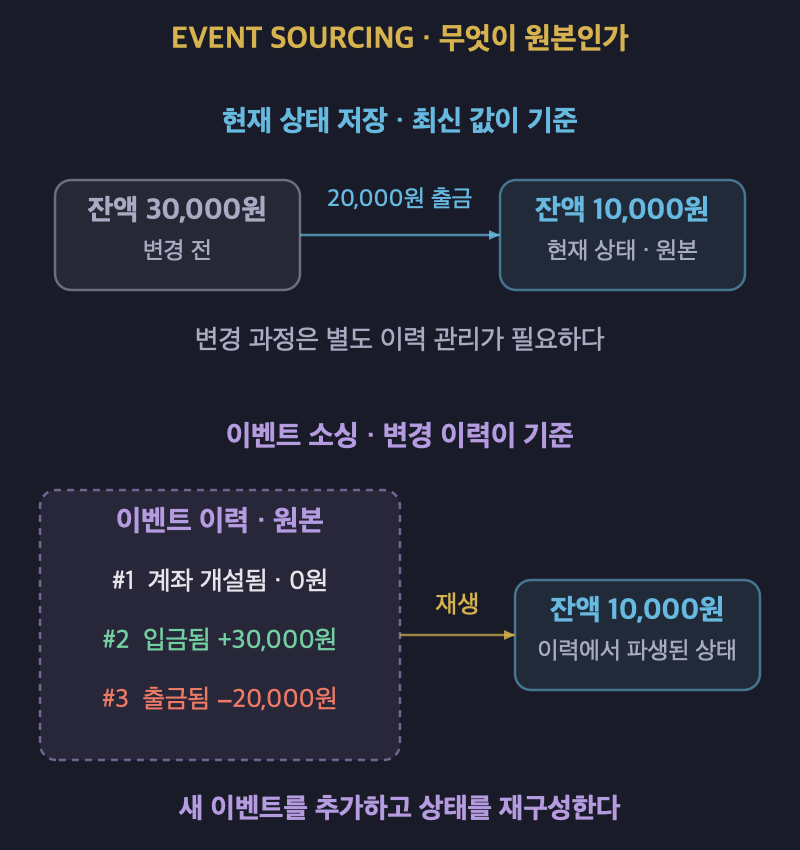
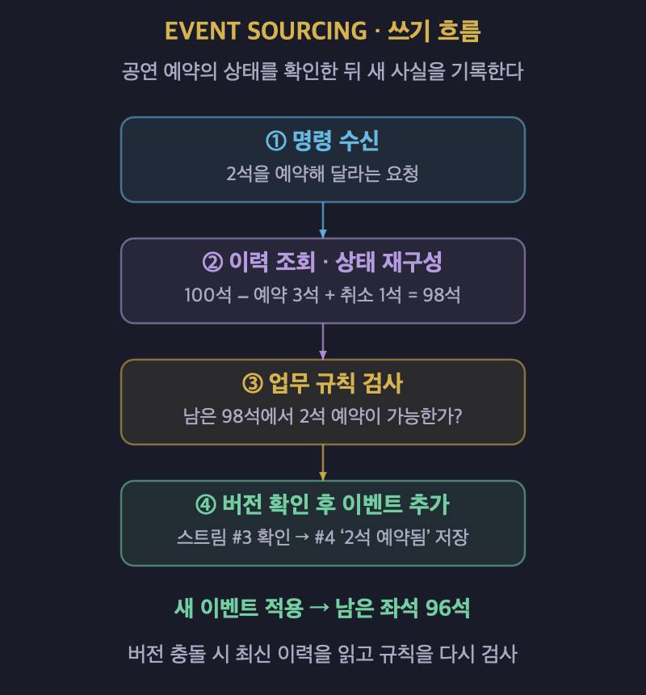
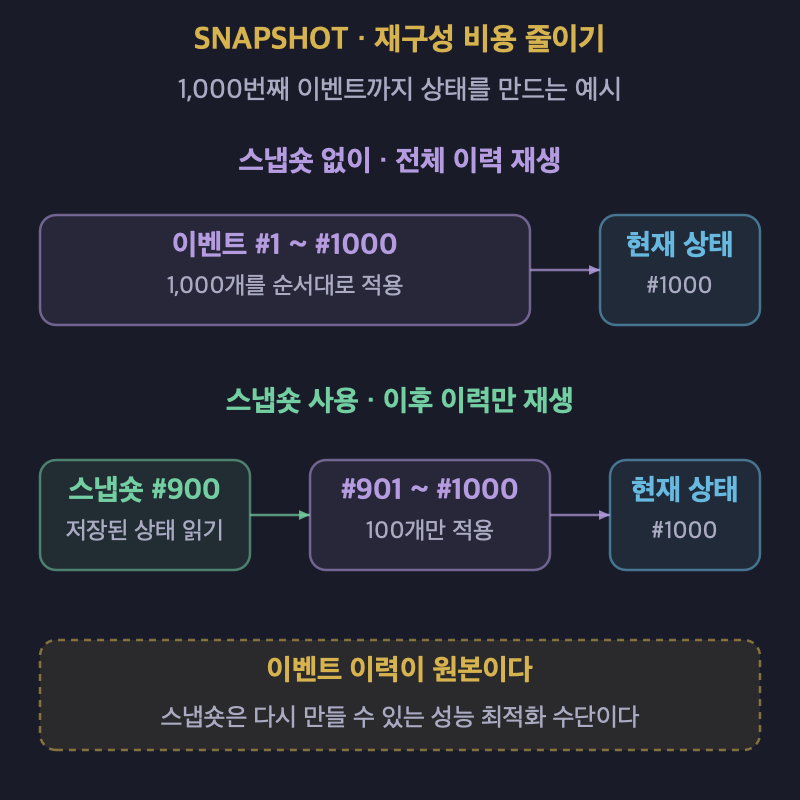
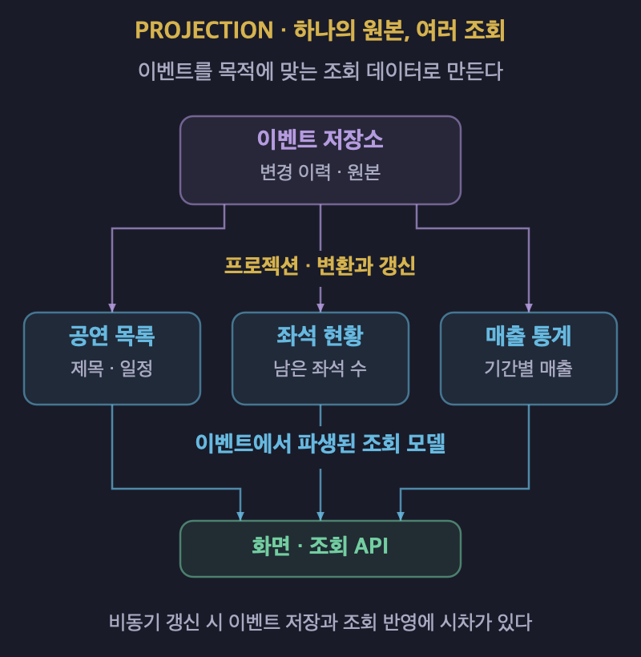

# 이벤트 소싱: 변경 기록을 원본으로 저장하는 이유

## 1. 이벤트 소싱의 개념

- **이벤트 소싱은 상태를 바꾼 이벤트의 이력을 원본으로 저장하는 패턴이다.**
- 현재 상태는 이벤트를 순서대로 적용한 결과이다.
- 이벤트는 주문 생성, 상품 추가, 예약 취소처럼 이미 일어난 일을 표현한다.
- 저장된 이벤트를 덮어쓰는 대신 새로운 이벤트를 뒤에 추가한다.
- 현재 상태를 별도로 저장하더라도 이벤트 이력이 판단의 기준이 된다.
- **핵심은 이력의 존재가 아니라 이력이 상태의 원본이라는 점이다.**

### 현재 값과 변경 이력을 구분한다

| 비교 항목 | 현재 상태를 원본으로 저장한다. | 이벤트 이력을 원본으로 저장한다. |
| :---: | :--- | :--- |
| 저장 대상 | 계좌 잔액 10,000원을 저장한다. | 입금 30,000원과 출금 20,000원을 기록한다. |
| 변경 방식 | 잔액을 새 값으로 갱신한다. | 새로운 거래 이벤트를 추가한다. |
| 현재 상태 | 저장된 잔액을 읽는다. | 거래 이벤트를 적용하거나 파생된 상태를 읽는다. |
| 변경 과정 | 별도 이력 관리가 필요하다. | 원본 이벤트에 변경 과정이 남는다. |

- 일반적인 CRUD에서도 이력 테이블과 감사 로그를 둘 수 있다.
- 변경 내역을 저장한다는 사실만으로 이벤트 소싱이 되는 것은 아니다.

## 2. 기록을 원본으로 남기는 이유

- 현재 값만으로는 어떤 과정을 거쳐 그 값이 되었는지 알기 어렵다.
- 같은 주소 변경도 이사와 오기 정정은 서로 다른 업무 사건이다.
- 이벤트에 업무 의미를 담으면 결과뿐 아니라 변경의 성격을 이해할 수 있다.
- 행위자와 사유를 추적하려면 해당 정보를 이벤트에 함께 기록해야 한다.

| 얻을 수 있는 기능 | 활용 방식 |
| :--- | :--- |
| 변경을 감사한다. | 언제 어떤 변경이 발생했는지 확인한다. |
| 과거 상태를 재현한다. | 특정 시점까지의 이벤트를 순서대로 적용한다. |
| 파생 상태를 재구성한다. | 이벤트를 다시 적용해 현재 상태나 조회 모델을 만든다. |
| 새로운 조회를 만든다. | 기존 이벤트로 새로운 화면과 통계를 구성한다. |
| 장애를 분석한다. | 문제가 발생한 이벤트 흐름을 재생한다. |

- 새로운 조회도 과거 이벤트에 필요한 정보가 있어야 만들 수 있다.
- 재현에 필요한 외부 입력과 처리 규칙을 보존해야 같은 결과를 얻을 수 있다.

## 3. 쓰기 흐름과 동시성 제어

### 이력을 읽고 규칙을 검사한 뒤 이벤트를 추가한다

- 명령은 수행하려는 요청이고, 이벤트는 수행 결과로 일어난 일을 나타낸다.
- `2석 예약`이라는 명령을 받으면 해당 공연의 이벤트 스트림을 읽는다.
- 이벤트 스트림은 하나의 대상에 대해 순서대로 기록한 이벤트의 모음이다.
- 이력을 적용해 현재 상태를 재구성한 뒤 업무 규칙을 검사한다.
- 처리할 수 있는 요청이면 새 이벤트를 원본 저장소에 추가한다.

| 단계 | 공연 예약 예시 |
| :---: | :--- |
| 1. 이력을 읽는다. | 공연 등록 100석, 예약 3석, 취소 1석을 읽는다. |
| 2. 상태를 재구성한다. | 남은 좌석을 98석으로 계산한다. |
| 3. 규칙을 검사한다. | 2석을 추가로 예약할 수 있는지 확인한다. |
| 4. 새 이벤트를 저장한다. | `2석 예약됨` 이벤트를 추가한다. |
| 5. 결과를 반영한다. | 이벤트를 적용한 상태는 남은 좌석 96석이 된다. |

### 같은 이력을 읽은 요청끼리 충돌할 수 있다

- 두 요청이 같은 시점의 좌석 수를 읽고 각각 예약을 승인할 수 있다.
- 이벤트를 추가할 때 읽었던 스트림 버전과 현재 버전을 비교한다.
- 그 사이 다른 이벤트가 추가되었다면 저장을 거부하고 충돌을 알린다.
- 명령 처리기는 최신 이력을 다시 읽고 업무 규칙을 재검사한다.
- 이를 낙관적 동시성 제어라고 한다.
- 추가만 하는 저장 방식도 동일한 대상의 동시성 제어가 필요하다.

## 4. 이벤트에 업무 의미를 담는다

- `남은 좌석이 96석으로 바뀜`보다 `2석 예약됨`이 업무 사건을 잘 표현한다.
- 결과값만 저장하면 예약, 취소, 정정 중 무엇이 발생했는지 구분하기 어렵다.
- 이벤트 유형과 데이터에는 재구성에 필요한 정보를 담는다.
- 대상 식별자, 이벤트 식별자와 순서 등을 관리한다.
- 시간 정보만으로 동시 발생한 이벤트의 적용 순서를 결정하지 않도록 한다.

### 정정할 때도 새 이벤트를 추가한다

- **기존 기록을 지우는 대신 그 효과를 바로잡는 이벤트를 추가한다.**
- `2석 예약됨`을 취소하려면 해당 예약을 식별하는 `예약 취소됨`을 추가한다.
- 원래 예약과 취소 사실이 함께 남아 변경 과정을 설명할 수 있다.
- 잘못된 이벤트가 이미 저장되었다면 코드 수정만으로 이력이 바로잡히지는 않는다.

## 5. 스냅숏으로 재구성 비용을 줄인다

- 이벤트가 많아지면 매번 처음부터 적용하는 비용이 커진다.
- 스냅숏은 특정 이벤트 순번까지 반영한 상태를 저장한 것이다.
- 재구성할 때 스냅숏을 읽고 그 뒤의 이벤트만 적용한다.

| 방식 | 1,000번째 이벤트까지 재구성하는 예시 |
| :--- | :--- |
| 스냅숏을 사용하지 않는다. | 1번부터 1,000번까지 모두 적용한다. |
| 900번째 스냅숏을 사용한다. | 저장된 상태를 읽고 901번부터 1,000번까지 적용한다. |

- **스냅숏은 성능 최적화 수단이며 이벤트 이력을 대체하는 원본이 아니다.**
- 필요한 이력이 보존되어 있으면 스냅숏을 다시 만들 수 있다.
- 생성 주기는 저장 비용과 재구성 시간을 함께 고려해 정한다.
- 업무상 가능하다면 일마감처럼 자연스러운 경계에서 스트림을 나누는 방법도 검토한다.

## 6. 프로젝션과 조회 모델

- 이벤트 스트림은 특정 대상의 변경 이력을 읽는 데 적합하다.
- 목록, 검색과 통계를 매번 전체 이벤트 재생으로 처리하면 비용이 커질 수 있다.
- 프로젝션은 이벤트를 적용해 조회 목적에 맞는 데이터를 만드는 처리이다.
- 같은 이벤트에서 공연 목록, 좌석 현황과 매출 통계를 각각 만들 수 있다.
- 프로젝션으로 만든 조회 모델은 원본 이벤트에서 파생된 데이터이다.

| 구분 | 스냅숏 | 프로젝션으로 만든 조회 모델 |
| :---: | :--- | :--- |
| 주요 목적 | 특정 대상의 상태 재구성을 빠르게 한다. | 화면과 검색 등 조회 요구에 맞춘다. |
| 저장 형태 | 특정 순번까지 적용한 상태를 저장한다. | 필요한 필드와 집계 결과를 저장한다. |
| 재처리 | 스냅숏 이후의 이벤트를 적용한다. | 이벤트를 반영하거나 전체 모델을 재구축한다. |

- 조회 모델을 비동기로 갱신하면 이벤트 저장과 조회 반영 사이에 지연이 생긴다.
- 쓰기가 성공했어도 조회 화면에 이전 상태가 보일 수 있다.
- 최종 일관성은 이런 비동기 갱신 구조에서 고려할 특성이다.
- 이벤트 소싱 자체가 모든 읽기에 지연된 일관성을 강제하는 것은 아니다.

### CQRS 및 메시지 브로커와 구분한다

- CQRS는 읽기와 쓰기 모델의 책임을 나누는 패턴이다.
- 이벤트 소싱은 어떤 데이터를 상태의 원본으로 저장할지 결정한다.
- 둘은 자주 함께 쓰이지만 서로 다른 설계 결정이다.
- CQRS는 현재 상태를 저장하는 방식으로도 구현할 수 있다.
- 이벤트 저장소는 이력 보존, 대상별 스트림 조회와 동시성 제어를 담당한다.
- 메시지 브로커는 이벤트를 프로젝션과 외부 소비자에게 전달하는 역할을 맡을 수 있다.
- **메시지를 발행하거나 Kafka를 사용한다는 사실만으로 이벤트 소싱이 되지는 않는다.**

## 7. 재생과 운영에서 만나는 문제

| 문제 | 대응 방향 |
| :--- | :--- |
| 이벤트 구조가 바뀐다. | 버전을 식별하고 이전 구조를 계속 읽을 수 있게 한다. |
| 잘못된 이벤트가 저장되었다. | 정정 이벤트와 명시적인 보정 방식을 설계한다. |
| 같은 이벤트가 중복 전달된다. | 처리 식별자와 진행 위치 등을 이용해 멱등하게 반영한다. |
| 이벤트의 적용 순서가 바뀐다. | 대상별 순서와 누락 여부를 확인한다. |
| 재생 중 결제나 알림이 다시 실행된다. | 상태 재구성과 외부 부작용의 실행을 분리한다. |

### 이전 이벤트와의 호환성을 유지한다

- 업캐스팅은 이전 이벤트 구조를 읽을 때 현재 처리 가능한 구조로 변환하는 방식이다.
- 저장된 기록을 그대로 두면서 애플리케이션의 변경을 수용할 수 있다.
- 구조 변환과 잘못된 업무 사실의 정정은 구분해야 한다.
- 이벤트를 만든 코드의 버그와 이벤트를 적용하는 코드의 버그도 구분한다.
- 이벤트가 올바르고 계산만 잘못되었다면 수정한 로직으로 파생 상태를 재구축할 수 있다.

### 재생이 외부 동작을 반복하지 않게 한다

- 상태를 재구성하려고 과거 결제와 알림을 다시 실행해서는 안 된다.
- 외부 연동을 분리하고 재생 모드에서 실제 호출을 제어한다.
- 과거 환율처럼 결과에 영향을 준 외부 값이 필요하다면 이를 보존한다.
- 현재의 외부 값으로 과거 이벤트를 처리하면 다른 결과가 나올 수 있다.

### 개인정보의 보존과 삭제를 설계한다

- 장기간 보존할 이벤트에 개인정보를 그대로 넣을지 신중히 결정한다.
- 개인정보를 별도 저장소에 두고 이벤트에는 참조 식별자를 남길 수 있다.
- 암호화한 데이터를 저장하고 관련 키를 폐기하는 방식도 검토할 수 있다.
- 키 관리와 복제본, 백업까지 포함해 삭제의 범위를 설계해야 한다.
- 개인정보나 키를 삭제하면 과거 상태를 완전히 재현하지 못할 수 있다.
- 이력의 보존 범위와 데이터 삭제 요구를 함께 검토한다.

## 8. 이력 테이블과 감사 로그와의 차이

| 판단 기준 | 현재 상태와 별도 이력·감사 로그 | 이벤트 소싱 |
| :--- | :--- | :--- |
| 무엇을 원본으로 삼는가? | 현재 상태를 원본으로 삼는다. | 이벤트 이력을 원본으로 삼는다. |
| 기록의 역할은 무엇인가? | 변경 내역을 확인하는 보조 기록이다. | 상태를 만들어 내는 근거이다. |
| 상태를 다시 만들 수 있는가? | 이력만으로 완전한 재구성을 보장하지 않을 수 있다. | 보존된 이벤트와 적용 로직으로 재구성하도록 설계한다. |
| 서로 어긋나면 무엇을 확인하는가? | 현재 상태와 감사 기록의 정합성을 조사한다. | 이벤트를 기준으로 파생 상태를 검증한다. |

- 감사 로그도 상태 변경과 같은 트랜잭션에서 빠짐없이 기록할 수 있다.
- 이력이 누락되지 않는다는 조건만으로 두 방식을 구분하지 않는다.
- **이력이 단순한 증거인지, 상태를 만드는 권위 있는 원본인지가 핵심이다.**

## 9. 장점과 트레이드오프

### 장점

- 변경 결과뿐 아니라 업무 사건의 흐름을 보존할 수 있다.
- 특정 시점의 상태 재현과 원인 분석에 활용할 수 있다.
- 기존 이벤트로 조회 모델을 다시 만들거나 새로 추가할 수 있다.
- 취소와 정정을 포함한 변경 과정을 추적할 수 있다.

### 비용과 한계

- 이벤트 구조와 이전 버전의 호환성을 장기간 유지해야 한다.
- 스냅숏, 프로젝션과 재처리 절차를 운영해야 할 수 있다.
- 비동기 조회 모델의 지연과 중복 처리를 다뤄야 한다.
- 데이터의 보정과 개인정보 삭제가 복잡해질 수 있다.
- 도입뿐 아니라 현재 상태 중심 구조로 되돌리는 데도 비용이 든다.
- 추가 저장 방식만으로 성능 향상이나 충돌 제거가 보장되지는 않는다.

## 10. 적용할 영역을 고르는 기준

| 검토할 상황 | 업무 예시 |
| :--- | :--- |
| 변동 이력 자체가 핵심 업무이다. | 원장, 포인트와 재고 수불을 관리한다. |
| 변경 사유와 정정 과정을 보존해야 한다. | 계약 변경과 거래 취소를 처리한다. |
| 과거 기준일의 상태를 재현해야 한다. | 분쟁 대응과 장애 원인 분석을 수행한다. |
| 같은 기록으로 조회와 통계를 다시 만든다. | 새로운 집계 기준과 화면 요구에 대응한다. |

- 단순 CRUD나 변경이 적은 참조 데이터에는 일반적인 저장 방식이 더 단순할 수 있다.
- 이력 확인만 필요하다면 이력 테이블과 감사 로그로 충분한지 먼저 판단한다.
- 비동기 조회를 사용할 계획이라면 반영 지연을 업무가 허용하는지 확인한다.
- 팀이 이벤트 설계와 재처리 운영 비용을 감당할 수 있는지 확인한다.
- 시스템 전체가 아니라 이력이 원본이어야 하는 영역에 적용한다.
- **도입 기준은 이력이 필요한지가 아니라 이력이 원본이어야 하는지이다.**

## 11. 레퍼런스

- [Martin Fowler — Event Sourcing](https://martinfowler.com/eaaDev/EventSourcing.html): 이벤트 기반 상태 변경, 재구성, 과거 시점 조회와 외부 연동 문제를 설명한다.
- [Microsoft — Event Sourcing pattern](https://learn.microsoft.com/en-us/azure/architecture/patterns/event-sourcing): 쓰기 흐름, 동시성 제어, 스냅숏과 프로젝션, 운영상 고려사항을 설명한다.
