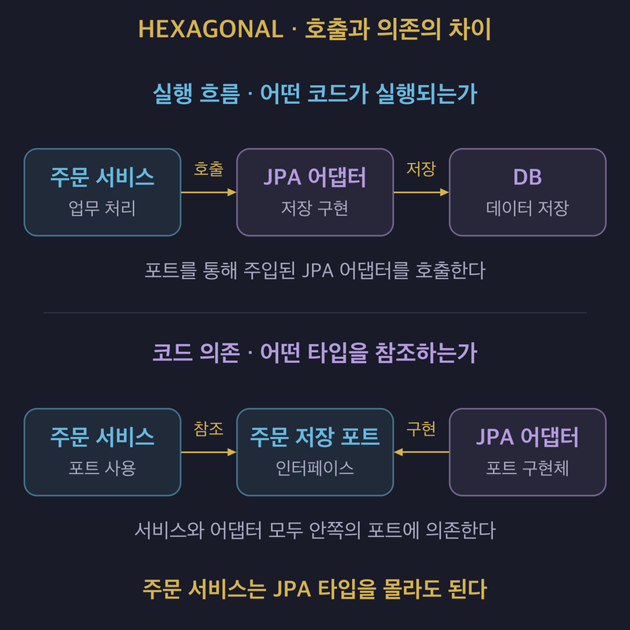

# 헥사고날 아키텍처: 포트와 어댑터로 업무 로직을 기술에서 떼어 내기

## 1. 헥사고날 아키텍처의 개념

- **헥사고날 아키텍처는 포트와 어댑터로 핵심 업무 로직을 외부 기술과 분리하는 패턴이다.**
- Alistair Cockburn이 2005년에 소개했으며 Ports and Adapters라고도 부른다.
- 웹 화면, 배치, 다른 프로그램과 테스트 코드가 같은 업무 로직을 호출할 수 있게 한다.
- 실제 DB나 외부 시스템 없이도 업무 로직을 개발하고 테스트하는 것이 주요 목적이다.
- 안쪽에는 업무 규칙을 두고, 바깥에는 입력과 출력을 처리하는 기술별 코드를 둔다.
- **핵심은 육각형 모양이 아니라 안과 밖의 경계와 코드 의존 방향이다.**

### 육각형의 여섯 면에는 특별한 의미가 없다

- 여러 포트와 어댑터를 자유롭게 배치하기 위해 육각형으로 표현한다.
- 포트가 여섯 개여야 하거나 모듈을 여섯 개로 나눠야 하는 것은 아니다.
- 같은 구조를 계층으로 그릴 수도 있다.
- 그림의 모양보다 업무 코드가 외부 기술을 직접 알고 있는지 확인한다.

## 2. 업무 로직에 기술이 섞이면 생기는 문제

- 주문 서비스가 JPA 저장소, HTTP 결제 클라이언트와 Kafka 발행 코드를 직접 사용할 수 있다.
- 이때 최소 주문 금액 같은 업무 규칙도 기술 처리와 같은 메서드에 섞이기 쉽다.
- 규칙 하나를 검증하려고 DB를 준비하거나 여러 기술 객체를 Mock으로 대체해야 한다.
- 결제사나 메시지 처리 방식이 바뀌면 주문 규칙이 있는 코드까지 수정하게 된다.

| 문제 | 기술과 업무 로직이 섞였을 때의 영향 |
| :--- | :--- |
| 테스트가 번거롭다. | 업무 규칙을 확인하는 데도 JPA, HTTP와 Kafka 의존성을 다뤄야 한다. |
| 기술 변경의 영향이 커진다. | 외부 연동 구현을 바꾸면서 업무 코드도 함께 수정한다. |
| 같은 규칙을 재사용하기 어렵다. | 웹, 배치와 메시지 처리 코드에 규칙이 분산될 수 있다. |

- 계층을 나누더라도 업무 로직이 화면이나 저장 코드에 섞이면 같은 문제가 생긴다.
- 패키지 이름뿐 아니라 실제 의존 관계와 업무 규칙의 위치를 관리해야 한다.

## 3. 포트와 어댑터의 역할

- 포트는 애플리케이션이 외부와 주고받는 기능과 규약을 정의한다.
- 주문 접수, 주문 저장과 결제 요청처럼 업무 목적을 기준으로 구분한다.
- 어댑터는 그 규약을 특정 기술과 연결하는 코드이다.

| 구분 | 책임 | 주문 처리 예시 |
| :---: | :--- | :--- |
| 포트 | 외부와 어떤 기능과 데이터를 주고받을지 정한다. | 주문을 저장하는 기능을 정의한다. |
| 어댑터 | 포트의 규약을 기술별 호출과 데이터 형식으로 연결한다. | JPA로 주문을 저장하거나 테스트용 메모리에 보관한다. |

- **포트는 통신 규약이며 언어의 인터페이스 문법과 같은 뜻은 아니다.**
- Java 인터페이스는 포트를 코드로 표현하는 대표적인 방법이다.
- 하나의 포트에 여러 어댑터를 연결할 수 있다.
- 같은 주문 저장 포트를 운영에서는 JPA 어댑터로, 테스트에서는 메모리 어댑터로 구현할 수 있다.

## 4. Driving과 Driven을 구분한다

- Driving과 Driven은 누가 호출을 시작하는지에 따른 구분이다.
- Primary와 Secondary, Inbound와 Outbound라는 이름도 사용한다.

| 구분 | 호출 관계 | 어댑터 예시 |
| :---: | :--- | :--- |
| Driving / Primary / Inbound | 외부에서 애플리케이션을 호출한다. | 웹 컨트롤러, 배치, Kafka 리스너와 테스트 코드이다. |
| Driven / Secondary / Outbound | 애플리케이션이 외부 기능을 호출한다. | JPA 저장 어댑터, 결제 어댑터와 Kafka 발행 어댑터이다. |

- 웹 컨트롤러는 HTTP 요청을 애플리케이션이 이해하는 호출로 변환한다.
- 결제 어댑터는 애플리케이션의 결제 요청을 결제사의 API 호출로 변환한다.
- Kafka도 메시지를 받는 리스너와 메시지를 보내는 어댑터의 역할이 다르다.
- 기술 이름만으로 Driving과 Driven을 구분하지 않는다.

## 5. 의존성 역전으로 기술을 분리한다

- 업무 로직이 필요한 저장 기능을 안쪽의 포트로 정의한다.
- 업무 서비스는 구체적인 JPA 구현 대신 이 포트에 의존한다.
- 바깥의 JPA 어댑터가 안쪽의 포트를 구현한다.
- 실행할 때는 사용할 어댑터를 업무 서비스에 주입한다.

- 실행 흐름의 화살표는 호출 방향이고, 코드 의존 방향의 화살표는 타입을 참조하거나 구현하는 방향이다.
- 파란색은 애플리케이션 안쪽의 업무 서비스와 포트, 보라색은 바깥의 어댑터와 DB이다.
- 주문 서비스는 주문 저장 포트 타입을 참조하고, 실행할 때 주입된 JPA 어댑터의 저장 기능을 호출한다.
- JPA 어댑터가 이 포트를 구현하므로 주문 서비스는 구체적인 어댑터 타입을 몰라도 된다.
- **실행 중 호출이 바깥으로 향하더라도 코드 의존은 안쪽의 포트를 향하게 할 수 있다.**

| 구성 요소 | 의존성 역전 전 | 의존성 역전 후 |
| :--- | :--- | :--- |
| 주문 서비스 | JPA 저장소를 직접 사용한다. | 주문 저장 포트를 사용한다. |
| 저장 구현 | 업무 코드가 알아야 하는 기술이다. | 업무 코드가 정의한 포트를 구현한다. |
| 테스트 구성 | JPA 의존성을 준비하거나 대체한다. | 같은 포트의 메모리 어댑터를 주입한다. |

## 6. 같은 업무 로직을 테스트하고 재사용한다

### 외부 시스템 없이 업무 규칙을 검증한다

- 주문 서비스에 테스트용 저장 어댑터를 주입한다.
- 테스트 코드에서 주문 기능을 호출하고 최소 주문 금액 같은 규칙을 확인한다.
- DB 연결이나 결제사 HTTP 호출 없이 업무 규칙의 결과를 검증할 수 있다.
- 기술별 동작을 흉내 내는 코드와 업무 규칙을 검증하는 코드를 분리하기 쉬워진다.

### 여러 진입점에서 같은 기능을 호출한다

- 웹 API, 배치와 메시지 리스너가 같은 주문 접수 기능을 호출한다.
- 각 진입점은 입력 형식을 변환하고 업무 판단은 애플리케이션에 맡긴다.
- 주문 규칙이 바뀌면 공유하는 업무 로직에서 수정한다.
- 진입점이 늘어날 때마다 같은 규칙을 다시 구현하는 일을 줄일 수 있다.

## 7. 모듈 구성은 구현 사례에 따라 달라진다

- 우아한형제들은 기술 선택과 변경에 드는 비용을 줄이기 위해 헥사고날 구조를 적용했다.
- 해당 사례는 Domain, Application, Framework와 Bootstrap으로 역할을 나눈다.

| 구성 | 책임 |
| :--- | :--- |
| Domain | 프레임워크와 인프라에 의존하지 않는 엔티티, 값 객체와 업무 규칙을 둔다. |
| Application | 유스케이스와 나가는 포트를 정의한다. |
| Framework | 나가는 포트를 구현하는 Driven 어댑터를 둔다. |
| Bootstrap | REST API, Kafka와 SQS 등의 Driving 진입점을 두고 실행에 필요한 구성을 조합한다. |

- 이 구분은 한 팀의 구현 사례이며 헥사고날 아키텍처의 표준 모듈 구조는 아니다.
- 모듈 이름이나 개수를 복제하기보다 업무 로직과 기술 구현의 경계를 확인한다.

## 8. 장점과 트레이드오프

### 장점

- DB나 외부 시스템 없이 핵심 업무 로직을 테스트하기 쉽다.
- 기술 변경이 업무 규칙에 미치는 영향을 줄일 수 있다.
- 웹, 배치와 메시지 등 여러 진입점에서 같은 기능을 재사용할 수 있다.
- 포트의 규약을 유지하면서 기술별 어댑터를 교체할 수 있다.

### 비용과 한계

- 요청 DTO, 도메인 객체와 JPA 엔티티 사이의 변환 코드가 필요할 수 있다.
- 포트를 인터페이스로 표현하면 관리해야 할 인터페이스가 늘어난다.
- 기능 하나를 바꾸는 데 도메인, 포트, 어댑터와 매핑을 함께 수정할 수 있다.
- 개발자가 구조와 의존 관계를 익히는 데 시간이 든다.
- 기술을 교체할 때 새 어댑터를 구현하고 검증하는 비용은 남는다.
- **얻는 것은 변경 영향의 격리이며 변경 비용 자체가 없어지는 것은 아니다.**

## 9. 도입한 팀과 제거한 팀의 차이

| 비교 항목 | 카카오뱅크 메시지 허브 | 카카오페이 홈 서버 |
| :--- | :--- | :--- |
| 주요 업무 | 여러 채널로 고객 알림을 발송한다. | 여러 서비스의 정보를 모아 홈 화면에 제공한다. |
| 핵심 로직 | 네 개의 서비스가 하나의 도메인을 이루며 공유할 로직이 있었다. | 외부 정보를 조합하는 비중이 높고 고유한 도메인 로직이 뚜렷하지 않았다. |
| 외부 연결 | DB, 메시지 큐와 발송 시스템을 사용했다. | 2023년 개편 기준 연동 서버 23개와 나가는 포트 40개 이상을 다뤘다. |
| 선택과 결과 | 코어와 어댑터를 공유하면서 서비스별로 필요한 구성을 조합했다. | 헥사고날 구조를 제거해 코드 8,000줄 이상을 줄였다. |

- 카카오뱅크는 공통 로직을 재사용하면서 서비스마다 필요한 인프라만 연결했다.
- 카카오페이는 연동 API의 공통 규약이 이미 외부 변경을 줄이고 있어 추가 구조의 효과가 작았다.
- 강의는 두 사례의 차이를 보호하고 재사용할 핵심 로직의 유무와 경계 유지 비용으로 설명한다.
- 도입 여부만으로 판단하지 않고 각 서비스에서 얻은 이점과 부담을 함께 살펴본다.

## 10. 적용할 영역을 고르는 기준

### 적용을 검토할 상황

- 업무 규칙이 복잡하고 오래 유지된다.
- 같은 업무 로직을 웹, 배치와 메시지 등 여러 진입점에서 사용한다.
- DB나 외부 연동 기술의 변경으로부터 업무 코드를 보호해야 한다.
- 외부 시스템 없이 핵심 기능을 개발하고 테스트할 필요가 크다.

### 다른 방법을 먼저 검토할 상황

- 단순 CRUD가 대부분이고 업무 규칙이 적다.
- 외부 데이터를 모아 보여주는 것이 주된 책임이다.
- 서비스 수명이 짧거나 팀이 인터페이스와 매핑 비용을 감당하기 어렵다.
- 별도로 보호할 핵심 로직보다 경계를 유지하는 코드가 더 많아진다.

### 한 팀의 경험을 보편적인 조건으로 적용하지 않는다

- 카카오페이는 도메인 모델을 명확히 정의할 수 있는 서비스를 조건으로 제시했다.
- 외부 의존성이 많지 않고 코어를 사용하는 모듈이 두 개 이상인 서비스도 제시했다.
- 이 조건은 해당 팀의 도입과 제거 경험에서 나온 기준이다.
- 외부 연동의 개수만으로 적합성을 판단하지 않고 포트가 보호할 업무 의미를 확인한다.
- **보호하고 재사용할 핵심 로직이 있고, 경계를 유지하는 비용만큼 가치가 있을 때 적용한다.**

## 11. 레퍼런스

- [Alistair Cockburn — Hexagonal Architecture](https://alistair.cockburn.us/hexagonal-architecture): 포트와 어댑터의 원래 의도, 안과 밖의 경계와 Driving·Driven 구분을 설명한다.
- [우아한형제들 — Spring Boot Kotlin Multi Module로 구성해보는 헥사고날 아키텍처](https://techblog.woowahan.com/12720/): Domain, Application, Framework와 Bootstrap으로 나눈 구현 사례를 설명한다.
- [카카오뱅크 — 유일한 멀티모듈 헥사고날 아키텍처: 메시지 허브 적용기](https://tech.kakaobank.com/posts/2311-hexagonal-architecture-in-messaging-hub/): 코어와 어댑터를 공유하고 서비스별 구성을 조합한 사례를 설명한다.
- [카카오페이 — Hexagonal Architecture, 진짜 하실 건가요?](https://tech.kakaopay.com/post/home-hexagonal-architecture/): 홈 서버에서 구조를 제거한 이유와 적용 조건을 설명한다.
