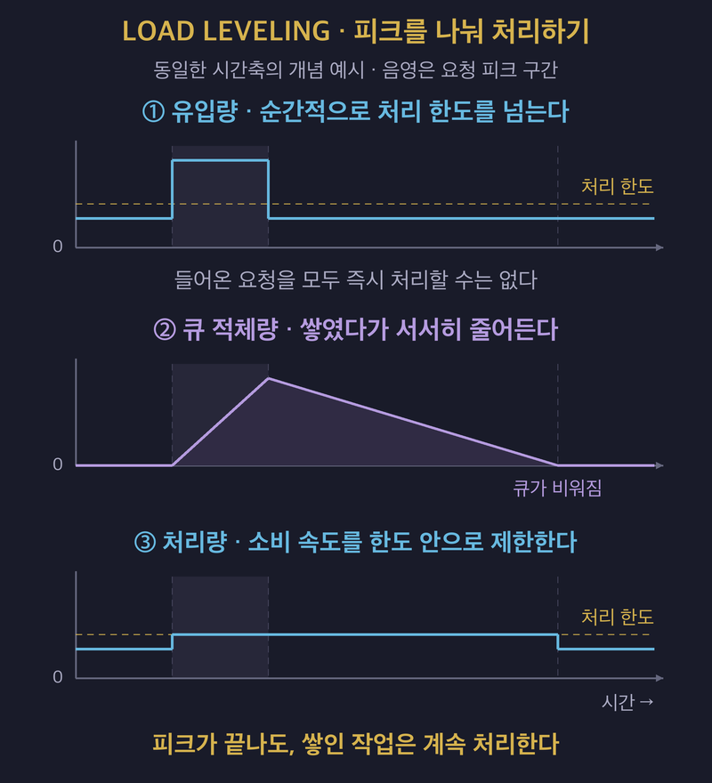

# Load Leveling: 폭주하는 요청을 큐로 완충하는 방법

## 1. Queue-Based Load Leveling의 개념

- **Queue-Based Load Leveling은 생산자와 처리 서비스 사이에 큐를 두어 일시적으로 몰리는 요청을 완충하는 패턴이다.**
- 생산자는 처리할 작업을 메시지로 큐에 넣고, 소비자는 감당할 수 있는 속도로 가져와 처리한다.
- 요청을 받는 속도와 실제 작업을 처리하는 속도를 분리한다.
- 피크에는 처리하지 못한 작업이 큐에 쌓이고, 유입이 줄면 소비자가 남은 작업을 처리한다.
- 생산자와 소비자는 비동기로 동작한다.
- **큐는 처리할 일을 없애지 않으며, 당장 처리하지 못한 일을 나중에 처리하도록 보관한다.**

## 2. 앱 서버를 늘리는 것만으로 해결되지 않는 이유

- 요청이 몰리면 여러 앱 인스턴스가 같은 DB나 외부 서비스를 동시에 호출한다.
- 앱 서버를 늘려도 DB, 레거시와 외부 연동의 처리 능력은 그대로일 수 있다.
- 동시 요청이 자원을 두고 경합하면 처리 시간이 늘고, 호출한 쪽에서 타임아웃이 발생한다.
- 과부하가 계속되면 뒤쪽 서비스가 실패할 수 있다.
- 피크에 맞춰 용량을 항상 확보하면 요청이 적은 시간에도 사용하지 않는 자원의 비용을 낸다.

| 비교 항목 | 요청을 즉시 처리한다. | 큐로 완충한다. |
| :---: | :--- | :--- |
| 피크의 영향 | 몰린 요청이 처리 서비스에 바로 전달된다. | 처리하지 못한 작업을 큐에 보관한다. |
| 처리 속도 | 유입 속도에 따라 동시 처리 요구가 커진다. | 뒤쪽 서비스의 처리 능력에 맞춰 조절한다. |
| 용량 계획 | 피크를 즉시 처리할 용량이 필요하다. | 허용 대기 시간 안에 누적 작업을 처리할 용량이 필요하다. |
| 사용자 응답 | 처리 결과를 기다린다. | 접수 응답을 먼저 받고 결과는 나중에 확인한다. |

- 소비자가 잠시 멈춰도 큐가 정상적으로 메시지를 받아 주는 동안은 접수를 계속할 수 있다.
- 큐의 용량과 보관 기간이 한정되어 있으므로 이 분리가 무제한으로 유지되지는 않는다.

## 3. Rate Limiting과 접속 대기열의 차이

| 구분 | 제어 대상 | 한도를 넘거나 몰린 요청의 처리 | 사용자 경험 |
| :--- | :--- | :--- | :--- |
| Rate Limiting | 일정 시간 동안 허용할 요청 수를 제한한다. | 초과 요청을 거절할 수 있다. | HTTP 429 등의 응답을 받는다. |
| Queue-Based Load Leveling | 접수한 작업의 처리 속도를 조절한다. | 작업을 큐에 저장하고 나중에 처리한다. | 접수 응답을 먼저 받고 완료를 기다린다. |
| 접속 대기열 | 시스템에 들어오는 사용자나 요청을 제한한다. | 입장 순서가 올 때까지 입구에서 대기시킨다. | 티켓팅처럼 대기 순번을 확인한다. |

- 접속 대기열은 시스템에 들어오는 속도를 제어한다.
- Load Leveling은 이미 접수한 일을 처리하는 속도를 제어한다.
- Throttling은 과부하 상황에서 자원 사용을 제한하는 더 넓은 설계 문제이다.
- Microsoft는 요청 거절, 기능 축소와 큐를 통한 부하 평준화를 그 전략으로 소개한다.
- 유입이 계속 처리량을 넘는다면 큐와 함께 입구의 요청 제한도 사용할 수 있다.

## 4. 접수와 처리 완료를 나눈다

| 단계 | 요청 흐름 |
| :---: | :--- |
| 1. 요청한다. | 사용자가 API에 작업을 요청한다. |
| 2. 큐에 넣는다. | API가 처리에 필요한 데이터를 메시지로 저장한다. |
| 3. 접수를 알린다. | API가 접수 ID와 함께 HTTP 202 Accepted 등의 응답을 반환한다. |
| 4. 작업을 가져온다. | 소비자가 처리 가능한 속도로 메시지를 가져온다. |
| 5. 처리한다. | 소비자가 작업을 실행하고 결과와 처리 상태를 갱신한다. |
| 6. 결과를 확인한다. | 사용자가 접수 ID로 처리 중, 완료와 실패 등의 상태를 조회한다. |

- **접수 응답은 작업이 완료되었다는 뜻이 아니다.**
- API는 메시지 저장 성공을 확인한 뒤 접수 성공을 응답해야 한다.
- 요청용 큐만으로는 처리 결과를 호출자에게 돌려줄 수 없다.
- 상태 조회 API, 알림이나 응답용 큐 등 결과 전달 경로를 별도로 마련한다.
- 결과가 어느 요청에 대한 것인지 접수 ID 등으로 연결한다.
- 비동기 처리에 맞춰 API뿐 아니라 화면의 대기와 실패 처리도 설계한다.

## 5. Competing Consumers로 작업을 나눠 처리한다

- Competing Consumers는 여러 소비자가 같은 큐의 작업을 나눠 처리하는 패턴이다.
- 각 메시지를 소비자 중 하나에 배정해 여러 작업을 병렬로 처리한다.
- 한 소비자가 오래 걸리는 작업을 처리하는 동안 다른 소비자는 별도 작업을 수행할 수 있다.
- 소비자가 실패하면 메시지의 재전달 방식에 따라 다른 소비자가 작업을 이어받을 수 있다.

| 비교 항목 | Competing Consumers | Publish-Subscribe |
| :---: | :--- | :--- |
| 목적 | 같은 종류의 작업을 여러 소비자가 나눠 맡는다. | 같은 사건에 여러 구독자가 각각 반응한다. |
| 메시지 전달 | 소비자 풀 안에서 처리할 소비자 하나에 배정한다. | 해당 메시지를 구독하는 각 구독자에게 전달한다. |
| 주문 예시 | 여러 주문 처리 인스턴스가 주문을 나눠 처리한다. | 주문 완료를 알림, 포인트와 통계 시스템이 각각 처리한다. |

- 메시지를 하나의 소비자에게 배정한다는 것과 정확히 한 번만 처리한다는 것은 다르다.
- 실패와 재전달 때문에 같은 작업이 다시 실행될 수 있으므로 중복 처리에 대비한다.
- 작업이 서로 독립적일수록 병렬 처리하기 쉽다.

## 6. Kafka에서는 컨슈머 그룹으로 작업을 나눈다

- Kafka의 컨슈머 그룹 안에서는 파티션을 나눠 맡아 레코드를 처리한다.
- 같은 그룹의 소비자들은 경쟁 소비자처럼 작업을 분담한다.
- 서로 다른 그룹은 각자의 읽기 위치를 관리하며 같은 토픽을 독립적으로 소비한다.
- 주문 처리와 알림을 다른 그룹으로 구성하면 같은 주문 메시지를 각각 읽을 수 있다.

| 구성 예시 | 파티션 할당 |
| :--- | :--- |
| `orders` 토픽에 파티션이 네 개 있다. | 파티션 0, 1, 2, 3에 레코드가 저장된다. |
| 주문 처리 그룹 A에 소비자가 두 개 있다. | A1이 0·1을, A2가 2·3을 맡을 수 있다. |
| 알림 그룹 B에 소비자가 한 개 있다. | B1이 0~3을 모두 맡을 수 있다. |

- 일반적인 컨슈머 그룹 구독에서는 파티션 하나를 그룹 안의 소비자 하나에 배정한다.
- 따라서 구독한 파티션 수보다 소비자를 늘려도 추가 소비자에게 할당할 파티션이 없을 수 있다.
- 소비자가 실패하거나 그룹 구성이 바뀌면 파티션을 재할당한다.
- **Kafka의 순서 보장 범위는 토픽 전체가 아니라 파티션 내부이다.**
- 주문번호처럼 순서가 필요한 단위를 키로 사용해 같은 파티션에 배치한다.
- 소비자가 읽은 뒤 병렬로 처리한다면 같은 파티션 안에서도 완료 순서가 바뀌지 않도록 관리해야 한다.

## 7. 소비자 수의 상한은 뒤쪽 처리 능력으로 정한다

- 큐가 길어졌다고 소비자를 계속 늘리면 DB와 외부 서비스에 요청이 다시 몰린다.
- 큐를 빨리 비우는 것만으로 뒤쪽 서비스의 과부하가 해결되지는 않는다.
- 경쟁 소비자는 병렬 처리량을 늘리는 수단이고, Load Leveling은 안전한 처리 속도를 유지하는 설계이다.
- 두 패턴을 함께 사용할 때는 소비자 전체가 만드는 부하를 제한해야 한다.

| 제어 항목 | 확인할 사항 |
| :--- | :--- |
| 최대 소비자 인스턴스 수 | 확장한 모든 소비자가 뒤쪽 서비스에 만드는 부하를 감당할 수 있는가? |
| 소비자별 동시 처리 수 | 인스턴스 하나가 동시에 실행하는 작업은 몇 개인가? |
| 외부 호출 속도 | DB, 레거시와 외부 API의 처리 한도를 지키는가? |
| 부하 테스트 | 피크에도 큐 이후의 서비스가 안정적으로 처리하는가? |

- 인스턴스 수와 인스턴스별 동시 처리 수를 함께 정한다.
- 외부 API에 초당 호출 한도가 있다면 동시 처리 수와 별도로 호출 속도도 제어한다.
- **소비자 확장은 큐 길이뿐 아니라 뒤쪽 서비스가 감당할 수 있는 범위 안에서 수행한다.**

## 8. 큐의 길이와 대기 시간을 함께 본다

- 같은 1만 건이 쌓여 있어도 처리 속도에 따라 사용자가 기다리는 시간은 달라진다.
- 큐 길이만으로 처리 지연을 판단하지 않는다.
- 유입량, 완료 처리량과 오래된 메시지의 대기 시간을 함께 확인한다.

| 관측 항목 | 확인하려는 내용 |
| :--- | :--- |
| 큐에 쌓인 메시지 수 | 미처리 작업이 얼마나 남아 있는가? |
| 유입량과 처리량 | 작업이 계속 쌓이는가, 줄어드는가? |
| 메시지 대기 시간 | 접수한 작업이 허용 시간 안에 처리되는가? |
| 큐 용량과 보관 기간 | 처리 전에 저장 한도에 도달하거나 메시지가 만료될 수 있는가? |

- 일시적인 피크가 끝나고 유입량이 처리량보다 작아지면 누적된 작업을 줄일 수 있다.
- 평균 유입량이 처리량을 계속 넘으면 큐와 지연이 계속 증가한다.
- 지속 과부하에는 안전한 범위의 처리량 확대나 신규 요청 제한이 필요하다.
- 큐가 한도에 도달하면 제품과 설정에 따라 새 요청이 거절되거나 메시지가 만료·삭제될 수 있다.
- **이 패턴은 일시적인 피크를 완충하며, 지속적인 처리 능력 부족을 해결하지는 않는다.**

## 9. 중복, 순서와 실패 메시지를 처리한다

| 문제 | 발생 이유 | 대응 방향 |
| :--- | :--- | :--- |
| 중복 처리 | 최소 한 번 전달과 재시도 때문에 같은 메시지를 다시 받을 수 있다. | 멱등 소비자로 같은 작업이 다시 실행되어도 결과가 중복되지 않게 한다. |
| 순서 변경 | 여러 소비자가 병렬로 실행하면 접수 순서와 완료 순서가 달라진다. | 순서 의존을 줄이거나 같은 키의 작업을 묶어 순차 처리한다. |
| 독 메시지 | 형식 오류나 잘못된 참조 등으로 재시도해도 계속 실패한다. | 재시도 한도를 두고 DLQ로 분리해 조사한다. |
| 메시지 유실 | 저장 내구성 부족, 장애, 용량 한도와 보관 기간 만료 등이 원인이 된다. | 영속 저장과 복제, 용량 및 보관 정책을 확인한다. |

### 멱등 소비자로 중복 실행에 대비한다

- 같은 메시지를 다시 처리해도 포인트가 두 번 적립되거나 결제가 중복되지 않게 한다.
- 메시지나 업무 요청의 식별자를 기준으로 이미 처리한 작업인지 확인할 수 있다.
- 멱등성은 중복 실행에 대한 대응이며 메시지의 처리 순서를 보장하는 기능은 아니다.

### DLQ도 운영 대상이다

- DLQ는 Dead-Letter Queue의 약자로, 정상 처리하지 못한 메시지를 별도로 보관한다.
- 계속 실패하는 메시지가 무한히 재시도되어 처리 자원을 차지하지 않게 한다.
- DLQ에 쌓인 메시지 수와 실패 원인을 확인한다.
- 원인을 수정한 뒤 재처리할지 판단하고, 재처리에도 중복 방지 규칙을 적용한다.

## 10. 장점과 적용 기준

### 장점과 비용

- 일시적인 처리 지연이나 장애가 접수 단계에 바로 영향을 주는 것을 줄인다.
- 요청을 받는 쪽과 처리하는 쪽을 독립적으로 확장할 수 있다.
- 허용 대기 시간에 맞춰 처리 용량을 정하면 피크 대비 과도한 자원 확보를 줄일 수 있다.
- 대신 큐 대기 시간이 추가되고, 즉시 최종 결과를 응답하기 어렵다.
- 큐 운영, 결과 조회, 중복 방지와 실패 메시지 처리 비용이 추가된다.

### 적용을 검토할 상황

| 상황 | 적용 예시 |
| :--- | :--- |
| 주문 이후의 작업이 몰린다. | 주문 성립과 분리할 수 있는 알림, 포인트 적립과 통계를 비동기로 처리한다. |
| 대량 발송이 필요하다. | 푸시와 문자를 발송 시스템의 처리 한도에 맞춰 전송한다. |
| 작업이 오래 걸린다. | 이미지·영상 변환과 리포트 생성을 접수한 뒤 처리한다. |
| 로그 유입이 급증한다. | 로그를 큐에 보관하고 저장소의 처리 능력에 맞춰 저장한다. |
| 뒤쪽 서비스의 처리량이 제한되어 있다. | 레거시나 외부 연동 앞에 큐를 두고 호출 속도를 제한한다. |

- 비동기 주문 접수 흐름을 사용한다면 접수 성공과 주문 확정을 구분해야 한다.
- 후처리만 분리한다면 주문 성립에 필요한 검증과 처리는 해당 업무 흐름에서 완료한다.

### 다른 방법을 먼저 검토할 상황

- 호출자가 짧은 지연 안에 최종 결과를 동기 응답으로 받아야 한다.
- 부하가 낮고 일정해서 큐를 운영하는 비용에 비해 효과가 작다.
- 작업 간 의존성이 높아 독립적으로 나누기 어렵다.
- 엄격한 순차 실행이 필요하다면 경쟁 소비자를 통한 병렬화에 제약이 있다.
- **먼저 확인할 것은 나중에 처리해도 되는 업무인지와 뒤쪽이 감당할 수 있는 처리 속도이다.**

## 11. 레퍼런스

- [Microsoft — Queue-Based Load Leveling pattern](https://learn.microsoft.com/en-us/azure/architecture/patterns/queue-based-load-leveling): 큐를 통한 완충, 소비 속도 제한과 지속 과부하의 한계를 설명한다.
- [Microsoft — Competing Consumers pattern](https://learn.microsoft.com/en-us/azure/architecture/patterns/competing-consumers): 경쟁 소비자, 결과 전달과 중복·순서·실패 처리의 고려사항을 설명한다.
- [Microsoft — Throttling pattern](https://learn.microsoft.com/en-us/azure/architecture/patterns/throttling): 요청 제한, 기능 축소와 큐를 통한 부하 평준화의 관계를 설명한다.
- [Apache Kafka — KafkaConsumer](https://kafka.apache.org/43/javadoc/org/apache/kafka/clients/consumer/KafkaConsumer.html): 컨슈머 그룹의 파티션 할당, 독립적인 구독과 재할당 동작을 설명한다.
