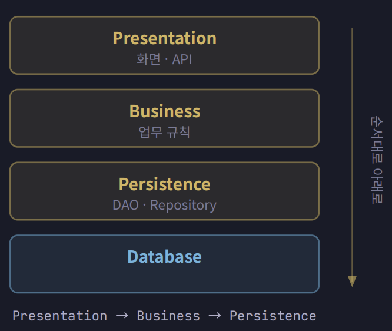
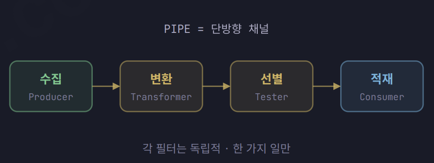
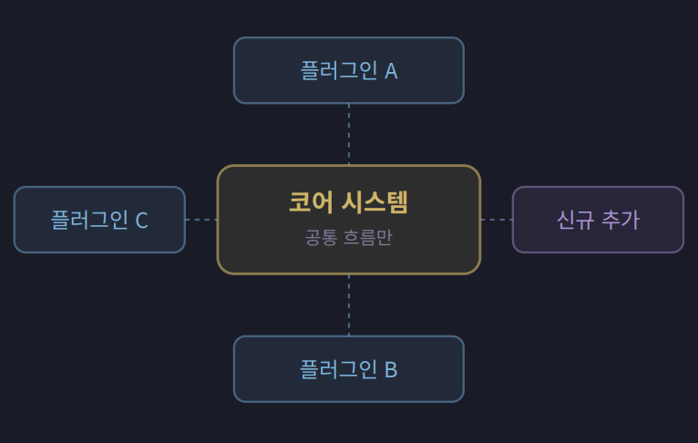
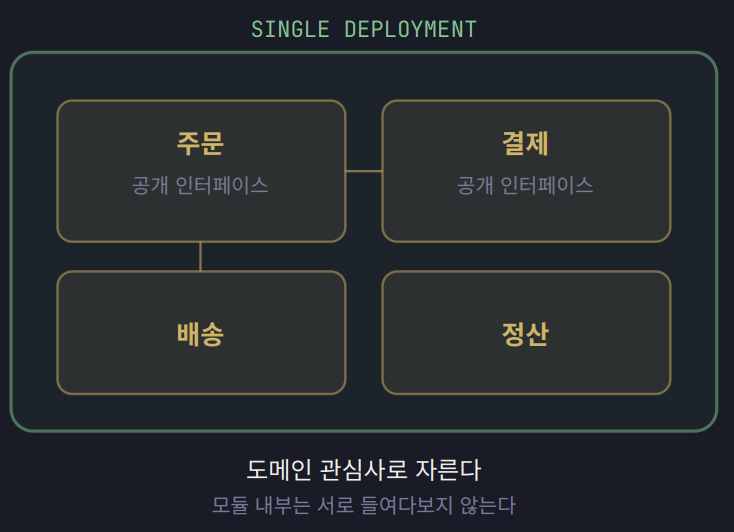

# 모놀리식 계열의 네 가지 아키텍처

## 1. 계층형 아키텍처

### 개념과 등장 배경

- **계층형 아키텍처는 시스템을 기술적 역할에 따라 여러 계층으로 나누는 구조이다.** 화면 처리, 업무 규칙, 데이터 접근 등의 관심사를 분리하고, 각 계층이 자신의 역할에 집중하도록 구성한다.

계층형 아키텍처의 원형은 1968년 다익스트라가 설계한 THE 운영체제에서 찾을 수 있다. 다익스트라는 시스템을 여러 수준으로 나누고, 각 계층이 아래 계층에서 제공하는 기능을 사용하도록 설계했다. 이를 통해 개발자가 시스템 전체의 세부 사항을 한 번에 이해해야 하는 부담을 줄였다.

이 구조의 핵심은 **하위 계층의 세부 구현을 감춰 상위 계층이 신경 써야 할 것을 줄이는 데 있다.**

### 기본 구조와 호출 규칙

일반적인 계층형 아키텍처에서는 요청이 다음과 같은 흐름으로 처리된다.

| 구분 | 역할 |
| :---: | :---: |
| Presentation | 화면과 API를 통해 들어오는 요청을 처리한다. |
| Business | 업무 규칙과 비즈니스 로직을 처리한다. |
| Persistence | DAO나 Repository를 통해 데이터에 접근한다. |
| Database | 데이터를 저장하고 관리한다. |

계층 사이의 호출 규칙에 따라 닫힌 계층과 열린 계층으로 구분한다.

- **닫힌 계층(Closed Layer)**에서는 요청이 중간 계층을 건너뛰지 않고 아래로 순서대로 전달된다.
- **열린 계층(Open Layer)**에서는 필요에 따라 일부 중간 계층을 건너뛰는 것을 허용한다.

### 장점

- 많은 개발자에게 익숙한 구조이므로 시스템을 이해하는 데 드는 비용이 낮다.
- 새로운 개발자가 프로젝트에 적응하기 쉽고, 유지보수 담당자가 바뀌어도 인수인계가 비교적 수월하다.
- 전통적인 엔터프라이즈 프레임워크와 잘 맞아 초기 설계와 개발 비용이 비교적 낮다.

### 한계

계층형 아키텍처는 기술적 역할을 기준으로 코드를 나누기 때문에 하나의 업무 기능이 여러 계층에 흩어진다. 예를 들어 주문 기능은 Controller, Service, DAO 등에 나뉘어 구현된다. 따라서 주문 기능을 변경할 때 여러 계층을 함께 수정해야 할 수 있다.

또한 일부 계층이 별다른 처리 없이 요청을 아래 계층으로 전달하기만 할 수 있다. 이러한 현상을 **싱크홀 안티패턴(Sinkhole Anti-pattern)**이라고 한다. 단순한 요청도 여러 계층을 통과하면 추가적인 처리 비용이 발생한다.

### 적합한 상황

- **규모가 작거나 중간이고 하나의 팀이 개발하는 프로젝트에 적합하다.** 이러한 환경에서는 시스템을 더 세분화해서 얻는 이점보다 구조를 나누고 관리하는 비용이 클 수 있다.
- **요구사항이 비교적 명확하고 개발 기간이 정해진 프로젝트에 적합하다.** 익숙한 구조를 활용하면 초기 설계 부담을 줄이고 일정에 맞춰 개발하기 쉽다.
- **유지보수 담당자가 자주 바뀌는 환경에 적합하다.** 구조를 이해하고 인수인계하기 쉽다는 점은 SI·공공 시스템에서 계층형 아키텍처를 선택하는 이유 중 하나이다.

계층형 아키텍처는 익숙한 구조와 낮은 초기 설계 비용이 중요한 프로젝트에서 유효한 선택이다. 다른 구조를 선택해야 할 특별한 요구가 없다면, 계층형 아키텍처는 여전히 유효한 출발점이다.

### 계층과 티어의 차이

**계층(Layer)은 코드의 논리적 구분이고, 티어(Tier)는 물리적 배포의 구분이다.**

화면 처리, 업무 규칙, 데이터 접근으로 코드를 나누는 것은 계층을 구분하는 일이다. 반면 웹서버, WAS, DB로 나누어 배포하는 것은 티어를 구분하는 일이다. 따라서 계층형 아키텍처를 적용하는 것과 3티어로 배포하는 것은 서로 다른 결정이다.

## 2. 파이프라인 아키텍처

### 개념과 등장 배경

- **파이프라인 아키텍처는 데이터를 여러 처리 단계에 순서대로 흘려보내는 구조이다.**
- 파이프와 필터를 조합하므로 Pipes and Filters라고도 부른다.
- 1973년 유닉스에 파이프가 도입되면서 자리 잡았다.
- 작은 도구를 연결해 복잡한 작업을 수행하는 방식에서 출발했다.
- **데이터를 처리하는 역할과 전달하는 역할을 분리하는 것이 핵심이다.**

### 기본 구조와 처리 흐름

- **필터(Filter)**는 입력을 받아 한 가지 작업을 수행하고 결과를 출력한다.
- 각 필터는 앞뒤에 어떤 필터가 연결되어 있는지 알 필요가 없다.
- **파이프(Pipe)**는 필터 사이에서 데이터를 전달하는 단방향 통로이다.
- 파이프는 데이터를 전달하며, 직접 가공하지 않는다.
- 처리 흐름의 예로 **수집 → 변환 → 선별 → 적재**가 있다.

| 구분 | 역할 |
| :---: | :---: |
| Producer | 처리할 데이터를 생성하거나 수집한다. |
| Transformer | 데이터를 필요한 형태로 변환한다. |
| Tester | 조건을 검사하고 데이터를 선별한다. |
| Consumer | 처리 결과를 받아 저장하거나 소비한다. |

- 필터의 입출력 조건이 맞으면 순서를 바꾸거나 중간 단계를 추가할 수 있다.
- 위 흐름은 구성 예시이며, 모든 파이프라인이 같은 단계를 거칠 필요는 없다.

### 장점

- 각 필터가 한 가지 작업에 집중하므로 역할이 명확하다.
- 데이터 처리와 전달을 분리해 각 구성 요소의 책임을 줄인다.
- 독립적인 필터를 조합해 다양한 처리 흐름을 구성할 수 있다.
- 기존 흐름에 필터를 추가해 처리 단계를 확장하기 쉽다.

### 한계

- **CRUD 중심의 요청·응답 시스템 전체에 적용하기에는 잘 맞지 않을 수 있다.**
- 화면에서 데이터를 조회하고 수정하는 흐름은 단방향 처리만으로 표현하기 어렵다.
- 시스템 전체보다 배치나 데이터 처리 영역에 부분적으로 적용하는 경우가 많다.

### 적합한 상황

- **데이터가 한 방향으로 흐르며 단계적으로 처리되는 작업에 적합하다.**
- 컴파일러처럼 여러 변환 단계를 거치는 작업에 활용한다.
- ETL 배치처럼 데이터를 추출하고 변환한 뒤 적재하는 작업에 활용한다.
- Logstash와 같은 로그 수집·처리 도구에서 활용한다.
- Kafka Streams나 Spark를 이용한 스트림 처리에도 활용한다.
- CI 파이프라인도 여러 작업 단계를 연결한다는 점에서 비슷한 발상을 따른다.

### 유닉스 파이프 예시

- `cat log | grep ERROR | sort | uniq -c`는 작은 도구를 연결한 예시이다.
- `cat log`는 로그 파일의 내용을 출력한다.
- `grep ERROR`는 `ERROR`가 포함된 줄을 선별한다.
- `sort`는 선별한 줄을 정렬한다.
- `uniq -c`는 연속된 동일한 줄을 묶고 개수를 센다.
- `|`는 앞 도구의 출력을 다음 도구의 입력으로 전달한다.

## 3. 마이크로커널 아키텍처

### 개념과 등장 배경

- **마이크로커널 아키텍처는 핵심 기능과 확장 기능을 분리하는 구조이다.**
- 공통 기능은 코어에 두고, 달라지는 기능은 플러그인으로 분리한다.
- 플러그인 아키텍처라고도 부른다.
- 1980년대 운영체제 커널의 기능을 최소화하려는 연구에서 출발했다.
- **코어를 작게 유지하고 플러그인으로 기능을 확장하는 것이 핵심이다.**

### 기본 구조와 확장 방식

- 시스템은 코어와 플러그인을 중심으로 구성한다.
- 코어에는 공통 처리 흐름과 확장 메커니즘을 둔다.
- 상품이나 요구사항에 따라 달라지는 규칙은 플러그인에 둔다.

| 구분 | 역할 |
| :---: | :---: |
| 코어 시스템 | 공통 기능을 처리하고 플러그인을 연결하는 기반을 제공한다. |
| 플러그인 | 개별 요구사항에 맞는 기능과 규칙을 구현한다. |
| 플러그인 계약 | 코어와 플러그인이 연결되는 인터페이스를 정의한다. |

- 새 기능이 기존 계약에 맞으면 플러그인을 추가해 확장한다.
- 이때 코어의 공통 처리 흐름은 수정하지 않아도 된다.

### 장점

- **공통 기능을 유지하면서 다양한 요구사항에 대응할 수 있다.**
- 변형 기능을 플러그인으로 분리해 코어의 복잡도를 줄인다.
- 코어를 수정하지 않고 새로운 기능을 추가하기 쉽다.
- 상품별 규칙이나 개별 기능의 변경 범위를 플러그인 안으로 줄일 수 있다.

### 한계

- **플러그인 계약의 설계가 확장성을 좌우한다.**
- 계약이 새로운 요구사항을 수용하지 못하면 인터페이스를 변경해야 한다.
- 인터페이스 변경은 기존 플러그인 전반의 수정으로 이어질 수 있다.
- 공통 기능과 변형 기능의 경계를 신중하게 나눠야 한다.

### 적합한 상황

- **핵심 흐름은 유지되지만 변형 기능이 계속 추가되는 도메인에 적합하다.**
- IDE에서 새로운 개발 도구를 플러그인으로 추가할 때 활용한다.
- 브라우저에서 확장 기능을 제공할 때 활용한다.
- 보험료 산출 엔진에서 상품별 계산 규칙을 분리할 때 활용한다.
- 전자결재 양식 엔진에서 양식별 기능과 규칙을 확장할 때 활용한다.

### 단순한 플러그인 사용과의 차이

- 플러그인을 사용한다는 사실만으로 마이크로커널 아키텍처가 되는 것은 아니다.
- 일부 코드에 어댑터나 전략 패턴을 적용한 것만으로도 판단할 수 없다.
- **시스템의 핵심 구조가 코어와 확장을 중심으로 설계되어 있어야 한다.**

## 4. 모듈형 모놀리스 아키텍처

### 개념과 등장 배경

- **모듈형 모놀리스는 하나로 배포하되 내부를 도메인별 모듈로 나누는 구조이다.**
- 주문, 결제, 배송, 정산처럼 업무 영역을 기준으로 코드를 묶는다.
- 모놀리스 내부를 체계적으로 나누려는 발상은 오래전부터 존재했다.
- 2010년대 마이크로서비스의 대안으로 다시 주목받았다.
- **단일 배포의 단순함을 유지하면서 모듈 사이의 경계를 지키는 것이 핵심이다.**

### 기본 구조와 모듈 간 호출

- 각 모듈은 자신의 도메인에 필요한 기능과 구현을 내부에 둔다.
- 다른 모듈과는 공개 인터페이스를 통해 협력한다.
- 다른 모듈의 내부 구현에 직접 접근하지 않는다.
- 모듈 내부에서는 필요에 따라 계층형 구조를 적용할 수 있다.

| 구분 | 역할 |
| :---: | :---: |
| 도메인 모듈 | 주문이나 결제처럼 특정 업무 영역의 기능을 담당한다. |
| 공개 인터페이스 | 다른 모듈이 사용할 수 있는 기능을 제공한다. |
| 내부 구현 | 모듈의 세부 로직을 담고 외부에 숨긴다. |
| 배포 단위 | 여러 모듈을 하나의 애플리케이션으로 묶어 배포한다. |

### 장점

- **하나의 업무 기능에 필요한 코드를 같은 모듈에 모을 수 있다.**
- 기능을 이해하거나 수정할 때 살펴볼 범위를 줄인다.
- 모듈 내부 구현을 숨겨 변경이 다른 영역에 미치는 영향을 줄인다.
- 단일 배포를 유지해 분산 시스템의 운영 부담을 줄인다.
- 서비스로 분리하기 전에 도메인 경계를 다듬을 수 있다.

### 한계

- **배포 단위는 여전히 애플리케이션 전체이다.**
- 특정 모듈만 독립적으로 배포하기 어렵다.
- 부하가 큰 모듈만 독립적으로 확장하기 어렵다.
- 경계를 강제하지 않으면 모듈 사이의 의존 관계가 복잡해질 수 있다.
- 독립 배포와 확장이 중요해지면 분산 아키텍처를 검토할 수 있다.

### 적합한 상황

- **도메인은 복잡하지만 개발 팀이 하나이거나 소수인 환경에 적합하다.**
- 마이크로서비스로 전환할 가능성은 있지만 서비스 경계가 불확실할 때 유용하다.
- 분산 환경의 모니터링과 추적 비용을 감당하기 어려울 때 적합하다.
- 여러 서비스의 배포 파이프라인을 관리하는 부담을 줄이고 싶을 때 유용하다.

### 모듈 경계를 지키는 방법

- **모듈 경계는 문서뿐 아니라 코드와 자동 검사로 강제해야 한다.**
- 모듈 시스템을 활용해 외부에서 접근할 수 있는 범위를 제한한다.
- ArchUnit과 같은 아키텍처 테스트로 금지된 의존 관계를 검사한다.
- 경계를 위반하면 빌드가 실패하도록 구성한다.

### 계층형 아키텍처와의 차이

- **계층형은 기술적 역할을 기준으로 나누고, 모듈형 모놀리스는 도메인을 기준으로 나눈다.**

| 비교 항목 | 계층형 아키텍처 | 모듈형 모놀리스 |
| :---: | :---: | :---: |
| 분할 기준 | 화면 처리, 업무 규칙, 데이터 접근으로 나눈다. | 주문, 결제, 배송 등의 업무 영역으로 나눈다. |
| 기능의 위치 | 주문 코드가 Controller, Service, DAO 계층에 흩어진다. | 주문 코드를 주문 모듈 내부에 모은다. |
| 내부 구조 | 기술적 계층을 중심으로 구성한다. | 각 모듈 내부에서 필요한 구조를 선택한다. |

- 두 구조는 함께 사용할 수 있다.
- 전체 시스템은 도메인별로 나누고, 각 모듈 내부는 계층형으로 구성할 수 있다.
