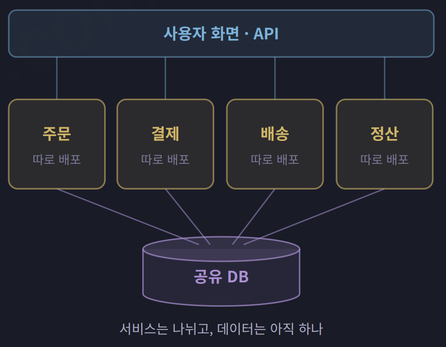
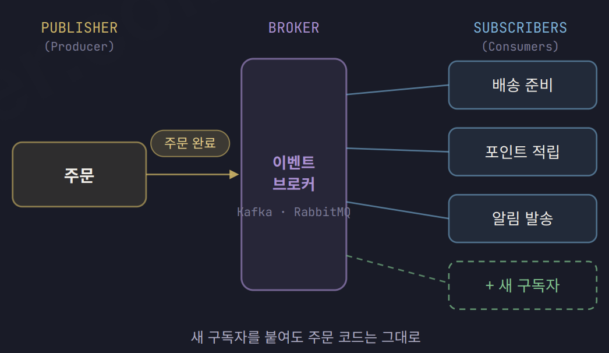
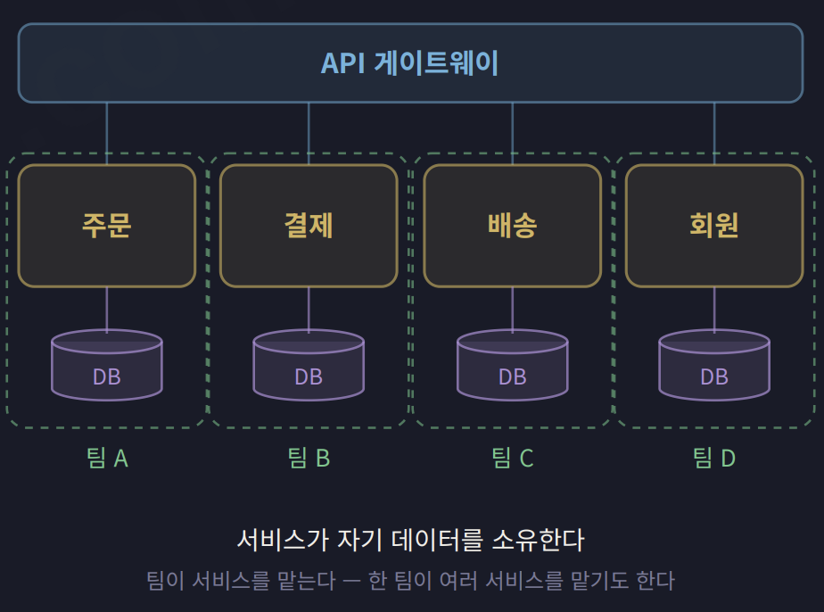

# 분산 계열 3가지와 아키텍처 선택 기준

## 1. 분산 아키텍처의 이점과 비용

### 배포 단위를 나누는 이유

- **분산 아키텍처는 시스템을 여러 배포 단위로 나누는 구조이다.**
- 변경한 서비스만 독립적으로 배포할 수 있다.
- 부하가 집중되는 서비스만 확장할 수 있다.
- 장애 전파를 막도록 설계하면 한 서비스의 장애를 격리할 수 있다.
- 서비스를 나누는 것만으로 장애 격리가 보장되지는 않는다.
- 동기 호출로 촘촘하게 연결하면 장애가 연쇄적으로 번질 수 있다.

### 네트워크 호출로 인해 생기는 비용

- **네트워크 호출은 성공과 실패뿐 아니라 결과를 알 수 없는 상태도 만든다.**
- 결제 요청이 타임아웃되어도 실제 결제는 완료되었을 수 있다.
- 시스템의 일부만 실패하는 부분 실패가 발생한다.
- 여러 서비스의 작업을 하나의 트랜잭션으로 묶기 어렵다.
- 한 요청의 로그가 여러 서비스에 흩어져 추적이 어려워진다.
- 네트워크 지연, 연결 실패, 통신 보안, 서버 주소 변경에 대비해야 한다.
- 독립 배포와 확장의 이점이 이러한 비용보다 클 때 분리를 검토한다.

## 2. 서비스 기반 아키텍처

### 개념과 등장 배경

- **서비스 기반 아키텍처는 굵직한 도메인 서비스와 공유 DB를 중심으로 구성한다.**
- 모놀리스의 배포 부담을 줄이면서 운영 복잡도를 제한하려는 선택에서 발전했다.
- 주문, 결제, 배송처럼 큰 업무 영역을 기준으로 서비스를 나눈다.
- 마이크로서비스보다 서비스 수가 적고 각 서비스의 기능 범위가 넓은 편이다.

### 기본 구조와 데이터 관리

| 구분 | 역할 |
| :---: | :---: |
| 사용자 화면·API | 필요한 도메인 서비스의 기능을 사용한다. |
| 도메인 서비스 | 업무 영역의 기능을 처리하고 독립적으로 배포한다. |
| 공유 DB | 여러 서비스가 사용하는 데이터를 함께 관리한다. |

- 기본 형태에서는 여러 서비스가 하나의 DB를 공유한다.
- 필요에 따라 DB를 분리하는 변형도 가능하다.
- 서비스의 배포 단위는 나누지만 데이터는 공유하는 구조이다.

### 장점

- 도메인별로 서비스를 따로 배포할 수 있다.
- 데이터를 분리한 구조보다 DB 조회와 트랜잭션 처리가 단순하다.
- 서비스 수가 적어 마이크로서비스보다 운영 부담이 작다.
- 기존 모놀리스에서 점진적으로 전환하기 쉽다.

### 한계

- **공유 DB가 서비스 사이의 결합 지점이 된다.**
- 테이블 변경이 여러 서비스에 영향을 줄 수 있다.
- 서비스의 범위가 넓어 내부의 특정 기능만 독립적으로 확장하기 어렵다.

### 적합한 상황

- 모놀리스의 배포 충돌이 잦지만 마이크로서비스의 운영 비용은 부담스러울 때 적합하다.
- 도메인 경계가 몇 개의 큰 업무 영역으로 명확히 나뉠 때 유용하다.
- 데이터 일관성이 중요해 DB 분리가 부담스러울 때 검토할 수 있다.
- **마이크로서비스로 가는 중간 단계뿐 아니라 최종 구조로도 선택할 수 있다.**

## 3. 이벤트 주도 아키텍처

### 개념과 등장 배경

- **이벤트 주도 아키텍처는 발생한 사건을 알리고 구독자가 반응하는 구조이다.**
- 기업용 메시징 시스템에서 발전해 이벤트 스트리밍으로 활용 범위가 넓어졌다.
- 명령(Command)은 특정 작업을 수행해 달라는 요청이다.
- 이벤트(Event)는 이미 발생한 사실을 알리는 메시지이다.
- 발행자는 어떤 구독자가 이벤트를 처리하는지 알 필요가 없다.

### 기본 구조와 처리 흐름

| 구분 | 역할 |
| :---: | :---: |
| 발행자(Publisher) | 업무 처리 결과를 이벤트로 발행한다. |
| 브로커(Broker) | 발행한 이벤트를 구독자에게 전달한다. |
| 구독자(Subscriber) | 관심 있는 이벤트를 받아 후속 작업을 처리한다. |

- 주문 서비스는 주문 처리를 마친 뒤 주문 완료 이벤트를 발행한다.
- 배송, 포인트, 알림 서비스는 이벤트를 받아 각자의 작업을 수행한다.
- 새 후속 기능은 구독자를 추가하는 방식으로 연결할 수 있다.
- 위 구조는 브로커 방식이며, 중재자가 흐름을 조정하는 방식도 있다.

### 장점

- 발행자와 구독자 사이의 결합을 낮춘다.
- 비동기 후속 처리를 기다리지 않아 사용자 응답 시간을 줄일 수 있다.
- 발행자 코드를 수정하지 않고 새로운 구독자를 추가하기 쉽다.
- 이벤트를 저장해 생산 속도와 소비 속도의 차이를 완충할 수 있다.
- 내구성 있는 브로커를 사용하면 중단된 구독자가 나중에 처리할 수 있다.

### 한계

- **전체 처리 흐름이 여러 구독자에 흩어져 추적이 어렵다.**
- 서비스 상태를 비동기로 갱신하면 최종 일관성을 받아들여야 할 수 있다.
- 최종 일관성에서는 처리 도중 서비스마다 보이는 상태가 다를 수 있다.
- 이벤트 중복 전달과 처리 순서 변경에 대비해야 한다.
- 같은 이벤트를 여러 번 처리해도 결과가 중복되지 않도록 설계해야 한다.

### 적합한 상황

- 한 사건에 반응하는 기능이 여럿이고 계속 늘어날 때 적합하다.
- 알림이나 통계처럼 사용자 응답 이후에 처리해도 되는 작업에 유용하다.
- 순간적으로 몰리는 트래픽을 쌓아두고 처리 속도를 조절할 때 적합하다.
- 다른 아키텍처와 조합해 서비스 사이의 통신 방식으로 사용할 수 있다.

## 4. 마이크로서비스 아키텍처

### 개념과 등장 배경

- **마이크로서비스는 작은 서비스의 독립 배포와 데이터 소유권 분리를 강조한다.**
- 서비스는 비즈니스 기능을 기준으로 나뉘고 각자의 프로세스에서 실행된다.
- 2011년 명칭이 논의되었고 2014년 널리 알려졌다.
- 클라우드, 컨테이너, 배포 자동화와 모니터링 도구가 확산을 뒷받침했다.

### 기본 구조와 데이터 소유권

| 구분 | 역할 |
| :---: | :---: |
| 서비스 | 담당 기능을 처리하고 독립적으로 배포·확장한다. |
| 서비스 소유 데이터 | 해당 서비스가 접근과 변경을 책임진다. |
| API·이벤트 | 다른 서비스와 기능이나 데이터를 교환한다. |
| 담당 팀 | 서비스의 개발과 운영을 책임진다. |

- **핵심은 DB 서버 수보다 데이터 소유권을 나누는 데 있다.**
- 같은 DB 서버를 사용하더라도 스키마를 나눠 소유권을 구분할 수 있다.
- 다른 서비스의 데이터를 직접 변경하지 않고 API나 이벤트를 사용한다.
- 한 팀이 여러 서비스를 담당할 수도 있다.

### 장점

- 팀마다 개발과 배포를 독립적으로 진행할 수 있다.
- 서비스별로 필요한 확장 규모와 기술을 다르게 선택할 수 있다.
- 적절한 경계와 장애 대응 설계를 통해 장애 전파를 제한할 수 있다.

### 한계와 준비 사항

- **서비스 수가 늘수록 배포, 모니터링, 장애 대응 부담도 커진다.**
- 여러 서비스의 작업을 하나의 로컬 트랜잭션으로 묶기 어렵다.
- 서비스 간 작업에는 Saga와 같은 별도의 일관성 관리 방식을 검토한다.
- 한 화면에 필요한 데이터를 여러 서비스에서 모아야 할 수 있다.
- 서비스 사이의 API 변경을 조율하는 비용이 발생한다.
- 도입 전에 빠른 서버 준비, 기본 모니터링, 배포 자동화를 갖춰야 한다.

### 적합한 상황

- 여러 팀이 서로의 배포를 기다리는 일이 실제 병목일 때 적합하다.
- 서비스마다 필요한 확장 규모가 크게 다를 때 유용하다.
- 독립적인 개발·운영 책임을 나누고 이를 지원할 기반이 있을 때 검토한다.

### 서비스를 나누거나 합치는 기준

- **서비스 크기는 독립적으로 움직여야 할 이유를 기준으로 결정한다.**
- DDD의 바운디드 컨텍스트는 도메인 경계를 찾는 데 활용할 수 있다.

| 판단 | 기준 |
| :---: | :--- |
| 분리를 검토한다. | 기능 범위나 변경 주기가 다르다. |
| 분리를 검토한다. | 필요한 확장 규모가 다르다. |
| 분리를 검토한다. | 장애나 보안 수준을 따로 관리해야 한다. |
| 함께 유지한다. | 하나의 트랜잭션으로 처리해야 한다. |
| 함께 유지한다. | 작업 흐름상 항상 같이 호출되거나 데이터 관계가 긴밀하다. |

- 장바구니는 변경 주기가 다르면 주문 처리와 분리할 수 있다.
- 주문 조회는 트래픽이 많으면 독립 확장을 위해 분리할 수 있다.
- 주문 접수와 취소는 트랜잭션 요구에 따라 같은 서비스로 유지할 수 있다.
- 경계가 불확실하면 모놀리스 내부의 경계를 먼저 다듬고 점진적으로 분리한다.

### 서비스 기반 아키텍처와의 차이

| 비교 항목 | 서비스 기반 | 마이크로서비스 |
| :---: | :--- | :--- |
| 서비스 범위 | 큰 도메인 단위로 나눈다. | 독립성이 필요한 기능 단위로 더 세분화한다. |
| 데이터 관리 | DB 공유가 일반적이다. | 서비스별 데이터 소유권을 분리한다. |
| 배포·확장 | 큰 서비스 단위로 수행한다. | 더 작은 서비스 단위로 수행한다. |
| 운영 부담 | 상대적으로 작다. | 상대적으로 크다. |

## 5. 아키텍처 선택 기준

### 배포·팀·변경·부하를 확인한다

| 기준 | 확인할 질문 | 선택 방향 |
| :---: | :--- | :--- |
| 배포 | 함께 배포하는 것이 실제 병목인가? | 병목이 없다면 단일 배포를 유지하고, 있다면 서비스 기반부터 검토한다. |
| 팀 | 여러 팀이 서로의 작업과 배포를 기다리는가? | 팀이 소수라면 모놀리식이나 서비스 기반을 우선 검토한다. |
| 변경 | 기능마다 변경 주기가 크게 다른가? | 차이가 크면 해당 경계의 분리를 검토한다. |
| 부하 | 특정 기능에만 트래픽이 집중되는가? | 전체 확장이 비효율적이면 해당 기능의 독립 확장을 검토한다. |

- 여러 팀의 독립성이 중요하다면 마이크로서비스를 검토할 수 있다.
- 네 가지 기준에 성능, 가용성, 일관성 등의 품질 요구를 함께 반영한다.
- 핵심 기능 요구사항과 조직·기술적 제약도 함께 고려한다.
- **구조 결정에 큰 영향을 주는 요구와 제약을 아키텍처 드라이버라고 한다.**

### 여러 스타일을 함께 적용한다

- 한 시스템 안에서 여러 아키텍처 스타일을 조합할 수 있다.
- 전체 구조는 마이크로서비스로 구성하고 서비스 간 통신은 이벤트를 사용할 수 있다.
- 주문 서비스 내부는 계층형으로, 정산 처리는 파이프라인으로 구성할 수 있다.
- 전체 구조, 서비스 간 통신, 서비스 내부 구조를 구분해 선택한다.

### 분리를 결정할 때 피해야 할 판단

- 유명 기업이 사용한다는 이유만으로 마이크로서비스를 선택하지 않는다.
- 복잡하게 얽힌 코드를 그대로 분리하면 네트워크 너머의 의존 관계로 남는다.
- 미래의 성장만 예상해 경계가 불확실한 상태에서 과도하게 분리하지 않는다.
- 새로운 기술이라는 이유보다 현재의 배포 충돌과 확장 문제를 근거로 판단한다.
- **얻으려는 품질과 감당해야 할 비용을 함께 비교해 구조를 선택한다.**
