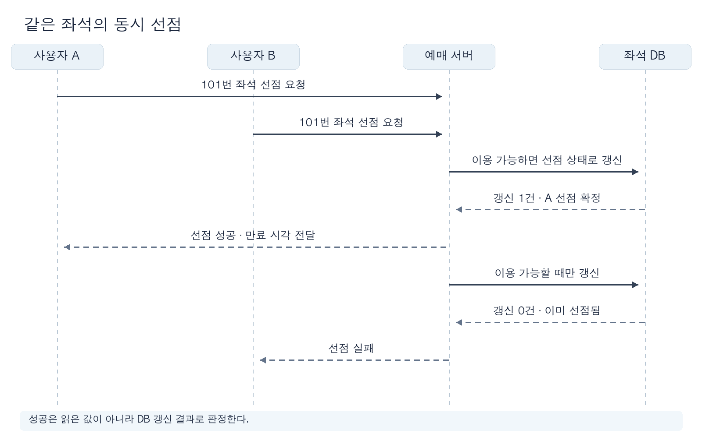
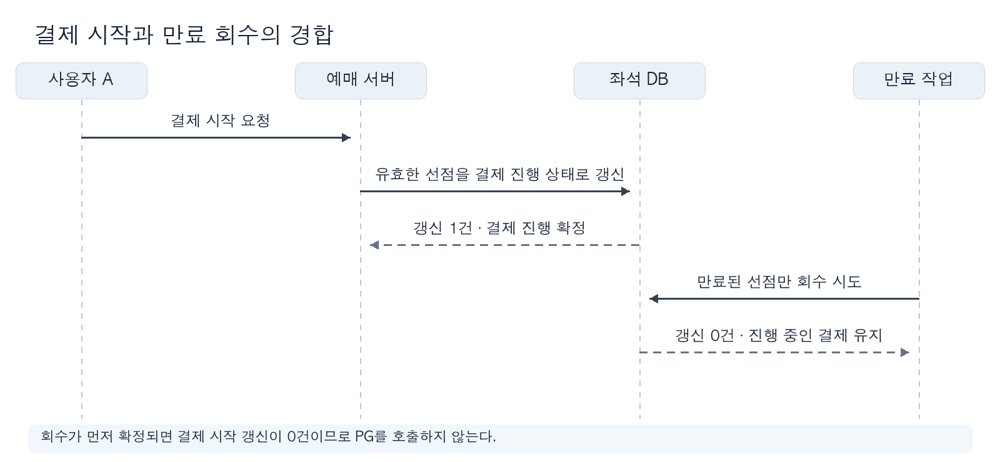

# 선착순 예매: 좌석 선점과 만료 경계 설계하기

## 1. 좌석을 언제 누구에게 보장하는지 정한다

- 한 좌석을 두 사용자에게 확정하지 않는 것을 필수 조건으로 둔다. 좌석 선택, 결제 시작과 판매 확정이 각각 무엇을 보장하는지 구분한다.
- 예를 들어 사용자 A가 101번 좌석을 선택한 뒤 결제하는 동안 사용자 B가 같은 좌석을 요청할 수 있다. 결제가 지연되거나 응답이 끊겨도 두 요청의 결과가 모순되지 않아야 한다.

| 확인할 질문 | 결정할 사항 |
| :--- | :--- |
| 선착순의 기준은 무엇인가? | 요청 도착, 대기열 통과 또는 DB 선점 확정 중 어느 시점을 기준으로 삼을지 업무 담당자와 정한다. 조건부 갱신은 DB에서 한 건만 성공시키지만, 요청 도착 순서까지 보장하지는 않는다. |
| 선점 성공 응답은 무엇을 보장하는가? | 좌석 식별자, 선점한 사용자와 유효 종료 시각을 함께 반환할지 정한다. |
| 결제 시작과 승인 중 어느 시점까지 좌석을 보장하는가? | 결제 진행 중 만료·취소 정책과 결과 확인 기한을 정한다. |
| 결제 결과를 알 수 없으면 어떻게 안내하는가? | 재조회·문의 경로와 좌석 재판매 보류 기준을 정한다. |

- 선점 시간은 사용자 결제 행동, 외부 결제 지연, 재판매까지의 대기 비용을 근거로 정한다. 자료의 `7분`은 설명용 값이다.
- 업무·제품 담당자는 선착순 규칙과 사용자 안내를, 결제·운영 담당자는 확인 불가 상태의 처리 기한과 절차를 확인한다.

## 2. 동시 선점에서 한 요청만 성공시킨다

- `AVAILABLE → HELD → PAYMENT_PENDING → SOLD`를 결제 성공 경로로 둔다. `HELD`는 지정된 사용자에게 만료 전까지 부여한 임시 점유권이다.
- A와 B가 모두 `AVAILABLE`을 읽은 뒤 각각 쓰면 둘 다 선점 성공으로 판단할 수 있다. 상태 확인과 변경을 DB의 조건부 갱신 한 번으로 판정한다.



```sql
UPDATE seat
   SET status = 'HELD', hold_id = :hold_id,
       held_by = :user_id, held_until = CURRENT_TIMESTAMP + :hold_duration
 WHERE seat_id = :seat_id AND status = 'AVAILABLE';
```

- 갱신 1건이면 선점 성공, 0건이면 현재 상태를 다시 확인해 실패·재시도 여부를 판단한다. 성공 응답은 갱신 트랜잭션이 확정된 뒤 보낸다.
- DB가 단일 좌석 행의 조건부 갱신을 원자적으로 처리한다는 전제와 트랜잭션 격리·복제 구성을 확인한다. 조회용 캐시의 `AVAILABLE` 표시는 선점 성공의 근거가 될 수 없다.
- 선점 요청이 중복 전송될 수 있으므로 `hold_id` 또는 요청 식별자의 생성·재사용 규칙을 정하고, 같은 요청의 재시도가 선점을 여러 번 만들지 않는지 확인한다.

## 3. 만료 시각과 좌석 회수를 구분한다

- `held_until`은 유효성을 판단할 값이다. 시각이 지나도 DB의 `HELD`가 자동으로 `AVAILABLE`로 바뀌지는 않는다.

| 방식 | 적용 조건 | 확인할 한계 |
| :--- | :--- | :--- |
| 요청 시 만료 판단 | 조회·선점 경로에서 만료 시각을 함께 검사할 수 있다. | DB에는 만료된 `HELD`가 남는다. 조회·집계도 실제 이용 가능 조건을 적용해야 한다. |
| 주기적 회수 | 만료된 좌석을 별도 작업으로 다시 판매 가능하게 만든다. | 실행 간격만큼 회수가 지연될 수 있다. 다른 상태 전이와 경합하므로 상태·만료 조건을 함께 검사해야 한다. |

- 두 방식을 조합할 수 있다. 만료된 `HELD`를 요청 시 다시 선점한다면 `AVAILABLE` 또는 만료된 `HELD`일 때만 원자적으로 새 `hold_id`, 사용자와 종료 시각을 기록한다.
- 회수 작업은 `status='HELD' AND held_until < CURRENT_TIMESTAMP` 같은 조건으로 갱신한다. 결제 진행 상태는 이 조건에 포함하지 않는다.
- 경계 시각의 `<`·`>=` 규칙과 시각을 판정하는 DB 기준을 일치시킨다. 선점·결제·회수 경로가 서로 다른 서버 시계로 판정하지 않도록 한다.

## 4. 결제 시작과 만료 회수가 경합하는 순간을 정한다

- PG 호출 전에 유효한 선점을 `HELD → PAYMENT_PENDING`으로 조건부 전이한다. 갱신 0건이면 결제를 시작하지 않는다.
- `PAYMENT_PENDING`은 PG 호출을 준비하거나 시작했지만 결과가 확정되지 않은 상태다. 기존 `held_until`이 지나도 단순 만료 회수 대상으로 취급하지 않는다.



| 경합 결과 | 후속 처리 |
| :--- | :--- |
| 만료 회수가 먼저 확정된다. | `HELD → PAYMENT_PENDING`이 실패한다. PG를 호출하지 않고 선점 만료를 알린다. |
| 결제 시작 전이가 먼저 확정된다. | `HELD` 조건의 회수가 실패한다. PG 결과를 확인해 판매 또는 해제한다. |

- DB 전이와 PG 호출은 하나의 DB 트랜잭션으로 원자화할 수 없다. 전이 직후 서버가 중단되면 PG 호출 자체가 없었을 수도 있으므로, 요청 기록과 PG 결과를 대조해 종결한다.
- PG 요청 식별자와 `hold_id`의 연결, 중복 결제 요청 방지 범위, 콜백·재조회 결과의 중복 반영 방식을 결제 계약에 맞춰 정한다.

## 5. 결제 결과를 모를 때는 확인 후 종결한다

- PG가 승인했지만 응답이 유실될 수 있다. 타임아웃을 결제 실패로 간주해 좌석을 즉시 풀면, 같은 좌석이 다시 판매될 수 있다.
- 응답·콜백으로 결과를 확인하고, 확정되지 않으면 PG 조회와 재시도로 정합성을 맞춘다. 각 결과는 해당 `hold_id`와 결제 요청을 확인한 뒤 한 번만 반영한다.

| 확인된 결과 | 상태와 사용자 결과 |
| :--- | :--- |
| 결제 승인 | 해당 좌석을 `SOLD`로 확정하고 예매 결과를 알린다. |
| 결제 거절·취소 | 재판매가 안전하다고 확인한 뒤 `AVAILABLE`로 해제한다. |
| 결과 미확인 | `PAYMENT_PENDING`을 유지하고 재조회한다. 정한 기한에도 확인되지 않으면 운영 판단·환불 절차로 넘긴다. |

- `PAYMENT_PENDING`의 보류 기한은 `HELD`의 선점 기한과 별도로 정한다. 보류 기한이 지났다는 이유만으로 승인 가능성이 남은 결제를 실패로 확정하지 않는다.
- PG 조회·콜백의 제공 범위와 최종 결과 확인 방법은 실제 계약으로 확인해야 한다. 결과가 늦게 도착하는 경우의 중복 판매·중복 청구 처리도 정한다.

## 6. 같은 시나리오로 설계안을 검증한다

- 합격 기준은 업무 영향과 비용을 근거로 합의한다. 아래 항목의 수치·측정 범위는 이 자료만으로 정할 수 없다.

| 검증할 상황 | 확인할 결과와 측정 방법 |
| :--- | :--- |
| 같은 좌석에 동시 선점 요청 | 요청 도착·DB 확정 순서와 갱신 건수를 기록한다. 한 좌석에서 유효한 선점은 최대 한 건이며, 성공 응답과 확정 상태가 일치한다. |
| 만료 직전 결제 시작과 회수 경합 | 두 전이 순서를 반복 실행한다. 결제 시작이 확정된 좌석은 회수되지 않고, 회수가 먼저 확정되면 PG 호출이 시작되지 않는다. |
| PG 승인 후 응답 유실·중복 콜백 | PG 결과와 내부 상태를 대조한다. 승인된 결제가 한 예매에 한 번 반영되고, 다른 사용자에게 같은 좌석이 확정되지 않는다. |
| PG 지연·조회 실패 | 미확인 건수와 지속 시간, 재조회 결과와 운영 이관 시간을 측정한다. 합의한 보류·안내 기한 안에 처리하는지 확인한다. |
| 피크 부하와 회수 작업 동시 실행 | 선점·결제 시작 응답의 지연 분포, 오류율, DB 경합과 회수 지연을 같은 기간에 측정한다. 합의한 용량·지연 기준을 충족하는지 확인한다. |

- 시험할 요청 규모·분포·지속 시간, 측정 기간과 집계 방식, 합격 기준을 먼저 정한다. `p95 2초` 같은 수치는 실제 요구로 합의되기 전에는 사용하지 않는다.
- 실험은 결제 연동 방식과 장애 주입 범위를 기록하고, 운영 환경과 다른 점을 명시한다. 필수 조건인 중복 판매 방지는 결제 지연·중단을 포함해 채택 전에 검증한다.
- 선점 시간을 줄이면 좌석 회전은 빨라질 수 있지만 결제 중 만료가 늘 수 있다. 길게 잡으면 결제 기회는 늘지만 미결제 좌석의 재판매가 늦어진다. 이 결과를 제품·결제·운영 담당자와 함께 검토한다.

## 7. 관련 문서

- [대규모 트래픽: 요구사항에서 대응 우선순위 찾기](01_identifying_architectural_priorities_for_high_traffic.md): 피크 시간에 보장할 업무 결과와 처리 기한을 정하는 방법을 설명한다.
- [품질 목표와 시나리오: 설계부터 검증까지 같은 기준 사용하기](../architecture-quality/03_defining_measurable_quality_goals_and_scenarios.md): 부하 조건, 측정 방법과 합격 기준을 구체화하는 방법을 설명한다.
- [트레이드오프: 품질과 비용을 함께 비교해 결정하기](../architecture-quality/04_evaluating_architectural_tradeoffs.md): 선점 시간과 결제 보류 정책의 효과·비용을 비교하는 기준을 설명한다.
