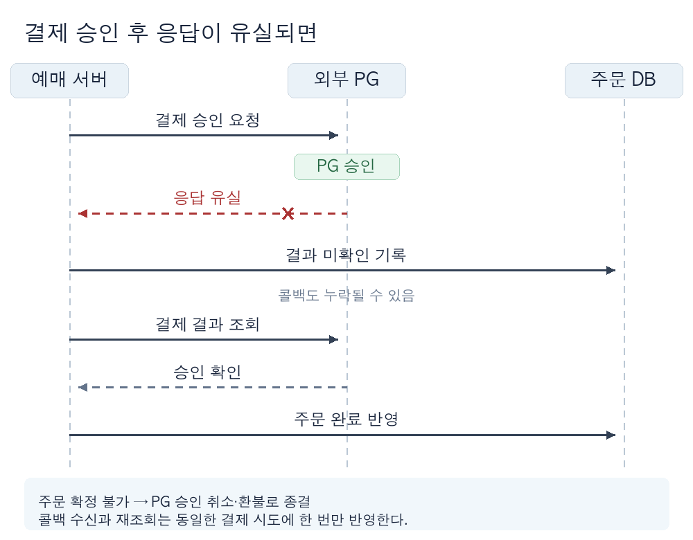

# 결제 정합성과 장애 복구: 결과를 확인하고 상태를 맞추기

## 1. 결제 성공과 주문 완료를 구분한다

- 주문 시스템과 외부 PG는 서로 다른 시스템이다. PG의 승인과 주문 DB의 확정은 하나의 로컬 트랜잭션으로 묶을 수 없다.
- 예를 들어 PG는 결제를 승인했지만, 응답이 유실되거나 우리 서버가 주문을 확정하기 전에 중단될 수 있다. 이때 고객의 결제 사실과 주문 상태가 어긋난다.

| 확인할 조건 | 결정할 사항 |
| :--- | :--- |
| 주문 완료 응답은 무엇을 보장하는가? | PG 승인과 주문 확정 중 어느 결과를 고객에게 약속하는지 제품·결제 담당자와 정한다. |
| 한 주문에 성공 결제를 몇 건까지 인정하는가? | 내부에 반영할 결제는 한 건으로 제한한다. PG의 중복 승인 가능성과 취소·환불 절차는 별도로 확인한다. |
| PG 승인 후 주문 확정이 실패하면? | 재확정할 조건과 불가능할 때 승인 취소·환불할 기준을 정한다. |
| 언제 정합성이 회복돼야 하는가? | 불일치 탐지 시작점, 복구 완료의 뜻, 허용 기한과 기한 초과 시 담당 역할을 정한다. |

- PG의 멱등 키, 시도별 상태 조회, 콜백, 승인 취소·환불의 보장 범위와 보관 기간을 계약으로 확인한다. 결제 승인과 매입 등 어떤 상태를 주문 완료로 인정할지도 정한다.

## 2. 결제 전에 주문과 결제 시도의 기준점을 남긴다

- 결제를 먼저 승인받고 주문을 만들면, 주문 생성 실패 시 PG 승인과 연결할 주문이 없을 수 있다. 미결제 주문과 결제 시도를 먼저 기록하는 안을 비교한다.

| 순서 | 기대 효과 | 감수할 비용과 실패 처리 |
| :--- | :--- | :--- |
| 결제 후 주문 생성 | 미결제 주문을 줄일 수 있다. | 주문 생성 실패 시 PG 승인과 주문 부재를 대조하고 취소·환불해야 한다. |
| 미결제 주문 생성 후 결제 | PG 요청을 주문·결제 시도 기록과 연결할 수 있다. | 미결제 주문 정리, 결제 결과 확인과 점유 자원의 만료 처리가 필요하다. |

- 주문 ID, 결제 시도 ID, PG 요청 식별자와 금액·통화를 연결해 저장한다. 같은 시도의 재전송과 새 시도를 구분한다.
- 주문과 결제 시도 기록을 우리 DB에서 함께 커밋할지 정한다. 커밋 후 PG 호출 전 중단되면 호출 여부가 불분명할 수 있으므로 PG 기록과 대조한다.
- 미결제 주문의 만료·취소, 좌석·재고 점유 비용과 승인 후 주문 생성 실패의 피해를 같은 장애 시나리오로 비교해 순서를 선택한다.

## 3. 같은 결제 시도의 재전송을 안전하게 처리한다

- 사용자 재클릭과 서버 재처리에서 동일한 결제 시도에는 동일한 ID를 사용한다. 새 ID를 발급할 조건은 이전 시도의 결과 확인 규칙과 함께 정한다.
- 우리 DB는 결제 시도 ID의 유일성을 보장하고, 주문 완료 반영 시 현재 주문 상태와 연결된 시도를 확인한다. 동일 ID에 다른 주문·금액·통화가 오면 충돌로 처리한다.
- PG가 멱등 키를 지원하면 같은 시도에 같은 키를 재사용하고 유효 기간을 확인한다. 우리 DB의 유일성 제약만으로 PG의 중복 승인은 막을 수 없다.
- PG의 멱등 보장이 없거나 만료됐다면 기존 시도의 PG 결과를 확인한 뒤 재호출 여부를 정한다. 중복 승인은 취소·환불로 처리한다.

## 4. 타임아웃을 결과 미확인으로 다룬다

- PG 응답 타임아웃은 승인 실패의 증거가 아니다. 진행 중(`PENDING`), 결과 미확인(`UNKNOWN`), 확정 성공(`SUCCEEDED`), 확정 실패(`FAILED`)를 구분한다.
- 동기 응답과 콜백은 같은 결제 시도를 가리켜야 한다. 콜백이 중복·역순으로 와도 확정된 결과를 덮어쓰지 않도록 현재 상태와 PG 요청 식별자를 검사한다.

| PG에서 확인한 결과 | 주문·결제 시도 처리 |
| :--- | :--- |
| 주문 완료로 인정할 승인 상태 | 주문·금액·시도를 대조한 뒤 한 번만 완료를 반영한다. 완료할 수 없으면 취소·환불한다. |
| 확정 실패·취소 | 미결제 주문의 취소·재시도와 점유 자원 해제 규칙을 적용한다. |
| 진행 중·조회 불가 | 결과 미확인으로 유지하고 재조회한다. 기한 초과 시 고객에게 안내하고 운영 담당자에게 이관한다. |

- 보류 기한이 지났다는 이유만으로 PG 실패를 확정하지 않는다. 늦게 도착한 승인이 이미 취소한 주문과 충돌할 때의 확인·환불 규칙을 정한다.

## 5. 복구 경로가 정상 경로와 같은 결과로 수렴하는지 확인한다

- 동기 응답과 콜백이 모두 유실될 수 있다. PG가 시도별 조회를 제공하면 일정 시간 이상 `PENDING`·`UNKNOWN`인 건과 주문·PG 상태가 어긋난 건을 대조한다. 조회할 수 없다면 거래 내역 대사나 운영 절차를 정한다.

- PG 승인·주문 미완료는 주문 확정 가능 여부를 다시 검사한다. 불가능하면 승인 취소·환불하고 고객에게 알린다. PG 실패·주문 완료는 원인을 확인하기 전 주문을 임의로 되돌리지 않는다.
- PG 조회 한도, 미확인 건수와 복구 기한을 근거로 대조 작업의 간격·처리량을 정한다. 재조회 후에도 결과를 모르면 마지막 확인 시각을 남기고 운영 담당자에게 이관한다.

## 6. 장애와 재시도를 포함해 검증한다

- 검증 전에 요청 규모, 결제·주문 데이터 범위, 장애 주입 시점, 측정 시작·종료 시각과 합격 기준을 정한다. 자료의 `5분`과 `10회`는 설명용 값이다.
- 복구 시간은 PG의 최종 결과 발생부터 주문 완료 반영 또는 취소·환불 완료까지로 측정한다. PG 시각을 받을 수 없으면 내부에서 결과 미확인을 탐지한 시각을 기산점으로 쓰고, 그 차이를 기록한다.

| 검증할 상황 | 확인할 결과와 측정 방법 |
| :--- | :--- |
| PG 승인 직후 서버 중단 | PG 거래 내역과 주문·결제 시도 기록을 대조한다. 승인 건이 주문 완료 또는 취소·환불로 종결되고 미해결 건은 식별된다. |
| PG 응답 타임아웃 | 실제 승인·실패 양쪽을 주입한다. 타임아웃만으로 실패를 확정하거나 새 결제를 중복 요청하지 않는다. |
| 동일 결제 시도 반복 전송 | 같은 식별자로 동시·순차 재시도한다. 내부 완료 반영 건수와 PG 승인 건수를 각각 세어 중복 여부를 확인한다. |
| 콜백 누락·중복·역순 도착 | 동기 응답과 대조 작업을 함께 실행한다. 누락 건을 발견하고 늦은 결과가 확정 상태를 뒤집지 않는다. |
| PG 조회 장애·처리 지연 | 미확인 건수와 체류 시간, 복구 완료까지의 시간, 운영 이관 건수를 측정해 합의한 기준과 비교한다. |

- PG 거래 내역을 주문 ID·결제 시도 ID로 대조해 중복 승인과 주문에 연결되지 않은 승인을 센다. 미확인 건은 건수와 최장 체류 시간을 주문 완료율과 함께 본다.
- PG 모의 환경이 실제 계약의 멱등·조회·콜백 동작을 재현하는지 확인하고 차이를 기록한다.
- PG의 멱등·조회 보장이 필수 조건을 충족하는지 채택 전에 확인한다. 운영 중 합의한 복구 기준을 넘으면 재조회 용량과 사용자 안내·운영 절차를 재검토한다.

## 7. 관련 문서

- [선착순 예매: 좌석 선점과 만료 경계 설계하기](04_designing_seat_holds_and_expiration_for_first_come_first_served_booking.md): 결제 시작과 좌석 만료가 경합할 때의 상태 전이를 설명한다.
- [Saga: 긴 트랜잭션을 나누고 보상하는 방법](../architecture-pattern/04_saga_pattern.md): 이미 확정된 단계의 효과를 취소·환불 같은 업무 작업으로 상쇄하는 방식을 설명한다.
- [품질 목표와 시나리오: 설계부터 검증까지 같은 기준 사용하기](../architecture-quality/03_defining_measurable_quality_goals_and_scenarios.md): 복구 시간과 정합성 조건을 검증 가능한 형태로 정하는 방법을 설명한다.
