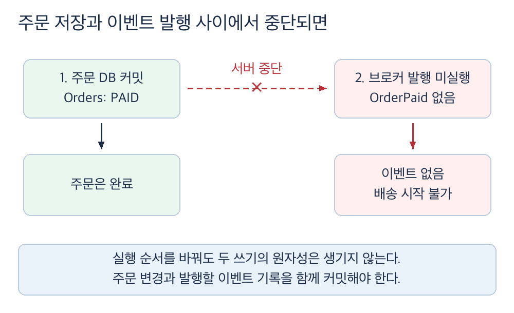
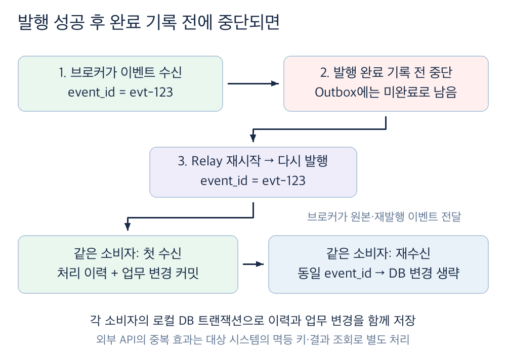
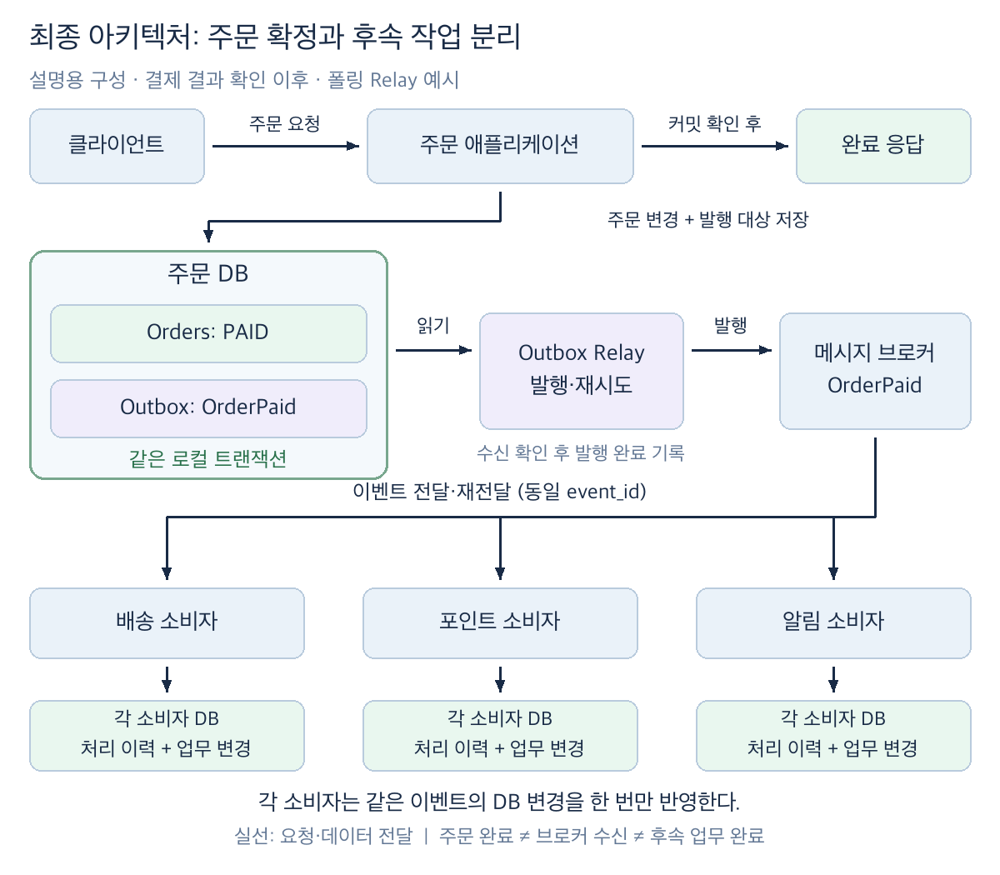

# 후속 작업 분리: Transactional Outbox로 이벤트 발행하기

## 1. 주문 완료와 후속 작업의 완료 조건을 나눈다

- 결제 결과를 확인해 주문을 `PAID`로 확정한 뒤 배송 요청, 포인트 적립과 알림이 이어질 수 있다. 각 작업이 주문 완료 응답 전에 끝나야 하는지는 업무 조건으로 정한다.
- 배송·포인트·알림을 주문 API에서 동기 호출하면 한 시스템의 지연·장애가 주문 완료 응답에 전파된다. 비동기로 분리하면 응답 경로는 짧아지지만 후속 작업의 완료와 실패를 별도로 관리해야 한다.

| 확인할 질문 | 결정할 사항 |
| :--- | :--- |
| 주문 완료 응답은 무엇을 보장하는가? | `PAID` 저장, 후속 작업 접수 또는 최종 완료 중 약속할 범위를 정한다. |
| 어떤 후속 작업을 지연할 수 있는가? | 배송·포인트·알림별 완료 기한, 실패 시 업무 피해와 사용자 안내를 정한다. |
| 작업이 중복 실행돼도 되는가? | 소비자별 중복 방지 범위와 외부 부작용의 처리 방법을 정한다. |
| 처리량이 줄거나 브로커가 중단되면? | 적체 한도, 재처리 기한과 운영 담당 역할을 정한다. |

- 후속 작업의 완료가 주문 완료 응답의 필수 조건이면 그 완료 전에 응답하는 비동기 흐름은 요구를 충족하지 못한다. 분리 가능한 범위와 사용자에게 약속할 완료 상태를 제품·운영 담당자와 먼저 확인한다.

## 2. DB 변경과 이벤트 발행을 따로 할 때의 실패를 확인한다

- 주문 상태 저장과 브로커 발행은 서로 다른 자원에 대한 쓰기다. 실행 순서만 바꿔서는 두 작업의 원자성을 얻을 수 없다.

| 순서 | 중간 장애 | 남는 결과 |
| :--- | :--- | :--- |
| DB에 `PAID` 저장 후 발행 | 저장 직후 서버 중단·발행 실패 | 주문은 완료됐지만 후속 시스템으로 전달할 이벤트가 누락된다. |
| 발행 후 DB에 `PAID` 저장 | 발행 직후 DB 저장 실패 | 후속 시스템이 완료되지 않은 주문을 처리할 수 있다. |
| 실패 시 애플리케이션에서 재시도 | 재시도 기록 전 서버 중단 | 다시 실행할 주체와 근거가 사라질 수 있다. |

- 브로커의 트랜잭션 기능만으로 주문 DB 변경까지 같은 로컬 트랜잭션에 포함되는지 가정하지 않는다. 실제 참여 자원과 보장 범위를 확인한다.
- 처리 방식을 선택할 때는 같은 응답 시간·장애·누락 시나리오로 비교한다.

| 대안 | 기대 효과 | 남는 문제와 비용 |
| :--- | :--- | :--- |
| 동기 흐름 유지 | 후속 작업의 결과를 응답 전에 확인할 수 있다. | 지연·장애가 전파되고, 일부 작업만 성공했을 때 복구가 필요하다. |
| DB 저장 후 직접 비동기 발행 | 후속 작업의 완료를 기다리지 않고 응답할 수 있다. | DB 커밋과 발행 사이의 장애로 이벤트가 누락될 수 있다. |
| Transactional Outbox | 주문 변경과 발행 대상을 함께 보존한다. | Outbox·Relay 운영과 발행 지연·중복 처리가 필요하다. |

## 3. 주문 변경과 발행 대상을 같은 DB에 기록한다

- Transactional Outbox는 주문 상태 변경과 발행할 이벤트 기록을 같은 DB 트랜잭션에서 커밋한다. 트랜잭션이 실패하면 둘 다 반영되지 않는다.
- `OrderPaid` 같은 이벤트에는 고유 `event_id`, 주문 ID, 이벤트 종류와 후속 처리에 필요한 데이터·스키마 버전을 기록한다. 어떤 결제 상태를 `PAID`로 인정하는지는 [05번 문서](05_designing_payment_consistency_and_failure_recovery.md)의 결제 결과 기준을 따른다.
- 커밋 후에는 별도의 Outbox Relay가 이벤트를 브로커에 발행한다. 이 문서의 최종 구성은 미발행 기록을 주기적으로 조회하는 폴링 방식이다. CDC로 커밋된 변경을 전달할 수도 있지만, 진행 위치와 재시작을 관리하는 방식은 별도로 확인해야 한다.

| 구성요소 | 책임과 확인할 경계 |
| :--- | :--- |
| 주문 애플리케이션·DB | `PAID` 변경과 Outbox 기록을 같은 트랜잭션으로 저장한다. 중복 주문 완료가 중복 이벤트를 만들지 않도록 한다. |
| Outbox Relay | 커밋된 기록을 읽어 발행하고, 브로커 수신 확인 후 Outbox에 발행 완료를 기록한다. 재시작 시 발행 완료가 확인되지 않은 건을 다시 처리한다. |
| 브로커 | Relay가 발행한 이벤트를 소비자에게 전달한다. 저장·재전달 보장은 제품과 설정을 확인한다. |
| 소비자 | `event_id`로 중복을 식별하고 배송·포인트·알림의 결과를 각 시스템에서 관리한다. |

- 같은 DB 트랜잭션에 기록할 수 없거나 주문 상태의 소유자가 다른 시스템이면 이 방식의 성립 조건을 다시 검토한다.

## 4. Relay의 재시작과 중복 발행을 설계한다

- Relay가 발행 완료를 먼저 기록하고 브로커에 보내기 전에 중단되면 이벤트가 유실될 수 있다. 브로커의 수신 확인 뒤 완료를 기록하면, 확인 직후 완료 기록 전에 중단된 이벤트는 다시 발행될 수 있다.
- 따라서 Outbox는 커밋된 주문의 발행 대상을 보존하지만 정확히 한 번 전달이나 후속 작업의 완료를 자동으로 보장하지 않는다. Relay의 조회·발행·완료 표시 순서와 브로커 확인이 실제로 보장하는 범위를 정한다.
- 미발행 건의 재시도 간격, 동시 처리 수와 오래 실패한 건의 격리·경보를 정한다. Outbox 적체가 DB 저장 용량과 주문 처리에 미치는 영향도 측정한다.
- Outbox의 발행 완료는 소비자의 업무 완료를 뜻하지 않는다. 브로커의 저장·재전달 보장과 재처리·감사 요구를 확인해 발행 완료 기록의 보관 기간을 정하고, 미발행 기록은 삭제 대상에서 제외한다.

## 5. 소비자의 중복 처리 범위를 정한다

- Relay는 재발행할 때도 원래의 `event_id`를 유지한다. 각 소비자는 자신이 처리한 이벤트를 식별해야 하며, 배송 소비자의 처리 이력 때문에 포인트·알림 처리가 생략되지 않도록 중복 확인 범위를 구분한다.
- 아래 그림은 소비자가 `event_id`의 유일성을 보장하는 처리 이력과 업무 데이터 변경을 같은 DB 트랜잭션으로 커밋하는 예시다. 같은 이벤트가 다시 도착하면 이미 커밋된 이력을 확인해 DB 변경을 생략한다. 실패로 롤백되면 재전달 시 다시 처리할 수 있다.
- 외부 배송·알림 API 호출은 이 DB 트랜잭션에 포함되지 않는다. DB에 처리 이력을 남겼다는 사실만으로 외부 효과의 중복을 막을 수 없으므로, 호출 대상의 멱등 키나 결과 조회·보상 절차를 확인한다.
- 중복 식별자의 보관 기간은 브로커 재전달과 운영 재처리 기간보다 짧지 않게 정한다. 이벤트 순서가 업무 결과에 중요하면 주문 ID별 순서 보장과 역순 수신 시 동작도 정한다.

## 6. 최종 아키텍처의 경계와 완료 시점을 확인한다

- 위 그림은 결제 결과 확인 이후의 설명용 구성이다. 실선 화살표는 요청 또는 데이터 전달 방향이다. 주문 DB의 트랜잭션과 각 소비자 DB의 트랜잭션은 독립적이며, 브로커를 포함한 전체 흐름을 하나로 커밋하지 않는다.
- 주문 애플리케이션은 주문 DB의 커밋을 확인한 뒤 주문 완료를 응답한다. 응답은 브로커 수신이나 배송·포인트·알림의 완료를 뜻하지 않는다. 이 응답 범위는 1절에서 확인한 업무 조건을 전제로 한다.

## 7. 실패 시나리오와 측정 기준으로 검증한다

- 검증할 요청 규모·지속 시간, 이벤트 크기·분포, 브로커 장애 범위, 측정 기간과 합격 기준을 먼저 정한다. 수치는 업무 기한과 운영 비용을 근거로 합의한다.

| 검증할 상황 | 확인할 결과와 측정 방법 |
| :--- | :--- |
| 주문 트랜잭션 커밋 전·후 서버 중단 | 주문과 Outbox를 대조한다. 해당 전이가 커밋되면 두 기록이 함께 남고, 롤백되면 둘 다 반영되지 않는다. |
| 브로커 중단·Relay 재시작 | 가정한 장애 지속 시간에서 미발행 건수와 최장 미발행 시간, 복구 후 전달 완료 시간을 측정한다. 합의한 후속 작업 기한과 비교한다. |
| 브로커 수신 직후 Relay 중단 | 발행 완료 기록 전에 중단시켜 동일 `event_id`가 재발행되는지 확인한다. 소비자의 업무 결과가 중복 반영되지 않는다. |
| 소비자 처리 중단·재전달 | 처리 이력과 실제 배송·포인트·알림의 효과를 대조한다. 외부 연동의 중복 방지 범위도 확인한다. |
| 후속 시스템의 지속적인 지연 | 적체 증가 속도, DB 용량, 주문 API 지연과 영구 실패 건수를 측정한다. 한도 초과 시 경보·격리·운영 조치가 작동한다. |

- 후속 작업 완료 지연은 주문·Outbox 커밋부터 각 소비자의 업무 완료까지로 측정한다. 외부 호출이 필요한 작업은 외부 결과 확인을 완료 시점에 포함한다.
- 주문 API의 빠른 응답만으로 후속 작업의 신뢰성을 판단하지 않는다. 주문 완료율, 이벤트 누락·중복 효과, 후속 작업 완료 지연을 함께 본다.
- 실험 환경과 운영의 브로커 보장·재시도 설정 차이를 기록한다. 필수 후속 작업 기한을 충족하지 못하면 동기 처리 범위, Relay 용량과 운영 정책을 재검토한다.

## 8. 관련 문서

- [문제와 트레이드오프로 이해하는 설계 해법](../architecture-pattern/01_design_solutions_through_problems_and_tradeoffs.md): Dual Write와 Transactional Outbox의 보장 범위를 비교한다.
- [Load Leveling: 폭주하는 요청을 큐로 완충하는 방법](../architecture-pattern/10_buffering_traffic_spikes_with_queues.md): 비동기 작업의 적체와 처리 용량을 관리하는 방법을 설명한다.
- [품질 목표와 시나리오: 설계부터 검증까지 같은 기준 사용하기](../architecture-quality/03_defining_measurable_quality_goals_and_scenarios.md): 후속 작업 완료 기한과 장애 복구 조건을 검증 가능하게 정하는 방법을 설명한다.
