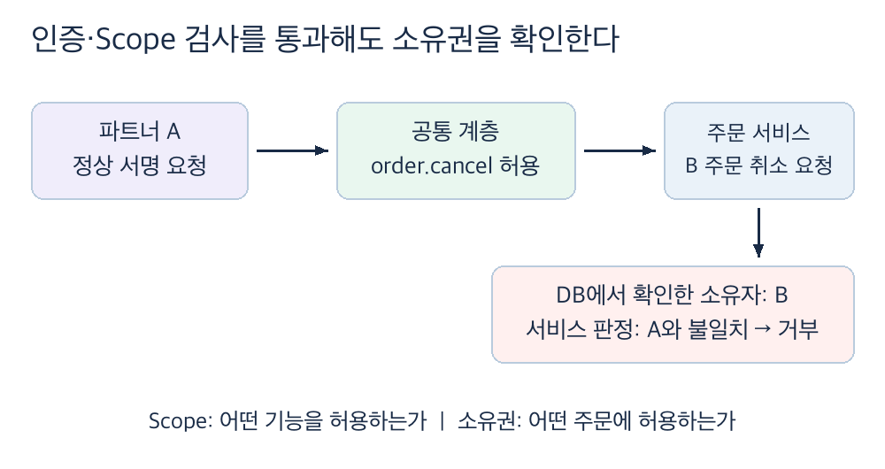
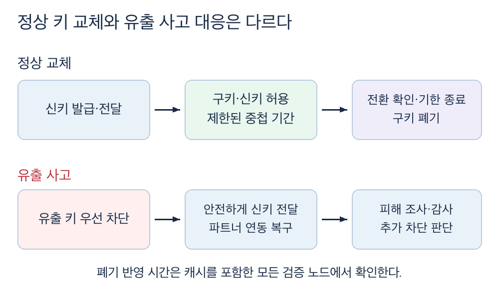
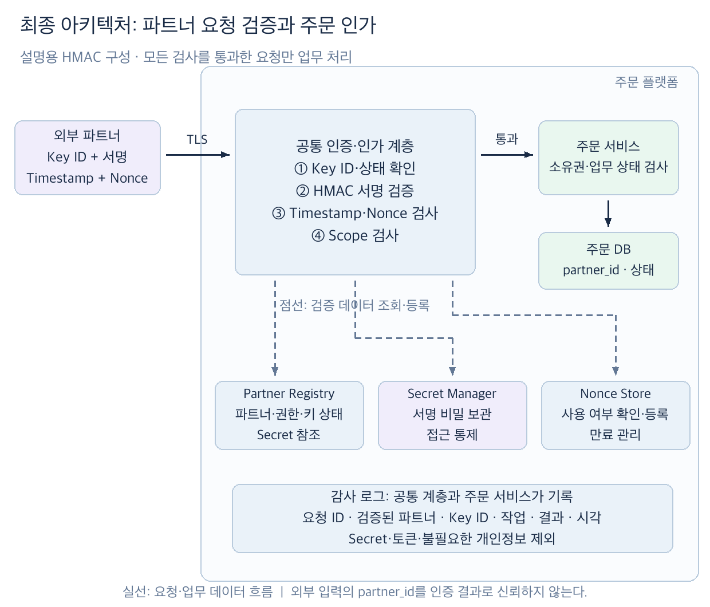

# B2B 파트너 API: 인증·요청 검증·인가와 키 수명주기 설계하기

## 1. 외부에 허용할 작업과 운영 조건을 확인한다

- 주문 플랫폼의 조회·취소 API를 파트너 서버에 개방한다고 가정한다. 주문에 개인정보가 포함되므로, 호출자의 신원뿐 아니라 어떤 주문의 어떤 작업을 허용할지도 판단해야 한다.
- 첨부 자료의 파트너 `5곳 → 100곳`과 개발 인력 규모는 설명용 조건이다. 실제 규모·계약·지원 역량을 확인한 뒤 인증 방식을 선택한다.

| 확인할 조건 | 설계에 미치는 영향과 확인할 역할 |
| :--- | :--- |
| 파트너별 허용 기능과 데이터 범위 | 제품·계약 담당자는 조회·취소 권한, 주문 소유권과 응답에 포함할 개인정보를 정한다. |
| 파트너의 구현 역량과 온보딩 비용 | 연동 담당자는 서명·시각 동기화·키 교체 지원 여부와 가이드·샘플의 필요 범위를 확인한다. |
| 요청 변조·재전송과 키 유출의 피해 | 보안·업무 담당자는 차단할 위협, 유출 시 영향 범위와 차단 기한을 정한다. |
| 계약·조직 정책상 필수 통제 | 보안·계약 담당자는 mTLS 등 필수 조건과 적용 구간을 확인한다. |
| 운영 중 장애와 감사 요구 | 운영 담당자는 검증 저장소 장애 시 동작, 기록 항목·보관 기간과 담당 역할을 정한다. |

- 아래는 TLS 연결 위에서 파트너별 공유 비밀로 요청을 서명하는 설명용 설계안이다. 소수 파트너의 연동 용이성과 요청 검증을 함께 고려한 예시이며, 파트너 수만으로 채택을 결정하지 않는다.

## 2. 파트너 식별 방식과 요청 검증 방식을 나누어 선택한다

- 인증은 어떤 파트너의 자격 증명으로 호출했는지 확인하는 과정이다. API Key 같은 비밀을 보유했다는 사실이 그 파트너의 정상 서버에서 보낸 요청임을 항상 보장하지는 않는다.

| 대안 | 기대 효과 | 성립 조건과 감수할 비용 |
| :--- | :--- | :--- |
| 고정 API Key | 파트너별 발급과 호출 구현이 단순하다. | 유출된 키로 호출할 수 있다. 키 폐기·교체와 TLS가 필요하고, 요청별 서명·재전송 방지는 별도다. |
| Key ID + HMAC 요청 서명 | 비밀 원문을 요청에 싣지 않고, 서명한 내용의 변경을 감지한다. | 양쪽이 비밀을 안전하게 보관하고 같은 서명 규칙을 구현해야 한다. 시각·Nonce 검증과 운영이 추가된다. |
| OAuth 2.0 Client Credentials | 서버 간 연동에 토큰 발급과 Scope 관리를 사용할 수 있다. | 인증 서버·토큰 검증 운영이 필요하다. Bearer Token만으로 요청별 서명과 재전송 방지가 제공되지는 않는다. |

- 자료에서는 고정 API Key로 시작해 요청 서명으로 발전시킨다. 최종 예시에서는 **Key ID는 자격 증명 조회용 식별자**, **Secret Key는 HMAC 계산용 비밀**로 사용한다. 고정 API Key 원문을 매번 보내는 방식과 구분한다.
- HMAC도 Secret Key가 유출되면 공격자가 유효한 서명을 만들 수 있다. 키마다 파트너를 연결하고 권한·활성 상태를 관리해 사고 범위를 제한한다.

## 3. 서명·시각·Nonce를 검증한다

- 파트너와 검증 서버는 HTTP Method, 대상 경로·쿼리, 본문 해시, Timestamp와 Nonce 등을 서명 대상에 포함한다. Key ID와 서명 규칙 버전의 결합 방식, 대상 호스트와 업무 의미를 바꾸는 헤더의 포함 여부도 계약에 명시한다.
- 아래는 서명 대상의 개념 예시다. 실제 규약에서는 각 필드의 순서·구분자·인코딩·정규화 규칙을 고정해야 한다. RFC 9421은 HTTP 메시지 서명에서 서명 대상과 서명 메타데이터를 다루는 표준이며, 이 개념식 자체가 해당 표준의 구현은 아니다.

```text
StringToSign = Encode(Method, CanonicalTarget, BodyHash, Timestamp, Nonce, KeyID, Version)
Signature    = HMAC-SHA256(SecretKey, StringToSign)
```

| 검사 | 확인할 내용과 실패 시 동작 |
| :--- | :--- |
| Key ID·키 상태 | 등록된 파트너와 유효한 키인지 확인한다. 알 수 없거나 폐기된 키는 거부한다. |
| 서명 | 서버가 수신한 요청으로 서명을 다시 계산해 안전한 비교 함수로 대조한다. 불일치하면 업무 처리를 시작하지 않는다. |
| Timestamp | 허용한 과거·미래 시각 범위 안인지 확인한다. 시계 오차를 포함해 허용 폭과 시간 동기화 방법을 정한다. |
| Nonce | 서명이 유효한 요청에 대해 파트너·키 범위에서 사용 여부를 원자적으로 확인·등록한다. 같은 값의 동시 요청도 한 건만 통과시킨다. |

- Nonce는 해당 요청이 시간 검사에 통과할 수 있는 마지막 시점까지 보관한다. 저장소 재시작·장애 전환 때 사용 이력이 사라질 가능성도 확인한다. 검증 서버들이 저장소를 공유하고, 저장소 장애로 재사용 여부를 판단할 수 없으면 보호 대상 요청을 거부하도록 설계한다. 이때 정상 요청도 중단되는 가용성 비용을 함께 검토한다.
- 프록시의 경로·쿼리 변경, JSON 재직렬화와 인코딩 차이는 정상 요청의 서명도 깨뜨릴 수 있다. 서명·검증 위치와 본문 바이트 처리 규칙을 맞추고, 파트너용 검증 예제를 제공한다.
- 재전송 방지와 업무 멱등성은 목적이 다르다. 응답 유실 후 정당한 재시도에는 새 Timestamp·Nonce로 서명하되 같은 업무 멱등 키를 유지한다. 멱등 키도 서명으로 보호하고, 주문 취소가 중복 반영되지 않도록 서비스에서 처리한다.

## 4. 기능 권한과 주문 소유권을 각각 검사한다

- 인증된 파트너 A에게 `order.cancel` 권한이 있어도 B의 주문 취소를 허용할 수는 없다. OWASP의 BOLA는 객체 식별자를 바꿔 다른 자원에 접근하는 인가 누락 위험을 설명한다.



- 공통 인증·인가 계층은 `order.read`·`order.cancel` 같은 기능 권한을 확인한다. 주문 서비스는 인증 결과의 파트너 ID와 주문 DB의 소유 파트너를 대조하고, 주문 상태상 취소 가능한지도 검사한다. 조회·목록·일괄 처리에도 같은 자원 범위를 적용한다.
- 호출자가 보낸 `partner_id`를 인증 결과로 사용하지 않는다. Gateway가 인증 결과를 전달한다면 외부의 동일 이름 헤더를 제거·재설정하고, 서비스 직접 접근을 차단하거나 서비스에서도 검증해 우회를 막는다.
- 권한 누락과 소유권 불일치는 거부한다. 다른 파트너 주문의 존재를 숨길 필요가 있으면 404 응답을 사용할지 API 계약으로 정한다. 응답 필드도 허용한 개인정보 범위로 제한한다.

## 5. 정상 키 교체와 사고 시 폐기를 구분한다



- 정상 교체는 새 Key ID·Secret Key를 안전하게 전달하고, 제한된 기간 구키와 신키를 함께 허용한다. 파트너의 전환을 확인하거나 정한 종료 시각이 되면 구키를 폐기한다. 중첩 기간에는 두 키의 사용량을 구분해 추적한다.
- 유출 사고에서는 정상 교체의 중첩 기간을 적용하지 않고 해당 키를 우선 차단한다. 파트너 전체를 중단할 조건, 새 키 전달·연동 복구와 피해 조사 절차를 보안·연동·운영 담당자가 정한다.
- Partner Registry에는 Key ID별 파트너 ID·권한·상태와 Secret 참조를 두고, 비밀은 Secret Manager 등 접근이 통제된 저장소에서 관리한다. HMAC 검증에는 비밀을 사용할 수 있어야 하므로 일반 비밀번호처럼 일방향 해시만 저장하는 방식은 그대로 적용할 수 없다.
- 키 상태·비밀을 캐시하면 폐기 반영이 늦어질 수 있다. 폐기 결정부터 모든 검증 노드의 차단까지를 차단 시간으로 측정하고, 캐시 무효화·갱신 주기와 합격 기준을 정한다. 비밀 저장소 장애 시 캐시 사용 허용 범위도 이 기준에 맞춘다.

## 6. 최종 아키텍처의 책임과 신뢰 경계를 확인한다



- 실선은 요청·업무 데이터 흐름, 점선은 검증 데이터 조회·등록을 뜻한다. 파트너 서버는 플랫폼의 신뢰 경계 밖에 있다. 공통 계층은 Gateway 또는 Backend Filter로 구현할 수 있으며, 이름보다 우회 없는 검증 경로와 신뢰할 수 있는 인증 결과 전달이 중요하다.
- Partner Registry는 파트너·키·권한의 기준을, Secret Manager는 서명 비밀의 보관·접근을, Nonce Store는 재사용 확인을 맡는다. 주문 DB는 자원 소유권과 업무 상태의 기준이다.
- 공통 계층과 주문 서비스는 요청 ID, 검증된 파트너 ID·Key ID, 대상 작업, 결과·거부 사유와 시각을 감사 로그에 남긴다. 인증 전에는 파트너 신원이 미확인임을 구분한다. Secret·토큰·불필요한 개인정보는 기록하지 않으며, 로그 접근·보관과 기록 실패 시 동작을 정한다.

## 7. 운영 조건이 바뀌면 선택을 재검토한다

| 변경 조건 | 재검토할 선택과 비용 |
| :--- | :--- |
| 파트너·권한·키 운영이 늘고 셀프 온보딩·표준 SDK가 필요하다. | OAuth 2.0 Client Credentials와 중앙 토큰 발급을 비교한다. 실제 발급·지원 비용과 인증 서버 장애 영향을 측정하며, `100곳` 자체를 전환 기준으로 삼지 않는다. |
| 계약에서 특정 파트너 구간에 mTLS를 요구한다. | 클라이언트 인증서 검증을 추가하고 발급·갱신·폐기와 인증서의 파트너 매핑을 운영한다. 인증서 검증 성공 후에도 기능·자원 인가는 수행한다. |
| 요청별 무결성·재전송 방지 요구가 유지된다. | OAuth 도입 후에도 필요한 통제를 확인한다. Bearer Token의 발급·검증만으로 기존 서명·Nonce 검증을 대체했다고 판단하지 않는다. |

- 최초 선택과 변경안은 같은 변조·재전송·타 파트너 접근·유출 시나리오로 비교한다. 필수 계약 조건을 충족하지 못하면 연동 범위나 전환 계획을 다시 협의한다.

## 8. 정상 연동과 공격·장애 시나리오로 검증한다

- 아래는 검증 계획이다. 이 문서에는 실제 구현의 시험 결과가 없다. 채택 전 보안·연동 담당자는 서명 규약과 파트너 구현 가능성을, 운영 담당자는 차단·복구 절차를 확인한다.

| 검증할 상황 | 확인할 결과와 측정 방법 |
| :--- | :--- |
| 정상 요청과 표현 차이 | 공통 시험 벡터로 경로·쿼리·본문·인코딩·프록시 통과를 검증한다. 합의한 표현은 양쪽에서 같은 서명이 계산된다. |
| 서명 후 본문·경로·쿼리 변경 | 각각 바꿔 전송한다. 요청이 거부되고 주문 조회·취소와 정보 노출이 발생하지 않는다. |
| 만료·미래 Timestamp와 동일 Nonce 동시 전송 | 시간 경계 양쪽을 시험하고 여러 검증 노드에 같은 요청을 보낸다. 허용 범위 밖 요청과 중복 요청이 거부된다. |
| A의 정상 자격 증명으로 B 주문 접근 | 조회·취소·목록 범위를 바꿔 요청한다. B의 데이터가 반환되거나 변경되지 않는다. Scope 없는 요청도 거부된다. |
| 정상 교체·유출 키 폐기 | 중첩 기간에는 양쪽 키가 동작하고 종료·폐기 후에는 구키가 차단된다. 캐시가 있는 모든 노드에서 차단 시간을 측정한다. |
| 검증 저장소 장애·서비스 직접 접근 | Registry·Secret·Nonce 의존성 장애와 공통 계층 우회를 주입한다. 미검증 요청이 업무 처리에 도달하지 않고 정상 요청의 장애 영향도 식별된다. |
| 응답 유실 후 정상 재시도 | 새 서명·Nonce와 같은 업무 멱등 키로 요청한다. 보안 검증은 통과하되 취소 결과는 중복 반영되지 않는다. |

- 거부 시 HTTP 상태·오류 형식은 API 계약으로 정한다. 자료의 401·403·404는 예시이며, 응답 코드만으로 차단 성공을 판정하지 않고 DB 변경·반환 데이터·감사 기록을 대조한다.
- 요청 부하·본문 크기·파트너 수·시계 오차·장애 지속 시간과 시험 기간을 먼저 정한다. 검증 지연 분포, 정상 요청 오거부율, 폐기 반영 시간과 감사 기록 누락을 함께 측정해 합의한 기준과 비교한다. 운영과 다른 프록시·캐시·저장소 설정은 차이로 남긴다.

## 9. 관련 문서와 레퍼런스

- [품질 목표와 시나리오](../architecture-quality/03_defining_measurable_quality_goals_and_scenarios.md): 차단 시간·연동 비용과 검증 지연을 측정 가능한 목표로 구체화한다.
- [횡단 관심사의 코드 수준 설계](03_code_level_strategies_for_cross_cutting_concerns.md): 공통 검증과 도메인 책임의 배치를 함께 검토한다.
- [RFC 9421 — HTTP Message Signatures](https://www.rfc-editor.org/rfc/rfc9421.html): 서명 대상·정규화와 재전송 방지 시 고려할 조건을 설명한다.
- [OWASP — API1:2023 BOLA](https://api-security.owasp.org/editions/2023/en/0xa1-broken-object-level-authorization/): 자원 식별자를 받는 API의 객체 수준 인가 필요성을 설명한다.
- [RFC 6749 — Client Credentials Grant](https://www.rfc-editor.org/rfc/rfc6749.html#section-4.4): 서버 간 클라이언트 자격 증명을 사용하는 토큰 발급 흐름을 정의한다.
