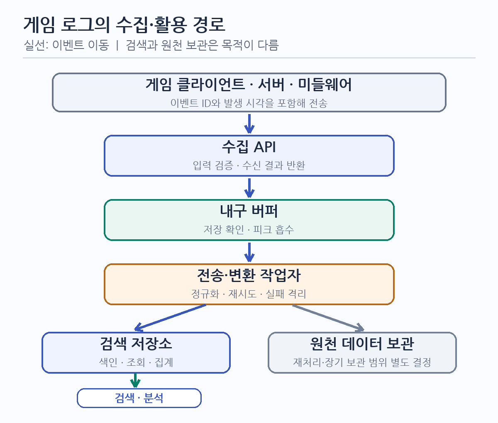
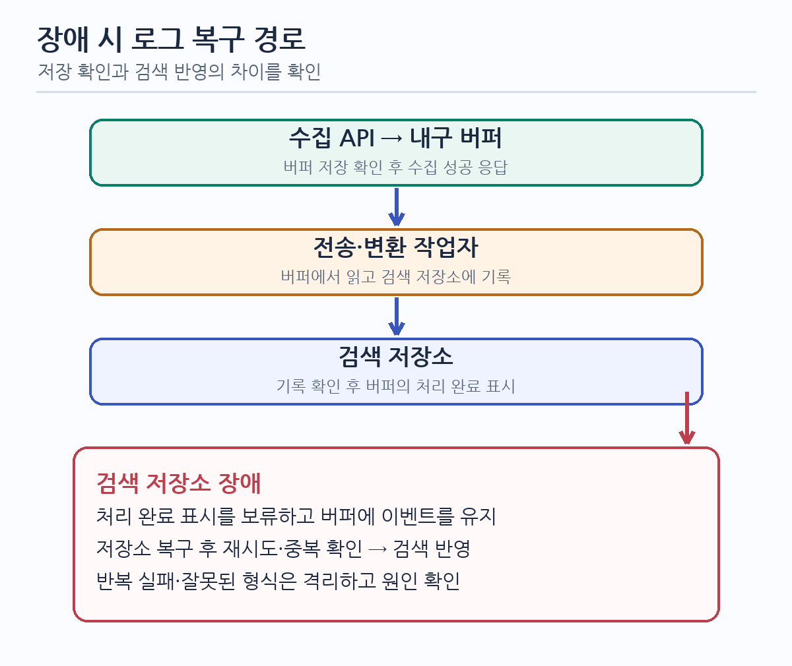

# 대용량 게임 로그 시스템: 수집·저장·검색의 경계와 검증 기준

## 1. 다룰 로그와 시스템 경계를 정한다

- 이 문서는 게임 플레이와 사업 지표 분석에 사용하는 Game Log의 수집·저장·검색 설계를 다룬다. 접근 기록, 오류, 인프라 상태를 다루는 Platform Log는 운영 목적과 보관·접근 정책이 다르므로 별도 경계로 둔다. 두 로그를 함께 추적해야 하면 양쪽에 전달할 상관관계 ID의 생성·전파·조회 규칙을 정한다.
- 게임 클라이언트·게임 서버·미들웨어에서 발생한 로그를 수집·처리·저장하고, 검색·분석·애플리케이션 연동과 원천 데이터 보관에 제공하는 흐름을 검토한다. 각 연동과 기술 구성의 채택 여부는 요구사항 확인 후 결정한다.
- 게임 동작을 로그 수집 실패에 종속시킬지, 누락 가능성을 감수하고 분리할지는 로그 종류별 업무 피해로 결정한다. 결제·재화처럼 상태 변경의 근거가 되는 기록은 일반 분석 이벤트와 같은 손실 정책을 적용하지 않는다.

## 2. 부하와 품질 목표를 먼저 확정한다

| 확인할 조건 | 설계에 미치는 영향과 확인할 역할 |
| :--- | :--- |
| 로그 종류와 사용 목적 | 게임 기획·분석 담당자가 실시간 운영 판단, 사후 분석, 감사에 필요한 이벤트와 필드를 구분한다. |
| 발생 위치와 전송 조건 | 클라이언트·서버 개발 담당자가 호출 빈도, 배치 가능 여부, 모바일 오프라인·재전송 조건과 게임 응답에 허용할 영향을 확인한다. |
| 평균·최대 유입량과 이벤트 크기 | 운영·개발 담당자가 실제 트래픽의 초당 건수, 크기 분포, 피크 지속 시간, 성장 전망을 측정한다. 일일 저장량은 유입 건수와 압축 전후 크기로 각각 산정한다. |
| 허용 가능한 누락·중복과 확인 시점 | 업무 담당자가 로그 종류별 손실 허용 범위를 정하고, 개발 담당자가 API 수신·내구 저장·검색 가능 중 어느 시점을 성공 응답으로 약속할지 정한다. |
| 검색 질문과 최신성 | 분석 담당자가 시간·사용자·게임·이벤트별 조회, 집계 범위, 검색 가능해질 때까지의 허용 시간과 동시 조회량을 정한다. |
| 보관·삭제·접근 | 개인정보·법무·보안 담당자가 검색용 보관, 원천 데이터 보관, 삭제·익명화, 접근 권한과 지역 제약을 확인한다. |
| 비용과 운영 역량 | 운영 담당자가 저장·복제·검색 비용 상한과 장애 대응·제품 운영 역량을 확인한다. |

- 처리량·이벤트 크기·보관 기간·검색 지연의 목표값은 실제 운영 조건과 업무 영향에 따라 합의한다.
- 품질 목표는 `대상 로그 / 유입 조건과 기간 / 기대 동작 / 측정 위치와 집계 방식 / 합격 기준`으로 적는다. 예를 들어 검색 최신성은 생산 시각과 검색 가능 시각의 차이를 정의한 뒤 피크 기간의 분포를 측정한다. API 응답 시간만으로 검색 최신성을 판정하지 않는다.
- 누락률을 목표로 쓰려면 분모를 `발생한 이벤트`, `클라이언트가 전송을 시도한 이벤트`, `API가 수신한 이벤트` 중 무엇으로 삼는지 정한다. 서버가 관측하지 못한 오프라인·전송 실패 이벤트까지 무손실이라고 주장할 수는 없다.

## 3. 수집 성공과 검색 성공을 다른 단계로 다룬다

- 화살표는 이벤트 또는 조회 결과의 이동을 나타낸다. 원천 데이터 보관은 검색 저장소와 별도의 용도·보관 정책을 가진 선택적 경로다. 인증·접근 제어와 모니터링은 각 경계에 적용한다.
- 수집 API는 입력 크기·형식·신원·전송량을 검증하고 이벤트 ID와 수신 결과를 다룬다. 버퍼는 유입과 색인 속도의 차이를 흡수한다. 전송·변환 작업자는 필드 검증·정규화·재시도·실패 격리를 맡는다. 검색 저장소는 조회와 집계를 제공한다.
- `API가 요청을 받음`, `이벤트가 장애 후에도 복구 가능한 곳에 기록됨`, `검색 결과에 반영됨`은 서로 다른 상태다. 응답 코드가 어느 상태를 뜻하는지 API 계약에 명시하고, 아직 검색되지 않는 이벤트를 즉시 조회할 수 있다고 약속하지 않는다.
- 수집 응답 전에 내구 저장을 요구한다면 저장 실패 때 성공을 반환하지 않는다. 응답 유실 후 발신자가 재시도할 수 있으므로 이벤트 ID로 중복을 식별한다. 같은 ID에 서로 다른 내용을 보내는 경우의 거부·버전 정책도 정한다.
- 클라이언트와 서버의 신뢰 수준을 구분한다. 클라이언트가 보낸 사용자 ID·게임 상태를 그대로 사실로 확정하지 않으며, 인증된 서버가 확인할 수 있는 필드와 분석용 자기 보고 필드를 구분한다.

## 4. 버퍼와 검색 저장소를 부하·복구 조건으로 고른다

| 대안 | 유효한 조건과 효과 | 실패 가능성과 검증할 비용 |
| :--- | :--- | :--- |
| 기존 수집 경로 유지·부분 개선 | 측정된 피크와 장애 요구를 만족하면 구성과 운영 부담을 줄인다. 배치 전송, 수집 API 확장, 저장 정책 조정부터 검토할 수 있다. | 수집과 색인이 직접 연결돼 있다면 검색 저장소 지연이 게임 호출에 전파되는지 확인한다. |
| 수집 API에서 검색 저장소로 직접 기록 | 유입량이 작고 변동이 낮으며 저장소 장애 시 중단을 허용할 때 단순하다. | 피크·색인 지연·장애가 수집 응답에 전파된다. 별도 재시도·복구 경로가 필요하다. |
| 내구성 있는 버퍼와 작업자 분리 | 피크 흡수와 색인 장애 중 대기·재처리를 요구할 때 적합하다. | 버퍼의 저장 확인, 보존 한도, 장애 전환, 재처리·중복 처리와 운영 비용을 설계해야 한다. |

- 중간 버퍼의 후보로 Redis Cluster·Sentinel·여러 Standalone 인스턴스를 비교할 수 있다. 이들은 배치·확장 방식의 후보이지, 로그의 내구 저장과 재처리 의미를 자동으로 보장하는 결정이 아니다. 각 후보에서 승인 시점, 복제·영속화 설정, 장애 전환 중 손실 범위, 소비 위치 관리와 전체 장애 복구를 시험해야 한다. 요구를 충족하지 못하면 다른 지속형 메시지 저장소도 비교한다.
- 분산 검색 클러스터를 선택하더라도 샤드·복제본·조정 노드의 존재만으로 처리량과 가용성이 증명되지는 않는다. 실제 필드·조회 패턴으로 색인 속도, 검색 지연, 저장 비용, 노드 장애와 재배치 시간을 측정한다. 원천 데이터 보관소는 검색 인덱스의 백업과 같은 의미가 아니므로 복원 대상·절차를 별도로 정한다.
- 필수 손실·복구 조건을 만족하지 못하는 후보는 속도나 비용이 좋아도 채택하지 않는다. 조건끼리 충돌하면 로그 등급, 보관 기간, 처리량 또는 자원 한도를 다시 협의한다.

## 5. 로그 계약과 연동 경계를 명시한다

- 공통 필드는 이벤트 ID, 이벤트 종류·버전, 발생 시각, 수신 시각, 발신 주체, 게임 식별자, 상관관계 ID처럼 검색·중복 식별에 필요한 최소 항목으로 정한다. 이벤트별 속성은 별도 영역에 두되 필드 수·이름·형식·최대 크기와 변경 호환성을 제한한다. 무제한 동적 필드는 인덱스 크기와 매핑 관리 비용을 키울 수 있다.
- 사용자 식별자·위치·언어 등은 모든 이벤트의 필수 공통 필드로 가정하지 않는다. 목적별 수집 필요성, 민감도, 마스킹·가명처리, 검색 허용 범위를 확인한다. 원문 보관과 검색 인덱스에 서로 다른 필드 정책을 적용할 수 있다.
- 외부 클라이언트 연결에는 전송 구간 보호, 발신자 확인 또는 남용 제한을 설계한다. 별도 인증 없이 로그를 받는 방식은 남용·위조 위험을 평가한 뒤 결정한다. 클라이언트에 비밀을 안전하게 보관할 수 없다는 조건까지 포함해 인증 방식과 서버 측 검증을 정한다.
- 수집, 조회, 원천 데이터 반출은 다른 권한이다. 애플리케이션·BI·분석 플랫폼 연동마다 제공할 데이터, 최신성, 호출 방식, 접근 주체와 실패 시 재시도 책임을 명시한다. Gateway·서비스 발견·설정 서버 등은 이 계약을 충족하는 데 필요한 범위에서 선택한다.

## 6. 정상·피크·장애 상황으로 설계를 검증한다

- 아래는 검증 계획이며 실제 시험 결과가 아니다. 업무·분석 담당자는 허용 지연과 누락 범위를, 운영·보안 담당자는 장애·보관·접근 기준을 확정해야 한다. 구현 전에는 부하 추정과 작은 실험으로 주요 가정을 확인하고, 구현 후에는 운영과 같은 설정·데이터 형태로 다시 측정한다.

| 상황 | 측정·판정할 항목 |
| :--- | :--- |
| 평상시와 지속 피크 유입 | 발생·전송·수신·내구 저장·색인 건수를 단계별로 대조한다. 게임 요청 지연, 수집 응답 지연, 버퍼 적체량·체류 시간, 색인 처리량과 검색 최신성을 같은 기간에 측정한다. |
| 짧은 급증과 버퍼 포화 | 큐 용량에 도달할 때 유량 제한·거부·재시도 응답이 계약대로 동작하는지, 적체가 해소되는 데 걸리는 시간과 게임 영향 범위를 확인한다. |
| 수집 API 종료와 응답 유실 | 저장 확인 전후에 종료·응답 유실을 주입한다. 성공 응답을 받은 이벤트의 복구 여부와 재시도한 이벤트의 중복 반영 여부를 이벤트 ID로 대조한다. |
| 버퍼 노드 장애와 전송 작업자 재시작 | 승인된 이벤트의 손실·중복, 소비 위치 복구, 재처리 순서가 필요한 이벤트의 순서와 복구 시간을 확인한다. |
| 검색 저장소 지연·장애 | 수집 경로의 지연 전파, 버퍼 보존 한도, 복구 후 밀린 데이터의 반영 시간, 조회 기능의 영향 범위를 확인한다. |
| 잘못된 형식·큰 이벤트·민감 정보 | 입력 거부·격리, 처리 실패 이벤트의 재검토 경로, 필드·크기 제한과 검색·원문 저장소의 접근·삭제 정책을 확인한다. |
| 조회 부하와 데이터 증가 | 실제 시간·사용자·이벤트별 조회에서 지연 분포, 색인/검색 자원 경쟁, 보관·삭제 비용과 노드 확장 효과를 측정한다. |

- 검증에는 로그 종류, 이벤트 크기 분포, 피크 배율·지속 시간, 장애 위치·지속 시간, 복제·영속화 설정, 시험 데이터 규모를 기록한다. 운영 환경과 다른 조건을 명시하고 합의한 기준에 따라 판정한다.
- 채택 후에는 단계별 건수 차이, 적체 체류 시간, 가장 오래된 미색인 이벤트, 검색 최신성, 실패 이벤트, 원천 데이터 복원 가능성을 관찰한다. 목표 위반 또는 트래픽·검색 패턴·보관 정책의 변경을 재설계 조건으로 둔다.

## 7. 선택과 미확인 조건을 남긴다

- 현재 상태는 설계 제안이다. 수집·검색을 분리하는 경계는 검토할 가치가 있지만, 버퍼 제품, 검색 저장소, API Gateway와 세부 운영 구성은 확정되지 않았다.
- 선택 전에 업무·분석 담당자는 이벤트 등급·검색 패턴·최신성·보관 기준을, 클라이언트·서버 개발 담당자는 발생량·재시도·게임 영향 조건을, 운영·보안 담당자는 내구성·복구·접근·비용 한도를 확인한다. 이후 같은 피크·장애 시나리오로 현 구조와 후보를 비교한다.
- 선택한 구조는 확인된 요구, 대안별 시험 결과, 감수할 운영 비용과 재검토 조건을 연결해 기록한다. 검증되지 않은 성능이나 무손실 보장은 결과로 적지 않는다.

## 8. 관련 문서

- [품질 목표와 시나리오](../architecture-quality/03_defining_measurable_quality_goals_and_scenarios.md): 수집·검색 지연과 복구 목표를 측정 가능한 기준으로 구체화한다.
- [큐로 트래픽 급증 흡수하기](../architecture-pattern/10_buffering_traffic_spikes_with_queues.md): 버퍼를 도입할 조건과 적체·복구를 검토한다.
- [분산 시스템 설계의 세 가지 기준](02_three_criteria_for_designing_distributed_systems.md): 장애와 데이터 경계를 함께 판단한다.
