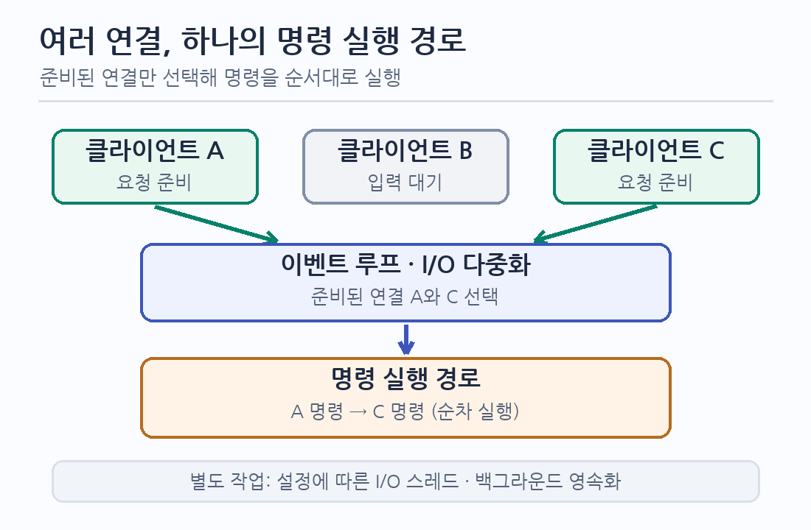

# Redis는 왜 명령을 한 스레드에서 실행할까?

- Redis의 ‘싱글 스레드’는 서버 프로세스에 스레드가 하나뿐이라는 뜻이 아니다. 핵심은 한 인스턴스에서 데이터에 접근하는 명령을 주로 한 실행 경로에서 순서대로 처리한다는 것이다. 네트워크 I/O와 디스크 작업은 별도의 스레드·프로세스를 사용할 수 있다.
- 따라서 질문은 ‘CPU 코어를 남기는데 왜 빠를까?’보다 ‘명령 실행을 병렬화하지 않고도 어떤 비용을 줄이고, 어디서 한계가 생길까?’에 가깝다.

## 1. 명령 실행을 직렬화해 공유 데이터 경합을 줄인다

- 한 인스턴스의 명령이 순서대로 실행되면 같은 데이터 구조를 여러 명령 스레드가 동시에 바꾸는 상황을 피할 수 있다. 명령 실행 경로의 잠금·경합과 이를 다루는 코드의 복잡도가 줄어든다. 개별 명령의 원자적 실행을 이해하기도 쉽다. 다만 여러 명령으로 이루어진 업무 절차까지 자동으로 원자적이 되는 것은 아니다.
- 다중 스레드가 항상 느리다는 뜻은 아니다. 병렬화할 수 있는 계산이 충분하고 공유 상태의 조정 비용을 감당할 수 있다면 이점이 있다. Redis는 짧은 명령을 많이 처리하는 경로에서 단순한 상태 접근을 우선한 선택으로 이해할 수 있다.
- 이 선택의 비용은 긴 명령 하나가 같은 인스턴스의 다른 명령을 기다리게 한다는 점이다. 명령 수보다 각 명령의 실행 시간과 데이터 크기를 함께 봐야 한다.

## 2. 여러 연결은 이벤트 루프로 관리한다

- 명령을 한 경로에서 실행하는 것과 연결마다 전용 스레드를 두는 것은 별개의 문제다. Redis는 비차단 소켓과 I/O 다중화를 이용해 여러 연결 중 읽기·쓰기가 가능한 연결을 확인하고 처리한다. 준비되지 않은 연결을 기다리느라 명령 실행 경로를 계속 점유하지 않는다.

- 그림의 화살표는 연결 준비 알림에서 명령 실행까지의 흐름이다. I/O 다중화는 연결을 효율적으로 감시하는 방법이지, 한 인스턴스의 명령을 여러 CPU 코어에서 동시에 실행한다는 뜻이 아니다.
- Linux에서는 `epoll` 같은 운영체제 기능을 사용할 수 있다. 구체적인 I/O 구현은 플랫폼과 Redis 버전에 따라 달라지므로 `epoll` 자체를 Redis의 속도나 명령 직렬화의 유일한 이유로 보지 않는다.

## 3. 빠른 데이터 접근과 통신 비용 절감이 함께 작동한다

| 선택 | 줄이는 비용 | 남는 한계 |
| :--- | :--- | :--- |
| 메모리 중심 데이터 접근 | 일반적인 명령에서 디스크 탐색을 피한다. | 데이터 크기, 메모리 압박, 영속화 설정과 장애 복구 비용이 남는다. |
| 명령에 맞는 자료구조 | 키 조회·원소 접근 등 흔한 연산의 비용을 낮춘다. | 모든 명령이 `O(1)`은 아니다. 원소 수가 큰 자료구조를 훑거나 큰 응답을 만들면 오래 걸린다. |
| RESP 요청·응답 형식 | 타입과 길이를 명시해 메시지 경계를 해석한다. | 프로토콜만으로 네트워크 왕복이나 큰 페이로드 비용이 사라지지는 않는다. |
| Pipelining·다중 인자 명령 | 여러 명령을 보낼 때 왕복과 소켓 처리 비용을 줄인다. | 명령 실행은 계속 필요하고, 큰 파이프라인은 응답 버퍼 메모리를 사용한다. Pipelining은 트랜잭션이 아니다. |

- 메모리 접근이 빠르더라도 전체 요청 시간에는 네트워크, 클라이언트, 명령 실행과 응답 전송이 포함된다. `GET` 같은 명령의 실행 시간과 클라이언트가 관측한 지연을 같은 값으로 취급하지 않는다.
- RESP의 길이 정보는 바이너리 문자열을 포함한 요청을 구분하는 데 쓰인다. 파싱 비용을 ‘없앤다’고 설명할 수는 없다. Pipelining은 앞선 응답을 기다리지 않고 다음 명령을 보내 왕복 대기를 겹친다.

## 4. ‘한 스레드’가 적용되는 범위를 구분한다

- Redis는 버전에 따라 네트워크 읽기·쓰기 등에 I/O 스레드를 사용할 수 있다. RDB 스냅샷과 AOF 재작성은 자식 프로세스를 이용하고, 일부 디스크 관련 작업은 백그라운드 스레드를 사용한다. 이것은 주된 명령 실행 경로가 직렬이라는 설명과 모순되지 않는다.
- I/O 스레드를 늘려도 명령 실행 CPU가 병목이라면 처리량이 그만큼 늘지 않는다. 반대로 네트워크 I/O가 병목인 구성에서는 도움이 될 수 있다. 두 경우를 구분해 측정한다.
- 여러 CPU 코어에 명령 부하를 나누려면 여러 Redis 인스턴스나 샤딩을 검토한다. Redis Cluster는 키 공간을 여러 노드에 나누지만, 특정 키 또는 샤드에 요청이 집중되면 그 부분의 병목은 남는다.

## 5. 느려질 때는 명령·데이터·환경을 나누어 확인한다

| 관찰할 상황 | 확인할 원인과 대응 |
| :--- | :--- |
| 일부 명령 뒤에 다른 요청도 지연된다 | `SLOWLOG`와 명령 복잡도, 큰 키·컬렉션을 확인한다. `KEYS` 같은 전체 탐색은 범위를 제한하거나 `SCAN` 계열로 바꿀 수 있는지 검토한다. `SCAN`도 전체 탐색 비용과 중복 반환 가능성이 있으므로 사용 측에서 처리한다. |
| 서버 명령 시간은 짧은데 클라이언트 응답이 느리다 | 네트워크 왕복, 연결 재생성, 큰 응답, 클라이언트 처리와 Pipelining 가능성을 확인한다. `SLOWLOG`는 네트워크 왕복 시간을 포함하지 않는다. |
| 백그라운드 저장 시 지연이 튄다 | 스냅샷·AOF 재작성 시 `fork`, 메모리 압박, 디스크 I/O와 영속화 설정을 확인한다. 영속화 강도를 낮추면 장애 시 손실 범위가 달라질 수 있다. |
| 특정 키 또는 샤드만 바쁘다 | 핫 키의 요청 분포와 단일 인스턴스의 CPU 한도를 확인한다. 데이터 분할만으로 한 키의 집중이 해소되는지 검증한다. |

- `SLOWLOG`는 명령 실행 시간을, 애플리케이션 지표는 전체 응답 시간을 보여준다. 같은 시간대의 지연 분포, 명령 구성, 키 크기, 네트워크 왕복과 CPU 사용률을 함께 비교한다.
- 성능 수치는 명령 종류·값 크기·동시 연결·파이프라인 깊이·영속화 설정·하드웨어에 따라 달라진다. 특정 초당 요청 수나 평균 지연을 Redis의 고정 성능으로 제시하지 않고, 목표 환경의 피크 부하에서 처리량과 지연의 분포를 측정한다.

## 6. 설계 판단

- Redis의 명령 직렬화는 공유 데이터 경합을 줄이고 명령 실행 규칙을 단순하게 만든다. 메모리 중심 접근, I/O 다중화, 자료구조와 통신 방식이 함께 짧은 명령을 많이 처리할 수 있게 한다. 이는 각 근거를 종합한 설계 해석이며, 싱글 스레드만의 성능 효과로 분리해 입증한 결과는 아니다.
- 사용하는 시스템에서는 명령 실행 CPU, 네트워크, 메모리·영속화 중 실제 병목을 확인한다. 긴 명령과 핫 키가 응답 지연 목표를 깨는지 먼저 검증하고, 명령 변경·데이터 분할·인스턴스 확장을 같은 부하 조건에서 비교한다.

## 7. 참고 문서

- [Redis — Diagnosing latency issues](https://redis.io/docs/latest/management/optimization/latency/): 명령 직렬화, 긴 명령의 영향, 네트워크·영속화 지연을 설명한다.
- [Redis — Benchmark](https://redis.io/docs/latest/operate/oss_and_stack/management/optimization/benchmarks/): 벤치마크 조건과 단일 인스턴스 처리량 해석의 한계를 설명한다.
- [Redis — What is Redis?](https://redis.io/tutorials/what-is-redis/): 명령 실행과 메모리 접근의 기본 구조를 소개한다.
- [Redis — Client handling](https://redis.io/docs/latest/develop/reference/clients/), [Event library](https://redis.io/docs/latest/operate/oss_and_stack/reference/internals/internals-rediseventlib/): 비차단 소켓과 이벤트 루프를 설명한다.
- [Redis — RESP specification](https://redis.io/docs/latest/reference/protocol-spec/), [Pipelining](https://redis.io/docs/latest/develop/using-commands/pipelining/): 요청 형식과 네트워크 왕복 절감 방식을 설명한다.
- [Redis — Redis 8 I/O threading](https://redis.io/blog/redis-8-0-m03-is-out-even-more-performance-new-features/), [Persistence](https://redis.io/docs/latest/management/persistence/): 명령 실행 이외의 I/O 스레드와 백그라운드 영속화 작업을 설명한다.
- [Redis — Scaling](https://redis.io/docs/latest/management/scaling/): 여러 노드로 키 공간을 나누는 방식을 설명한다.
- [Redis — SLOWLOG GET](https://redis.io/docs/latest/commands/slowlog-get/), [SCAN](https://redis.io/docs/latest/commands/scan/): 명령 실행 시간 확인과 점진적 순회를 설명한다.
