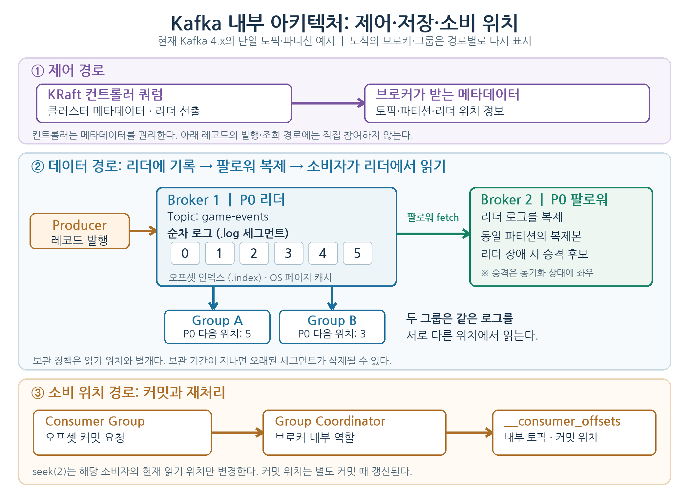

# Kafka는 왜 이렇게 설계됐을까? 원 논문으로 읽는 선택과 비용

- 2011년 논문 「Kafka: a Distributed Messaging System for Log Processing」은 대량의 활동·운영 로그를 실시간 서비스와 배치 분석에서 함께 소비하려는 문제를 다룬다. 당시의 선택을 현재 Kafka의 기본값이나 모든 업무 이벤트의 권장 설정으로 옮기지 않는다.
- 핵심 질문은 ‘메시지를 어떻게 전달할까?’에 더해 ‘많은 메시지를 오래 보관하면서 서로 다른 소비자가 각자 속도로 읽고 다시 읽을 수 있을까?’다.

## 1. 로그 수집과 일반 메시징의 요구 차이에서 출발했다

- 원 논문은 기존 로그 수집 도구가 배치 분석에, 당시의 범용 메시징 시스템이 개별 메시지의 전달 상태와 풍부한 보장에 치우쳐 있다고 평가했다. LinkedIn은 높은 유입량과 온라인·오프라인 소비를 함께 지원할 통로가 필요했다.
- 논문이 대상으로 삼은 로그 중 일부는 소량의 유실을 감수할 수 있었다. 이 전제는 결제·재화 변경 같은 업무 기록에 그대로 적용할 수 없다. 사용 목적에 따라 허용 손실, 중복, 지연과 보관 기간을 먼저 정해야 한다.

| 설계 질문 | 논문의 선택 | 감수한 비용 |
| :--- | :--- | :--- |
| 많은 로그를 어떻게 저장할까? | 파티션마다 추가 전용 로그를 두고 세그먼트 파일에 이어 쓴다. | 임의 위치 수정·삭제에 적합하지 않다. |
| 온라인·배치 소비를 어떻게 함께 지원할까? | 소비자가 필요한 위치에서 당겨 읽고, 소비 위치와 보관 정책을 분리한다. | 소비 지연과 보관 만료를 운영해야 한다. |
| 처리량을 어떻게 높일까? | 생산·소비 요청을 묶고 순차 접근과 운영체제 페이지 캐시를 활용한다. | 배치 크기와 확인 정책이 지연·메모리·손실 범위에 영향을 준다. |

## 2. 파티션 로그와 오프셋으로 읽기 위치를 표현한다

- 토픽은 메시지 분류 단위, 파티션은 저장·순서·병렬 소비의 단위다. 생산자는 파티션에 레코드를 추가하고 소비자는 파티션별 오프셋을 지정해 읽는다. 전체 토픽에 하나의 순서나 오프셋이 있는 것은 아니다.

- 그림은 현재 Kafka의 한 파티션을 확대한 논리 구조다. KRaft 컨트롤러는 메타데이터와 리더 배치를 관리하고, 생산자는 파티션 리더에 기록한다. 팔로워는 리더 로그를 복제하며 소비자 그룹은 리더에서 레코드를 읽는다. 그룹 코디네이터는 커밋 오프셋을 내부 토픽 `__consumer_offsets`에 저장한다. 실제 배치에서는 파티션·브로커·컨트롤러가 여러 개이고 복제본 위치도 달라진다.
- 원 논문은 메시지별 임의 접근용 ID 대신 로그 안의 위치를 주소로 사용했다. 당시 오프셋 설명과 현재의 레코드 오프셋 표현을 동일한 구현 세부사항으로 간주하지 않는다. 설계상 중요한 점은 소비자가 파티션별 읽기 위치를 관리해 다시 읽을 수 있다는 것이다.
- 세그먼트를 순차적으로 쓰고 읽으면 디스크와 페이지 캐시를 효율적으로 사용할 수 있다. 다만 ‘디스크에 기록한다’는 사실만으로 모든 쓰기가 즉시 영속 저장됐다는 뜻은 아니다. 생산자 응답과 복제·저장 확인의 조건을 별도로 정한다.

## 3. 보관과 소비 위치를 분리해 재처리한다

- 메시지를 읽었다고 바로 삭제하지 않는다. 보관 정책이 허용하는 동안 다른 소비자 그룹은 같은 데이터를 독립적으로 읽을 수 있고, 같은 그룹도 소비 위치를 뒤로 옮겨 재처리할 수 있다.

- 위 그림처럼 두 그룹은 같은 로그를 읽지만 읽기 위치는 서로 다르다. Group A의 소비자가 `seek(2)`를 호출하면 그 소비자의 해당 파티션 읽기 위치만 오프셋 2로 돌아가고 Group B의 위치는 그대로다. 현재 읽기 위치와 커밋 오프셋은 구분하며, 커밋 오프셋은 그룹·토픽·파티션별로 저장한다. 재처리는 보관 범위 안에서만 가능하고, 외부 DB나 알림에 이미 반영한 결과는 중복될 수 있으므로 소비자가 멱등 처리 또는 결과·오프셋의 일관된 저장을 설계해야 한다.
- 원 논문의 ‘상태 없는 브로커’는 브로커가 각 소비자의 개별 전달 확인 상태를 추적하지 않는다는 맥락이다. 브로커에 파티션 데이터나 메타데이터 상태가 없다는 뜻은 아니다. 당시 소비 위치와 그룹 조정에는 ZooKeeper가 쓰였다. 현재 소비자 그룹의 커밋 오프셋은 그룹 코디네이터가 Kafka 내부 토픽 `__consumer_offsets`에 저장한다.
- 같은 그룹에서는 한 파티션을 한 소비자에게 할당해 병렬 처리한다. 다른 그룹은 독립적으로 소비한다. 소비자를 늘려도 파티션 수, 파티션별 처리량과 키 분포가 한계를 정한다.

## 4. 배치·페이지 캐시·전송 최적화의 적용 조건을 본다

- 생산자가 여러 레코드를 한 요청에 묶고 소비자가 한 번에 여러 레코드를 가져오면 요청·네트워크 왕복 비용을 나눌 수 있다. 배치가 커지면 처리량에 유리할 수 있지만, 배치를 채우는 대기 시간과 버퍼 메모리도 늘 수 있다.
- 순차 읽기와 운영체제 페이지 캐시는 최근에 기록된 로그를 여러 소비자가 읽는 경우에 유리하다. 논문은 브로커가 별도의 메시지 캐시를 중복 관리하기보다 파일 시스템의 캐시를 활용하는 방향을 택했다.
- 원 논문은 파일에서 소켓으로 보내는 경로에 `sendfile`을 사용해 애플리케이션 버퍼로의 복사를 줄였다고 설명한다. 이는 해당 환경의 최적화이며, 전송 보안·압축·운영체제와 클라이언트 경로에 따라 실제 이득이 달라진다.
- 빠른 전송은 저장 내구성과 같은 목표가 아니다. 배치 크기, 생산자 확인 방식, 복제와 소비 지연을 함께 측정해야 한다.

## 5. 전달 보장은 생산·소비·외부 반영을 나누어 본다

| 구간 | 확인할 조건과 실패 가능성 |
| :--- | :--- |
| 생산자 → 브로커 | 성공 응답이 어떤 복제·저장 상태를 뜻하는지 `acks`, 복제본 수와 최소 동기화 복제본 설정으로 정한다. 확인 없이 전송하면 빠르더라도 브로커가 받지 못한 레코드를 생산자가 모를 수 있다. |
| 브로커 → 소비자 | 소비 위치를 처리 전에 커밋하면 장애 시 누락될 수 있고, 처리 후 커밋하면 장애 시 재전달될 수 있다. |
| 소비자 → 외부 시스템 | Kafka 안의 트랜잭션만으로 외부 DB·API에 같은 효과가 한 번만 반영되는 것은 아니다. 결과 저장과 오프셋 커밋을 함께 다루거나 멱등 키·중복 검사를 설계한다. |

- 원 논문은 당시의 로그 요구에 대해 중복 가능성을 감수하는 최소 한 번 전달을 설명한다. 현재 Kafka는 멱등 생산자와 트랜잭션을 제공하지만, 그 보장 범위는 설정과 읽기·쓰기 경로에 따라 달라진다. ‘정확히 한 번’을 전체 업무 결과에 자동으로 적용하지 않는다.
- 파티션 내 순서는 다룰 수 있어도 파티션 간 전역 순서는 보장되지 않는다. 같은 업무 객체의 순서가 중요하면 키·파티션 배치와 처리 방식을 확인한다.

## 6. 논문의 성능 결과와 현재 적용 판단을 구분한다

- 논문의 생산자 실험은 200바이트 메시지 1천만 건, 두 대의 당시 서버와 1Gb 네트워크, 비동기 flush 조건에서 수행됐다. Kafka는 배치 1에서 약 5만 건/초, 배치 50에서 약 40만 건/초를 보고했다. 해당 실험의 생산자는 브로커 확인을 기다리지 않았으므로 두 처리량을 현재의 내구성 보장과 동시에 달성한 수치로 읽지 않는다.
- 논문은 비교 제품보다 높은 처리량을 보고하면서도 목적과 제공 기능이 다른 시스템의 우열을 증명하려는 실험은 아니라고 명시한다. 사용 시스템의 결정을 위해서는 메시지 크기·배치·복제·확인 설정·소비 패턴을 동일한 조건으로 맞춰 시험해야 한다.
- 원 논문의 ZooKeeper 기반 조정과 내장 복제의 향후 계획은 현재 구조와 다르다. Kafka 4.0부터 ZooKeeper 모드는 제거됐고 KRaft가 메타데이터를 관리한다. 현재 구성의 복제·장애 전환·오프셋 저장을 판단할 때 2011년 그림을 그대로 사용하지 않는다.
- 채택 여부는 요구한 피크 처리량뿐 아니라 생산 확인 후 손실 범위, 소비 지연, 재처리 가능 기간, 파티션 불균형, 장애 후 중복 반영과 운영 비용으로 평가한다. 필수 요구를 충족하지 못하면 배치·보관·복제 정책 또는 기술 선택을 다시 검토한다.

## 7. 참고 문서

- [Kreps, Narkhede, Rao — Kafka: a Distributed Messaging System for Log Processing (NetDB 2011)](https://zaoxing.github.io/files/course/NetDB11_Kafka.pdf): 설계 배경, 저장·전송·소비 모델과 당시 실험 조건을 설명한 원 논문.
- [Apache Kafka — Design](https://kafka.apache.org/41/design/design/): 현재의 로그, 복제, 전달 보장과 트랜잭션 범위를 설명한다.
- [Apache Kafka — KRaft](https://kafka.apache.org/41/operations/kraft/): 컨트롤러 쿼럼과 브로커 역할을 설명한다.
- [Apache Kafka — Distribution](https://kafka.apache.org/41/implementation/distribution/): 소비자 그룹 오프셋과 `__consumer_offsets`의 역할을 설명한다.
- [Apache Kafka — Upgrading to 4.0](https://kafka.apache.org/40/getting-started/upgrade/): ZooKeeper 모드 제거와 KRaft 전환 조건을 설명한다.
- [Apache Kafka — Topic Configs](https://kafka.apache.org/41/configuration/topic-configs/): 복제와 확인에 영향을 주는 `min.insync.replicas` 설정을 설명한다.
